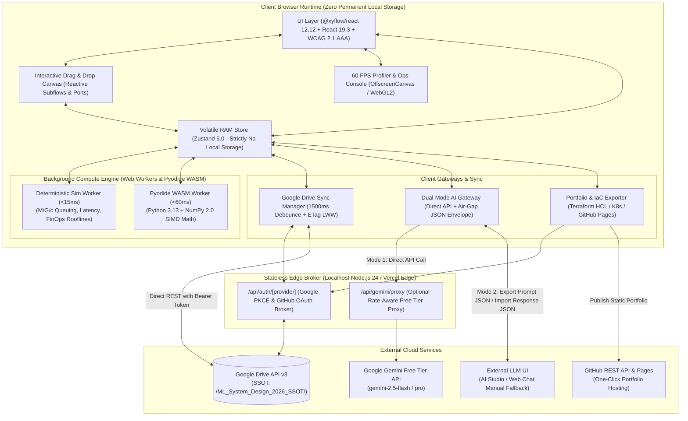

# ML System Design 2026: Interactive Simulation Platform

[](https://nodejs.org/)
[](https://nextjs.org/)
[](https://react.dev/)
[](https://reactflow.dev/)
[](https://zustand.docs.pmnd.rs/)
[](https://www.python.org/)
[](https://vitest.dev/)
[](https://www.w3.org/WAI/standards-guidelines/wcag/)
[](LICENSE)

> **A modern, local-first interactive simulation platform and AI whiteboard interview simulator for 2026 Machine Learning System Design.**
> Master generative AI foundations, real-time streaming MLOps, causal inference, and GPU/TPU unit economics with sub-100ms deterministic simulation and gamified chaos engineering.

---

## 1. Overview & Vision

In 2026, machine learning system engineering has fundamentally transformed. Commoditized skills—such as manual hyperparameter grid searches and basic scikit-learn feature selection—have been automated. High-leverage ML engineering now centers on:
1. **Mathematical Objective & Reward Alignment**: Formulating multi-objective loss and RLHF/DPO reward functions that resist Goodhart's Law and reward hacking.
2. **Generative AI Serving Economics (FinOps)**: Optimizing token time-to-first-byte (TTFT) and decode latency (TPOT) across NVIDIA H100/H200/B200, AMD MI300X, and Google TPU v5p/v6e architectures using speculative decoding and multi-tenant prompt caching.
3. **Data Archaeology & Contamination Auditing**: Programmatically purging synthetic model collapse artifacts, test-set leakage, and benchmark poisoning using MinHash LSH and Shannon entropy filters.
4. **Causal Inference & Variance Reduction**: Moving beyond simple correlations to causal DAGs, Pearl's backdoor adjustments, and CUPED experimental systems.
5. **Chaos & Resilience Engineering**: Halting multi-agent infinite recursion cascades, handling vector database shard partitions, and debugging INT4 edge deployments.

This platform provides an end-to-end interactive training ground combining visual architecture design, real-time mathematical simulation, production incident response, and a dynamic 6-step AI whiteboard interview simulator.

---

## 2. Core Architectural Pillars



### 1. Zero-Latency Client Compute ($<100\text{ ms}$)
All deterministic calculations—including $M/G/c$ queuing theory, Williams Roofline hardware bottlenecks, thermal throttling curves, and CUPED variance reduction—execute entirely inside dedicated **Web Workers** and in-browser **Pyodide WebAssembly (Python 3.13 + NumPy 2.0 SIMD)**. Canvas mutations update simulated metrics in $<15\text{ ms}$ without server cold-starts or network round-trips.

### 2. Ephemeral In-Memory State & Google Drive SSOT
To guarantee absolute privacy and clean workstations, the platform enforces **Zero Local Browser Storage**:
- Prohibits `localStorage`, `sessionStorage`, `IndexedDB`, and persistent cookies via an initialization runtime sanitizer.
- State exists purely in a volatile RAM store managed by **Zustand 5.0**.
- **Google Drive as Single Source of Truth (SSOT)**: Workspaces, interview recordings, chaos logs, and custom scenarios sync directly to the user's personal Google Drive folder (`/ML_System_Design_2026_SSOT/`) via Google Drive REST API v3 using a sliding 1500ms debounce window and conditional HTTP `If-Match` ETags.

### 3. Dual-Mode Hybrid AI Gateway (Free Tier Resilience)
Designed specifically to operate reliably on the **Google Gemini Free Tier**:
- **Direct Mode**: Automated streaming API calls via client bearer token or lightweight edge proxy.
- **Air-Gap Manual Mode**: When rate limits (`HTTP 429`) or timeouts occur, the platform exports a self-contained `LLMExchangeEnvelope` containing system instructions, structured context, and target JSON schemas. Users copy the prompt into any external LLM interface (Google AI Studio, ChatGPT, Claude) and paste back the response, validated client-side via strict Zod schemas and automatic syntax repair tools.

### 4. Isomorphic Deployment Parity (Localhost + Vercel)
Built on **Next.js 16.4 App Router** with Turbopack and Node.js 24 LTS. Runs identically on developer machines via `npm run dev` or `docker compose up`, and deploys seamlessly to Vercel's global edge network.

---

## 3. Key Subsystems & Functional Modules

| Subsystem | Key Capabilities & Technical Mechanics |
| :--- | :--- |
| **Interactive Sandbox Builder** | Drag-and-drop canvas powered by `@xyflow/react` 12.12+, utilizing `useNodesData()` for localized reactive subscriptions, `<EdgeLabelRenderer>` for interactive latency overlays, `<NodeResizer>`, and subflows for agent clusters. Calculates end-to-end $p99$ latency, TTFT, TPOT, and monthly cloud spend. |
| **Interactive Case-Study Library** | Production blueprints: *E-Commerce Real-Time Ranking* (two-tower + transformer ranker), *Streaming Fraud Detection* (Flink + Aerospike + XGBoost, $p99 < 20\text{ ms}$), and *Enterprise GenAI Knowledge Retrieval* (hybrid HNSW/BM25 RAG). Features a "Break the System" perturbation simulator. |
| **AI Interview Simulator (2026 Standard)** | Enforces the standardized **6-Step Production Lifecycle**: (1) Clarifying Requirements, (2) Data Ingestion & Features, (3) Model Selection & Training, (4) Offline & Online Evaluation, (5) Serving & Scalability, (6) Monitoring & Retraining. Evaluates multimodal voice transcripts and canvas graphs against a 4-dimension rubric. |
| **Chaos Monkey & Adversarial Playground** | Red-team playground where users inject faults (network partitions, context window prompt bombs, cache stampedes) into architectures generated by **Gemini Argon**. Simulates agent recursion cascades with deterministic similarity circuit breakers, and INT4 edge thermal throttling. |
| **FinOps & Hardware Unit Economics** | Evaluates workload arithmetic intensity ($I = \frac{\text{FLOPs}}{\text{Bytes}}$) against empirical 2026 hardware rooflines (NVIDIA H100 SXM, H200, B200, AMD MI300X, Google TPU v5p/v6e Trillium). Simulates token budget allocation across reserved vLLM clusters, prompt caching, and speculative decoding. |
| **Data Alignment & Curation Engine** | Audits synthetic LLM training batches using n-gram diversity, Self-BLEU, and Shannon entropy ($H(X) < 3.0$ pruning). Visual canvas for Human-in-the-Loop (HITL) active learning and DPO preference pair curation with Cohen's $\kappa$ agreement gates. |
| **Telemetry & Log Trace Analysis Game** | High-frequency $60\text{ FPS}$ ops console rendered via `OffscreenCanvas` and WebGL2. Streams realistic distributed crash logs (CUDA OOM stack traces, NCCL ring all-reduce deadlocks, gRPC deadlines, and vector shard starvation) for root-cause diagnosis training. |
| **Regulatory & AI Safety Simulator** | Designs compliant pipelines enforcing the **EU AI Act** and **GDPR Right-to-be-Forgotten (RTBF)** using SISA Machine Unlearning (Sharded, Isolated, Sliced, Aggregated) and vector database metadata tombstoning, paired with MinHash copyright and prompt injection filters. |
| **Mathematical Objective Sandbox** | Authors custom loss and reward functions in Python/LaTeX. Runs an agent population simulation inside Pyodide WASM to expose **Goodhart's Law** reward hacking (sycophancy collapse, length bias inflation, and null-output degeneration). |
| **Data Archaeology & Contamination Suite** | Detects benchmark contamination (GSM8K/MMLU test leaks) and poisoned backdoor triggers in synthetic corpora using MinHash Locality Sensitive Hashing (LSH, 128 permutations). |
| **Causal Inference & Counterfactual Lab** | Interactive Causal DAG canvas implementing Pearl's Backdoor Criterion and d-separation to isolate true business treatment effects ($\text{ATE}$). Benchmarks **CUPED** variance reduction in online A/B experimentation. |
| **Resume-Builder Portfolio Exporter** | One-click compiler transforming canvas workspaces into a publication-ready **Production Manifesto** (`README.md`, `architecture.tf` Terraform AST, and Kubernetes declarative YAML), published directly to `username.github.io/ml-portfolio` via GitHub REST API. |

---

## 4. Repository Structure

```text
ml-sys-design/
├── documentation/
│   ├── requirements/
│   │   └── 000_requirements.md               # 2026 Core Requirements
│   ├── design/
│   │   ├── high_level.md                     # High-Level Architecture & Component Models
│   │   └── detailed/                         # 10 Exhaustive Detailed Design Documents
│   │       ├── 00_overview_and_architecture.md
│   │       ├── 01_state_management_and_gdrive_ssot.md
│   │       ├── 02_dual_mode_ai_gateway_and_exchange_spec.md
│   │       ├── 03_deterministic_simulation_and_worker_engine.md
│   │       ├── 04_canvas_and_ui_component_system.md
│   │       ├── 05_interview_chaos_and_case_study_subsystems.md
│   │       ├── 06_data_alignment_causal_and_math_subsystems.md
│   │       ├── 07_telemetry_compliance_and_portfolio_exporter.md
│   │       ├── 08_plug_and_play_schema_and_curriculum_specs.md
│   │       └── 09_isomorphic_deployment_and_ci_cd.md
│   └── plan/                                 # 12 Phased Execution Plans
│       ├── 00_execution_roadmap_and_index.md
│       ├── 01_project_scaffolding_and_tooling.md
│       └── ...
├── src/
│   ├── app/                                  # Next.js 16.4 App Router Pages & Edge Routes
│   │   ├── api/auth/github/callback/         # Stateless GitHub Pages OAuth Broker
│   │   ├── api/gemini/proxy/                 # Rate-Aware Gemini Edge Proxy
│   │   └── workspace/[moduleId]/             # Unified Interactive Workspace Shell
│   ├── components/
│   │   ├── canvas/                           # @xyflow/react 12.12 Nodes, Edges, Keyboard Nav
│   │   ├── telemetry/                        # 60 FPS WebGL2 & Canvas2D Profiler Charts
│   │   └── ai_exchange/                      # Dual-Mode Prompt/Response Modal Dialogs
│   ├── core/
│   │   ├── state/                            # Zustand 5.0 RAM-Only Store & Workspace Types
│   │   ├── gdrive/                           # GIS Auth, Google Drive v3 Client & Sync Manager
│   │   ├── ai_gateway/                       # Dual-Mode LLM Orchestrator & Exchange Envelope
│   │   ├── exporters/                        # Terraform HCL & Kubernetes Manifest Serializers
│   │   └── math/                             # M/G/c Queuing, Roofline & CUPED Algorithms
│   ├── workers/
│   │   ├── deterministic-sim.worker.ts       # Comlink Web Worker for Graph Math (<15ms)
│   │   └── pyodide-sandbox.worker.ts         # Pyodide WASM Worker (Python 3.13 + NumPy 2.0)
│   └── schemas/                              # Zod Schemas for Envelopes & Scenarios
├── public/
│   └── scenarios/                            # Plug-and-Play YAML Scenario Definitions
├── scripts/
│   ├── standards_validator.ts                # TypeScript Coding Standards Checker
│   └── standards_validator.py                # Python Coding Standards Checker
├── tests/                                    # Unit & Integration Test Suite (90%+ Coverage)
├── Dockerfile                                # Node.js 24 Alpine Multi-Stage Production Container
├── docker-compose.yml                        # One-Command Local Development Environment
├── vercel.json                               # Vercel Global Edge Network Deployment Config
├── tsconfig.json                             # Strict TypeScript Configuration
└── package.json                              # Project Dependencies & Scripts
```

---

## 5. Technology Stack & Modern Library Versions

| Layer | Library / Runtime | Version | Role in Architecture |
| :--- | :--- | :--- | :--- |
| **Framework** | Next.js (App Router) | `^16.4.3` | Isomorphic serverless rendering, streaming SSR, native module workers, Turbopack |
| **UI Library** | React & React DOM | `^19.3.1` | Concurrent mode rendering, `useOptimistic`, `useActionState`, native metadata |
| **Interactive Canvas** | `@xyflow/react` | `^12.12.0` | Reactive node subscriptions (`useNodesData`), `<EdgeLabelRenderer>`, subflows, resizers |
| **State Container** | Zustand | `^5.0.16` | RAM-only volatile store, `useShallow` selectors, transient telemetry streams |
| **Web Workers** | Comlink | `^4.4.1` | Zero-overhead RPC bridge between UI thread and simulation workers |
| **WASM Python** | Pyodide (WebAssembly) | `v0.26+` | In-browser Python 3.13 runtime for reward functions, causal DAGs, and CUPED |
| **Scientific Compute** | NumPy & SciPy | `^2.0.0` / `^1.14.0` | SIMD-accelerated array transformations, covariance matrices, and Shannon entropy |
| **Validation** | Zod & jsonrepair | `^3.23.8` / `^3.8.0` | Schema validation and lenient automatic repair for imported LLM responses |
| **Styling & A11y** | Tailwind CSS & Lucide | `^3.4.19` / `^1.65.0`| Responsive utility classes, WCAG 2.1 AA/AAA Okabe-Ito colorblind palette |
| **Testing** | Vitest & Testing Library | `^2.1.3` / `^16.0.0` | Fast unit testing with v8 branch coverage ($\ge 90\%$ enforced) |
| **Python Tooling** | Ruff & Mypy | `^0.7.0` / `^1.12.0` | Strict Python linting and static typing |

---

## 6. Getting Started

### Prerequisites
* **Node.js**: `v20.9.0` or higher (Recommended: **Node.js 24 LTS**)
* **npm**: `v10.0.0` or higher
* **Python**: `3.13+` (for local standards validation and Pyodide testing)
* **Docker & Docker Compose** (Optional, for containerized local execution)

### 1. Installation
Clone the repository and install dependencies:
```bash
git clone https://github.com/Strider221B/ml-sys-design.git
cd ml-sys-design
npm install
```

### 2. Environment Configuration
Create a local `.env.local` file:
```env
# Google Identity Services / Drive API (Scope: drive.file)
# Note: Google Client Secret is NOT required (client-side GIS token model, matching synapse-sync)
NEXT_PUBLIC_GOOGLE_CLIENT_ID=your-google-client-id.apps.googleusercontent.com

# Google Gemini Free Tier API (Optional for direct mode; manual mode works without key)
GEMINI_API_KEY=your-gemini-free-tier-api-key

# GitHub OAuth App (Optional, for one-click portfolio export to GitHub Pages)
NEXT_PUBLIC_GITHUB_CLIENT_ID=your-github-client-id
GITHUB_CLIENT_SECRET=your-github-client-secret
```

### 3. Running Locally
Start the development server with Next.js Turbopack:
```bash
npm run dev
```
Open [http://localhost:3000](http://localhost:3000) in your browser.

Alternatively, run with Docker Compose:
```bash
docker compose up --build
```

---

## 7. Verification & Quality Gates

The repository enforces strict coding standards (SOLID, DRY, strict OOP, method bodies $\le 20$ lines, file lengths $\le 500$ lines, and $\ge 90\%$ branch test coverage).

Run the full local CI verification pipeline:
```bash
# 1. Typecheck TypeScript codebase
npm run typecheck

# 2. Run unit tests with coverage
npm test

# 3. Validate coding standards (TypeScript & Python)
npm run validate:ts
npm run validate:py
```

---

## 8. Documentation Suite

Comprehensive architectural and implementation documentation is available in the repository:

* [**Requirements Specification**](documentation/requirements/000_requirements.md): 2026 Core Requirements and non-functional guarantees.
* [**High-Level Design**](documentation/design/high_level.md): Macro architecture, C4 diagrams, and trade-off matrices.
* **Detailed Design Suite (`documentation/design/detailed/`)**:
  * [00. Overview & System Architecture](documentation/design/detailed/00_overview_and_architecture.md)
  * [01. Ephemeral State & Google Drive SSOT](documentation/design/detailed/01_state_management_and_gdrive_ssot.md)
  * [02. Dual-Mode AI Gateway & Exchange Specification](documentation/design/detailed/02_dual_mode_ai_gateway_and_exchange_spec.md)
  * [03. Deterministic Simulation & Worker Engine](documentation/design/detailed/03_deterministic_simulation_and_worker_engine.md)
  * [04. Canvas & UI Component System](documentation/design/detailed/04_canvas_and_ui_component_system.md)
  * [05. Interview, Chaos & Case Study Subsystems](documentation/design/detailed/05_interview_chaos_and_case_study_subsystems.md)
  * [06. Data Alignment, Causal & Mathematical Subsystems](documentation/design/detailed/06_data_alignment_causal_and_math_subsystems.md)
  * [07. Telemetry, Compliance & Portfolio Exporter](documentation/design/detailed/07_telemetry_compliance_and_portfolio_exporter.md)
  * [08. Plug-and-Play Schema & Curriculum Specifications](documentation/design/detailed/08_plug_and_play_schema_and_curriculum_specs.md)
  * [09. Isomorphic Deployment & CI/CD Pipeline](documentation/design/detailed/09_isomorphic_deployment_and_ci_cd.md)
* [**Phased Execution Plans**](documentation/plan/00_execution_roadmap_and_index.md): 12 step-by-step implementation roadmaps with verification gates.

---

## 9. License

This project is licensed under the MIT License — see the [LICENSE](LICENSE) file for details.
