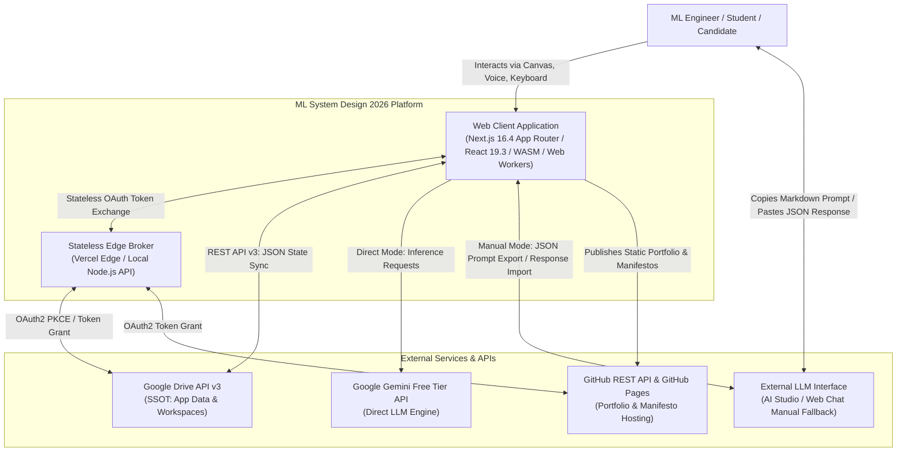
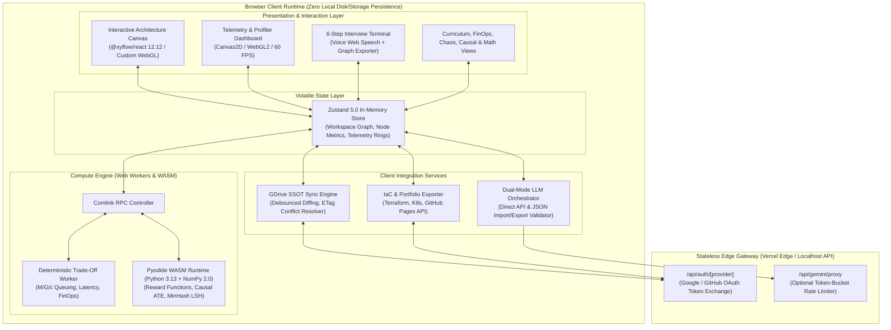
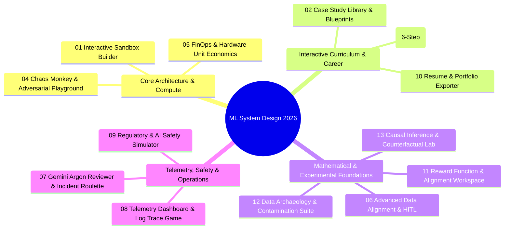
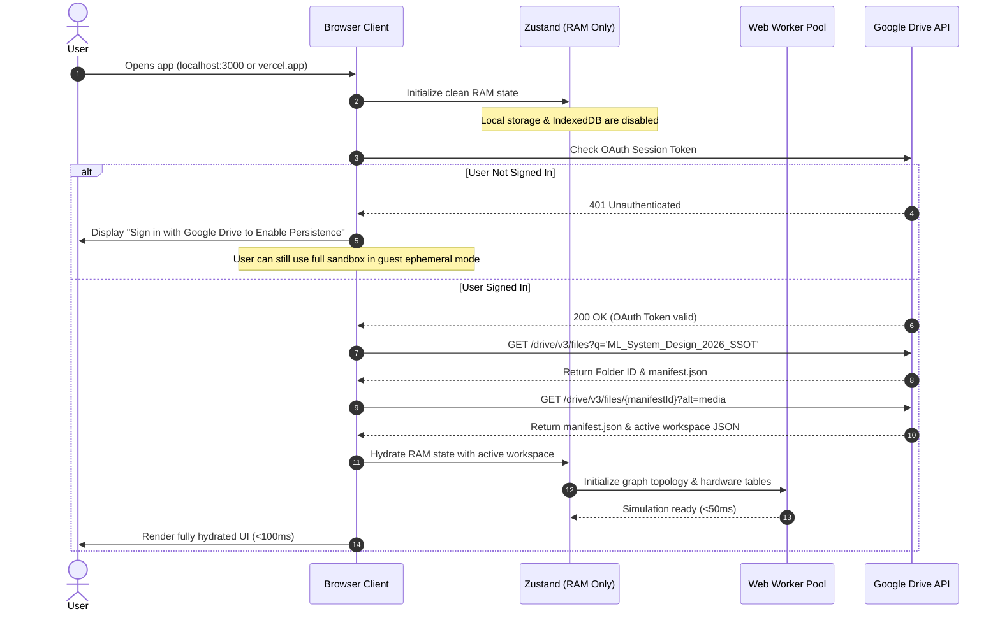
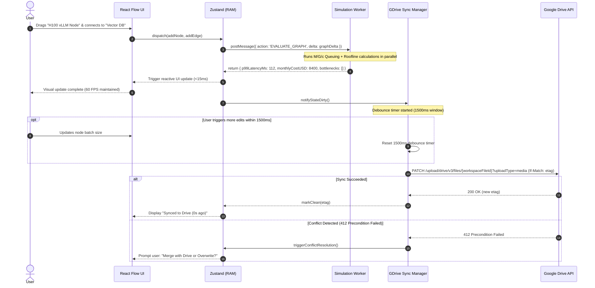

# Detailed Design: 00 - Overview & System Architecture

## 1. Document Context & Scope

This document establishes the macro architecture, design principles, system context, component decomposition, and operational boundaries for the **2026 Machine Learning System Design & Interactive Simulation Platform**.

It synthesizes the requirements from [000_requirements.md](file:///home/somesh/git_repos/ml-sys-design/documentation/requirements/000_requirements.md) and formalizes the blueprint outlined in [high_level.md](file:///home/somesh/git_repos/ml-sys-design/documentation/design/high_level.md) into concrete, modular specifications across the `./documentation/design/detailed/` suite.

### Detailed Design Document Map

| Index | Document | Purpose & Scope |
| :--- | :--- | :--- |
| **00** | [00_overview_and_architecture.md](file:///home/somesh/git_repos/ml-sys-design/documentation/design/detailed/00_overview_and_architecture.md) | Architectural foundations, C4 level 1 & 2 diagrams, component contracts, directory structure |
| **01** | [01_state_management_and_gdrive_ssot.md](file:///home/somesh/git_repos/ml-sys-design/documentation/design/detailed/01_state_management_and_gdrive_ssot.md) | RAM-only state lifecycle, Google Drive REST API v3 synchronization, conflict resolution, zero local disk/browser storage |
| **02** | [02_dual_mode_ai_gateway_and_exchange_spec.md](file:///home/somesh/git_repos/ml-sys-design/documentation/design/detailed/02_dual_mode_ai_gateway_and_exchange_spec.md) | Unified `LLMOrchestrator`, direct Gemini Free Tier handling, air-gapped JSON prompt export and schema-validated response import for all 13 modules |
| **03** | [03_deterministic_simulation_and_worker_engine.md](file:///home/somesh/git_repos/ml-sys-design/documentation/design/detailed/03_deterministic_simulation_and_worker_engine.md) | Web Worker & WASM computation pipeline ($<100\text{ ms}$ SLA), $M/G/c$ queuing theory, TTFT/TPOT latency, FinOps Roofline hardware profiler, CUPED variance reduction, reward hacking simulator |
| **04** | [04_canvas_and_ui_component_system.md](file:///home/somesh/git_repos/ml-sys-design/documentation/design/detailed/04_canvas_and_ui_component_system.md) | Interactive drag-and-drop canvas, custom node topologies, $60\text{ FPS}$ WebGL/Canvas2D telemetry dashboard, WCAG 2.1 AA/AAA accessibility and keyboard navigation |
| **05** | [05_interview_chaos_and_case_study_subsystems.md](file:///home/somesh/git_repos/ml-sys-design/documentation/design/detailed/05_interview_chaos_and_case_study_subsystems.md) | 6-Step AI Interview Simulator, Chaos Monkey Engine, Gemini Argon Adversarial Reviewer, Agent Cascading Loop Simulator, Edge & Quantization Debugger |
| **06** | [06_data_alignment_causal_and_math_subsystems.md](file:///home/somesh/git_repos/ml-sys-design/documentation/design/detailed/06_data_alignment_causal_and_math_subsystems.md) | Synthetic Data Pipeline Auditor, Data Leakage & Contamination Scanner (MinHash LSH), HITL Active Learning Designer, Reward Function Sandbox, Causal Graph Canvas & Counterfactual Lab |
| **07** | [07_telemetry_compliance_and_portfolio_exporter.md](file:///home/somesh/git_repos/ml-sys-design/documentation/design/detailed/07_telemetry_compliance_and_portfolio_exporter.md) | Prometheus/Grafana telemetry engine, Log Trace Analysis Game, EU AI Act & GDPR RTBF compliance gates, One-Click Portfolio Generator & Production Manifesto (Terraform/K8s/GitHub Pages) |
| **08** | [08_plug_and_play_schema_and_curriculum_specs.md](file:///home/somesh/git_repos/ml-sys-design/documentation/design/detailed/08_plug_and_play_schema_and_curriculum_specs.md) | Plug-and-play YAML/JSON scenario schema, 3 reference industry blueprints (E-Commerce Ranking, Streaming Fraud, Enterprise Vector RAG), 2026 Core Curriculum modules 1-3 |
| **09** | [09_isomorphic_deployment_and_ci_cd.md](file:///home/somesh/git_repos/ml-sys-design/documentation/design/detailed/09_isomorphic_deployment_and_ci_cd.md) | Next.js App Router isomorphic hosting (Localhost Node.js + Vercel Edge), stateless OAuth brokers, security boundaries, CI/CD pipeline, and 90%+ test verification |

---

## 2. Core Architectural Principles

1. **Local-First Compute, Cloud-Synced Ephemeral State**:
   - **Zero Local Persistence**: The client browser stores absolutely no application state in persistent storage mechanisms (`localStorage`, `sessionStorage`, `IndexedDB`, WebSQL, or local file caches). Refreshing the page or closing the tab without cloud sync clears state immediately.
   - **Google Drive as Single Source of Truth (SSOT)**: State is synchronized directly to Google Drive via Google OAuth2 and the Google Drive REST API v3 using an isolated application root folder (`/ML_System_Design_2026_SSOT/`).
   - **Sub-100ms Deterministic Execution**: All simulations, trade-off matrix calculations, queuing latency projections, and unit economics calculations run locally inside dedicated client Web Workers and Pyodide WebAssembly (WASM), decoupling interactive performance from network latency or server cold-starts.

2. **Dual-Path AI Resiliency (Air-Gap Direct + Manual Fallback)**:
   - Operating under the Gemini Free Tier implies strict rate limits (RPM/RPD quotas) and transient availability drops.
   - Every intelligent module provides a dual execution path:
     - **Direct API Execution**: Automated low-latency streaming calls via a secure edge proxy or client bearer token.
     - **Air-Gap Manual Fallback**: One-click generation of a standardized `LLMExchangeEnvelope` containing system instructions, structured context, and target JSON schemas, paired with a client-side JSON parser and Zod schema validator that ingests external LLM responses seamlessly.

3. **Strict Separation of Concerns & Unidirectional Data Flow**:
   - UI components (React 19.3 + `@xyflow/react` 12.12) interact purely with an in-memory `Zustand 5.0` store.
   - Heavy calculations offload asynchronously to the Web Worker pool via `Comlink` RPC.
   - Telemetry profiling uses a high-performance rendering loop with `OffscreenCanvas` and `Transferable` typed arrays, preventing React re-render thrashing.

4. **Isomorphic Deployment Parity**:
   - The platform runs identically on a local developer workstation (`localhost:3000` via Node.js or `docker compose`) and when deployed globally on Vercel's serverless/edge infrastructure.
   - Backend functions are strictly stateless and limited to lightweight OAuth token exchanges and optional rate-limiting proxying.

---

## 3. High-Level Architecture & C4 Model

### 3.1 C4 Level 1: System Context Diagram



### 3.2 C4 Level 2: Container & Subsystem Architecture



---

## 4. Module Decomposition & Responsibility Matrix

The system consists of 13 core functional modules categorized into 4 operational domains:



### Module Functional Breakdown

| Module Key | Functional Domain | Primary Worker / Compute Task | AI Orchestration Touchpoints |
| :--- | :--- | :--- | :--- |
| `SANDBOX_BUILDER` | Architecture Canvas | DAG topological sort, $M/G/c$ latency propagation, network hop cost | Node bottleneck detection, template recommendations |
| `CASE_STUDY_LIBRARY` | Case Studies | Synthetic traffic generation, perturbation injection | Case evaluation, architectural gap analysis |
| `AI_INTERVIEW_SIMULATOR` | Career / Interview | State machine validation (Steps 1-6), rubric scoring | Dynamic whiteboard interviewer persona, multimodal critique |
| `CHAOS_ADVERSARIAL_PLAYGROUND` | Chaos Engineering | Network partition simulation, token overflow cascades | Gemini Argon adversarial counter-architecture generation |
| `FINOPS_CALCULATOR` | Economics / Hardware | Roofline model arithmetic intensity, GPU memory allocation, token burn | SKU optimization recommendations, budget alerts |
| `DATA_ALIGNMENT_ENGINE` | Data Alignment | Pyodide n-gram frequency, Shannon entropy, active learning queue | Bias detection critique, edge-case generation |
| `CHAOS_MONKEY_ARGON` | Chaos Engineering | Real-time incident countdown, error budget burn engine | Killer workload packet generator, exploit discovery |
| `TELEMETRY_LOG_GAME` | Telemetry & Observability | 60 FPS time-series buffer generation, flame graph builder | Synthetic messy log trace generation (CUDA OOM, NCCL) |
| `REGULATORY_COMPLIANCE_SIM` | AI Safety & Compliance | Differential privacy ($\epsilon, \delta$) noise, MinHash copyright check | EU AI Act audit, prompt injection bypass red-teaming |
| `RESUME_PORTFOLIO_EXPORTER` | Career / Export | Terraform HCL AST generation, K8s manifest compilation | Production Manifesto write-up auto-generation |
| `MATH_REWARD_WORKSPACE` | Math Foundations | Pyodide agent population simulation, Goodhart's law detector | Reward hacking behavioral critique, Pareto weight tuner |
| `DATA_ARCHAEOLOGY_SUITE` | Data Quality | MinHash LSH indexing, decontamination filtering | Contamination detection verification, leak reporting |
| `CAUSAL_INFERENCE_LAB` | Causal Inference | DAG d-separation check, ATE calculation, CUPED variance reduction | Confounder identification assistance, study critique |

---

## 5. System Directory Layout & Codebase Structure

The codebase is organized as an isomorphic Next.js project adhering to strict modular boundaries:

```text
ml-sys-design/
├── documentation/
│   ├── requirements/
│   │   └── 000_requirements.md
│   └── design/
│       ├── high_level.md
│       └── detailed/
│           ├── 00_overview_and_architecture.md
│           ├── 01_state_management_and_gdrive_ssot.md
│           ├── 02_dual_mode_ai_gateway_and_exchange_spec.md
│           ├── 03_deterministic_simulation_and_worker_engine.md
│           ├── 04_canvas_and_ui_component_system.md
│           ├── 05_interview_chaos_and_case_study_subsystems.md
│           ├── 06_data_alignment_causal_and_math_subsystems.md
│           ├── 07_telemetry_compliance_and_portfolio_exporter.md
│           ├── 08_plug_and_play_schema_and_curriculum_specs.md
│           └── 09_isomorphic_deployment_and_ci_cd.md
├── src/
│   ├── app/
│   │   ├── (workspace)/
│   │   │   ├── canvas/page.tsx
│   │   │   ├── interview/page.tsx
│   │   │   ├── finops/page.tsx
│   │   │   ├── chaos/page.tsx
│   │   │   ├── telemetry/page.tsx
│   │   │   └── curriculum/page.tsx
│   │   ├── api/
│   │   │   ├── auth/
│   │   │   │   ├── google/callback/route.ts
│   │   │   │   └── github/callback/route.ts
│   │   │   └── gemini/
│   │   │       └── proxy/route.ts
│   │   ├── layout.tsx
│   │   └── page.tsx
│   ├── core/
│   │   ├── state/
│   │   │   ├── store.ts                 # RAM-only Zustand store (strictly zero persistence)
│   │   │   ├── slices/                  # Modular store slices (canvas, interview, finops, etc.)
│   │   │   └── types.ts
│   │   ├── gdrive/
│   │   │   ├── drive-client.ts          # Google Drive API v3 client
│   │   │   ├── sync-manager.ts          # Debounced diff, etag tracking, conflict resolution
│   │   │   └── drive-types.ts
│   │   ├── ai-gateway/
│   │   │   ├── llm-orchestrator.ts      # Dual-mode execution controller
│   │   │   ├── direct-client.ts         # Gemini Free Tier direct caller
│   │   │   ├── envelope-factory.ts      # Prompt package exporter
│   │   │   └── response-validator.ts    # Zod schema verification & repair engine
│   │   ├── exporters/
│   │   │   ├── terraform-exporter.ts    # Canvas -> Terraform HCL serializer
│   │   │   ├── k8s-exporter.ts          # Canvas -> Kubernetes manifests
│   │   │   └── github-publisher.ts      # GitHub Pages REST API publisher
│   │   └── math/
│   │       ├── queuing-theory.ts        # M/G/c latency model
│   │       ├── roofline-model.ts        # FLOPS vs HBM memory bandwidth
│   │       └── cuped.ts                 # Variance reduction algorithm
│   ├── workers/
│   │   ├── deterministic-sim.worker.ts  # Comlink Web Worker for graph math & trade-offs
│   │   ├── telemetry-stream.worker.ts   # 60 FPS OffscreenCanvas metric stream
│   │   └── pyodide.worker.ts            # Pyodide WASM worker for Python execution
│   ├── components/
│   │   ├── canvas/                      # React Flow custom nodes & edges
│   │   ├── telemetry/                   # WebGL2/Canvas2D Grafana-style charts
│   │   ├── ai-exchange/                 # Export Prompt & Import Response modal dialogs
│   │   └── shared/                      # Accessible UI components (WCAG 2.1 AA/AAA)
│   └── schemas/
│       ├── scenario-schema.ts           # YAML/JSON plug-and-play scenario schema
│       └── exchange-envelopes/          # Zod schemas for all 13 modules
├── public/
│   ├── scenarios/                       # Built-in scenario YAML definitions
│   └── templates/                       # Pre-configured architecture templates
├── Dockerfile                           # Localhost containerized setup
├── docker-compose.yml
├── vercel.json                          # Edge runtime configuration
├── next.config.ts
├── tsconfig.json
└── package.json
```

---

## 6. End-to-End User Interaction Lifecycles

### 6.1 Session Initialization & Ephemeral Hydration



### 6.2 Interactive Graph Editing & Background Sync Loop



---

## 7. Architectural Decisions & Trade-Offs (ADR Summary)

| ADR ID | Decision Title | Decision Made | Rationale | Alternatives Considered |
| :--- | :--- | :--- | :--- | :--- |
| **ADR-01** | Ephemeral Client State | RAM-only Zustand store; zero local browser persistence | User requirements explicitly mandate no permanent local state; Google Drive is the sole SSOT. | IndexedDB with local sync (rejected: violates zero-local-state requirement). |
| **ADR-02** | Dual AI Execution Mode | Direct API + Manual Prompt Export / Response Import | Gemini Free Tier has unstable RPM/RPD limits and latency spikes; manual fallback guarantees complete functionality. | Server-side queuing with paid LLM (rejected: must support Gemini Free Tier and zero-cost operation). |
| **ADR-03** | Simulation Computation Layer | Client Web Workers + Pyodide WASM | Guaranteed $<100\text{ ms}$ feedback and $60\text{ FPS}$ chart profiling without server network hops or edge function compute limits. | Serverless Edge API calculations (rejected: introduces $100\text{--}400\text{ ms}$ latency per canvas drag). |
| **ADR-04** | Telemetry Rendering Pipeline | OffscreenCanvas + WebGL2 with Transferable Buffers | Keeps the main React thread at $60\text{ FPS}$ even when streaming $10,000$ points/sec of synthetic metrics. | SVG / Recharts / standard DOM charts (rejected: causes frame drops and DOM thrashing above 100 nodes). |
| **ADR-05** | Infrastructure as Code Target | Terraform HCL + Kubernetes Declarative YAML | Standardizes exported architectures so users can directly run them in production or showcase them on GitHub portfolios. | Custom proprietary JSON format (rejected: lacks industry resume value). |

---

## 8. Next Steps & Detailed Design Traversal

For complete low-level technical specifications, proceed through the specialized documents:
- Continue to [01_state_management_and_gdrive_ssot.md](file:///home/somesh/git_repos/ml-sys-design/documentation/design/detailed/01_state_management_and_gdrive_ssot.md) for Google Drive REST API integration, OAuth2 PKCE flows, and conflict resolution protocols.
- See [02_dual_mode_ai_gateway_and_exchange_spec.md](file:///home/somesh/git_repos/ml-sys-design/documentation/design/detailed/02_dual_mode_ai_gateway_and_exchange_spec.md) for the complete JSON Schema exchange contract across all 13 modules.
