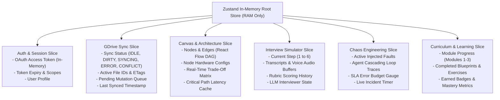
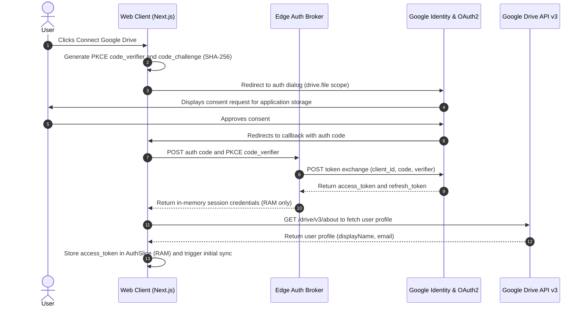
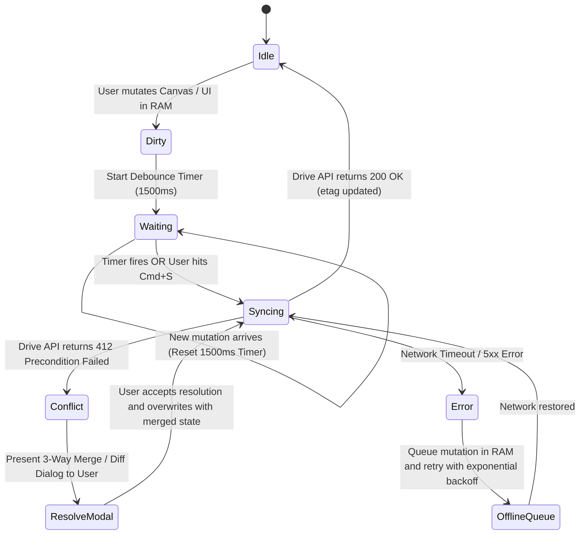
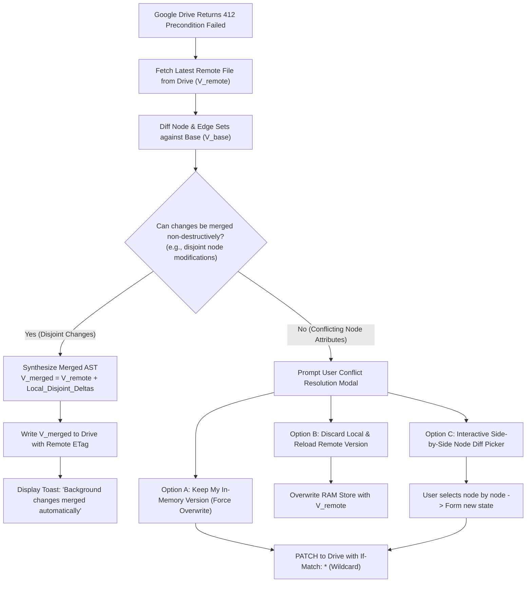

# Detailed Design: 01 - Ephemeral State & Google Drive SSOT

## 1. Executive Overview & Scope

The **2026 ML System Design Platform** operates under a strict architectural mandate:
1. **Zero Permanent Local State**: The client browser shall not persist any user work, credentials, settings, or project artifacts in local disk or browser storage systems (`localStorage`, `sessionStorage`, `IndexedDB`, WebSQL, or local CacheStorage).
2. **Google Drive as the Single Source of Truth (SSOT)**: Every user workspace, interactive canvas graph, interview rubric, chaos engineering log, custom scenario, and portfolio draft is stored exclusively in the user's personal Google Drive under a dedicated application folder (`/ML_System_Design_2026_SSOT/`).
3. **Volatile In-Memory Runtime**: During active browser execution, state resides strictly in volatile RAM managed by a modular `Zustand` state container. Closing the browser tab without syncing discards the in-memory delta.

This design draws direct inspiration from the cloud-native ephemeral state patterns established in the `synapse-sync` architectural model, ensuring zero data leakage onto shared workstations, zero local database corruption, and seamless cross-device mobility.

---

## 2. Ephemeral In-Memory State Architecture (Zustand 5.0 + React 19.3)

### 2.1 State Store Architecture & Slices

The runtime state is modeled as an in-memory **Zustand 5.0** store decomposed into modular slices. The store is initialized upon application launch and destroyed upon page teardown.

#### Modern Zustand 5.0 & React 19.3 Enhancements:
1. **Concurrency Safety & Zero-Tearing (`useSyncExternalStore`)**:
   - Zustand 5.0 natively leverages React 19's `useSyncExternalStore`, ensuring tear-free atomic reads across concurrent transitions without UI flickering during heavy background computation.
2. **Granular Shallow Selectors via `useShallow`**:
   - Complex component consumers (e.g., node inspectors, trade-off matrix badges) utilize `useShallow` from `zustand/react/shallow` to guard against redundant re-renders when adjacent canvas or interview state mutates:
     ```typescript
     import { useShallow } from 'zustand/react/shallow';
     const { p99LatencyMs, monthlySpend } = useZustandStore(
       useShallow((state) => ({
         p99LatencyMs: state.metrics.p99LatencyMs,
         monthlySpend: state.metrics.monthlySpend,
       }))
     );
     ```
3. **Transient Telemetry Subscriptions (Bypassing React DOM)**:
   - For high-frequency $60\text{ FPS}$ metric streaming generated by Web Workers, components subscribe transiently via `useZustandStore.subscribe(selector, callback)`. Metrics stream directly to WebGL/Canvas2D buffers without triggering React component reconciliation.
4. **Optimistic Cloud Sync via React 19 `useOptimistic`**:
   - UI status badges immediately reflect optimistic "Saved to Drive" states before the debounced REST network call completes, rolling back only if a conflict (`HTTP 412`) or timeout occurs.



### 2.2 Strict In-Memory Enforcement & Storage Prevention

To guarantee compliance with the zero-local-persistence constraint, the application registers an initialization interceptor that verifies and restricts browser storage APIs:

```typescript
/**
 * Storage Guard: Prevents accidental usage of persistent browser storage.
 * Enforced during bootstrap in both development and production.
 */
export class StorageSanitizer {
  public static enforceZeroLocalPersistence(): void {
    if (typeof window === 'undefined') return;

    const noopStorage = {
      getItem: (_key: string) => null,
      setItem: (_key: string, _value: string) => {
        console.warn('Persistent storage rejected: Zero Local State enforced by ADR-01.');
      },
      removeItem: (_key: string) => {},
      clear: () => {},
      length: 0,
      key: (_index: number) => null,
    };

    try {
      Object.defineProperty(window, 'localStorage', { value: noopStorage, configurable: false, writable: false });
      Object.defineProperty(window, 'sessionStorage', { value: noopStorage, configurable: false, writable: false });
    } catch (e) {
      console.warn('Storage overrides restricted by environment sandbox:', e);
    }
  }
}
```

### 2.3 Unload & Dirty State Protection

When a user introduces mutations into the canvas or completes an interview step, the `DriveSyncSlice` marks the state as `DIRTY`. If the user attempts to close or reload the browser tab before the debounced synchronization finishes, the browser triggers a native `beforeunload` warning dialog:

```typescript
export function useBeforeUnloadGuard(isDirty: boolean): void {
  useEffect(() => {
    const handleBeforeUnload = (event: BeforeUnloadEvent): string | void => {
      if (!isDirty) return;
      event.preventDefault();
      event.returnValue = 'You have unsaved changes. Closing this tab will permanently discard them unless synced to Google Drive.';
      return event.returnValue;
    };

    window.addEventListener('beforeunload', handleBeforeUnload);
    return () => window.removeEventListener('beforeunload', handleBeforeUnload);
  }, [isDirty]);
}
```

---

## 3. Google Drive SSOT Storage Model

### 3.1 OAuth2 Scope & Authorization Flow

The application requests the minimal permission scope necessary to interact with its own files:
- **Scope**: `https://www.googleapis.com/auth/drive.file`
- **Security Boundary**: The application can **only** read and write files and folders that it creates itself. It possesses zero access to existing user files, photos, personal documents, or spreadsheets in the user's Drive.

#### Authentication Sequence (OAuth2 PKCE Flow)



### 3.2 Google Drive Folder & File Hierarchy

The platform isolates all data within a single root folder at the base of the user's Google Drive:

```text
/ML_System_Design_2026_SSOT/
├── manifest.json                           # Global registry, active workspace pointers, settings
├── schemas/
│   └── custom_scenarios.json               # User-defined plug-and-play scenario plugins
├── workspaces/
│   ├── ws_8f1b2c_ecommerce_ranking.json    # Complete serialized architecture canvas
│   ├── ws_4a9d7e_fraud_detection.json      # Streaming fraud detection workspace
│   └── ws_1e3f8a_enterprise_rag.json       # Hybrid search RAG workspace
├── interviews/
│   ├── iv_session_9201_youtube_rec.json    # 6-step interview transcripts, audio notes, rubrics
│   └── iv_session_8812_ad_click_pred.json  # Candidate interview evaluation record
├── chaos_telemetry/
│   ├── chaos_run_551_cascade_logs.json     # Agent cascading loop traces & circuit breaker runs
│   └── incident_roulette_history.json      # Incident roulette performance records
└── llm_exchange_vault/
    ├── exports/                            # Exported JSON prompt bundles for manual execution
    │   └── prompt_AI_INTERVIEW_20261030.json
    └── imports/                            # Verified imported LLM response envelopes
        └── response_AI_INTERVIEW_20261030.json
```

### 3.3 Core Manifest JSON Schema (`manifest.json`)

The `manifest.json` file serves as the directory catalog and root index for the user's entire platform footprint:

```json
{
  "$schema": "https://json-schema.org/draft/2020-12/schema",
  "title": "PlatformManifest",
  "type": "object",
  "required": ["version", "updatedAt", "activeWorkspaceId", "userPreferences", "curriculumProgress", "workspaces"],
  "properties": {
    "version": { "type": "string", "const": "2026.1.0" },
    "updatedAt": { "type": "string", "format": "date-time" },
    "activeWorkspaceId": { "type": "string", "format": "uuid" },
    "userPreferences": {
      "type": "object",
      "required": ["highContrastMode", "telemetryFpsCap", "autoSaveDebounceMs", "preferredHardwareVendor", "aiExchangeMode"],
      "properties": {
        "highContrastMode": { "type": "boolean", "default": false },
        "telemetryFpsCap": { "type": "integer", "enum": [30, 60], "default": 60 },
        "autoSaveDebounceMs": { "type": "integer", "default": 1500 },
        "preferredHardwareVendor": { "type": "string", "enum": ["NVIDIA", "GOOGLE_TPU", "AMD"], "default": "NVIDIA" },
        "aiExchangeMode": { "type": "string", "enum": ["DIRECT_API", "MANUAL_IMPORT_EXPORT"], "default": "DIRECT_API" }
      }
    },
    "curriculumProgress": {
      "type": "object",
      "required": ["module1Completed", "module2Completed", "module3Completed", "completedExerciseIds"],
      "properties": {
        "module1Completed": { "type": "boolean" },
        "module2Completed": { "type": "boolean" },
        "module3Completed": { "type": "boolean" },
        "completedExerciseIds": {
          "type": "array",
          "items": { "type": "string" }
        }
      }
    },
    "workspaces": {
      "type": "array",
      "items": {
        "type": "object",
        "required": ["workspaceId", "name", "category", "fileId", "lastModified", "etag"],
        "properties": {
          "workspaceId": { "type": "string", "format": "uuid" },
          "name": { "type": "string" },
          "category": { "type": "string" },
          "fileId": { "type": "string" },
          "lastModified": { "type": "string", "format": "date-time" },
          "etag": { "type": "string" }
        }
      }
    }
  }
}
```

---

## 4. Synchronization Protocol & Conflict Resolution Engine

### 4.1 Debounced Mutation Pipeline

To prevent throttling from the Google Drive REST API ($10\text{ requests/sec/user}$ rate limits), mutations triggered by user actions (dragging nodes, editing edge weights, altering quantization levels) are batched through a sliding debounce window:



### 4.2 Optimistic In-Memory Updates & Conditional Writes (`If-Match`)

Every file synchronized with Google Drive tracks its remote `ETag` and `modifiedTime`. Writes use conditional HTTP headers to prevent accidental overwrites if the user has multiple browser tabs or devices open simultaneously:

```typescript
export class GDriveSyncClient {
  private readonly baseUrl = 'https://www.googleapis.com';

  /**
   * Updates an existing workspace file conditionally.
   * If the remote file changed since last read, Google Drive returns 412 Precondition Failed.
   */
  public async updateWorkspaceFile(
    accessToken: string,
    fileId: string,
    currentEtag: string,
    payload: Record<string, unknown>
  ): Promise<{ newEtag: string; modifiedTime: string }> {
    const serializedBody = JSON.stringify(payload, null, 2);

    const response = await fetch(
      `${this.baseUrl}/upload/drive/v3/files/${fileId}?uploadType=media`,
      {
        method: 'PATCH',
        headers: {
          Authorization: `Bearer ${accessToken}`,
          'Content-Type': 'application/json',
          'If-Match': currentEtag, // Prevents silent overwrite conflicts
        },
        body: serializedBody,
      }
    );

    if (response.status === 412) {
      throw new GDriveConflictError(`Conflict detected for file ${fileId}. Remote ETag does not match ${currentEtag}`);
    }

    if (!response.ok) {
      throw new GDriveSyncError(`Failed to update file ${fileId}: ${response.status} ${response.statusText}`);
    }

    const result = await response.json();
    return {
      newEtag: response.headers.get('ETag') || result.etag,
      modifiedTime: result.modifiedTime,
    };
  }
}
```

### 4.3 Three-Way Conflict Resolution Protocol

When a `412 Precondition Failed` error occurs, the platform initiates a 3-way merge algorithm:
- **Base Version ($V_{\text{base}}$)**: The state when the file was originally hydrated into RAM.
- **Local Version ($V_{\text{local}}$)**: The modified in-memory state with the user's uncommitted edits.
- **Remote Version ($V_{\text{remote}}$)**: The current version fetched directly from Google Drive.



---

## 5. Network Drop & Offline Resilience

If the user loses internet connectivity while working:
1. **Zero Disruption to Compute**: Web Workers, Pyodide WASM, and React Flow continue executing at full speed without network dependencies.
2. **RAM Queueing**: All state mutations are appended to an in-memory chronological replay log (`mutationQueue`).
3. **Visual Connectivity Indicator**:
   - `Green`: Connected & Synced (showing seconds since last save).
   - `Yellow (Pulsing)`: Local Changes Pending Sync.
   - `Red (Alert)`: Offline — $N$ Changes Buffered in Memory. *Warning: Do not refresh the page.*
4. **Automatic Reconnection Flush**: When the browser fires the `window.online` event, the sync manager initiates a heartbeat check to Google Drive, fetches the remote file's current ETag, and safely flushes the buffered `mutationQueue`.

---

## 6. Security, Tokens & Privacy Controls

1. **Token Lifecycle in Volatile Memory**:
   - OAuth access tokens and refresh tokens are kept strictly in JavaScript closure variables within the `AuthSlice`.
   - Never placed in cookies, `sessionStorage`, `localStorage`, or URL query parameters.
   - If the user reloads the page, they re-authenticate via the silent GIS (Google Identity Services) iframe or click "Reconnect".
2. **Data Isolation**:
   - The user's Google Drive acts as a private, sovereign data store.
   - The platform servers (whether running on Localhost or Vercel Edge) never store or log user architectures, prompts, trade-off matrices, or code snippets. All API requests to Google Drive are made directly from the user's browser client to Google's public endpoints.
3. **Data Portability**:
   - Because all files are stored as plain JSON in the user's `/ML_System_Design_2026_SSOT/` directory, users can download, backup, or inspect their files directly from drive.google.com at any time.

---

## 7. Synapse-Sync Architectural Comparison

| Architectural Feature | Synapse-Sync Paradigm | 2026 ML System Design Platform |
| :--- | :--- | :--- |
| **Local Storage Policy** | Prohibited | Strictly Prohibited (Enforced via runtime sanitizer) |
| **Persistence Target** | Google Drive `appDataFolder` / Custom Folder | Dedicated `/ML_System_Design_2026_SSOT/` User Root Directory |
| **State Container** | Reactive Observable Store | In-Memory `Zustand` with Comlink Web Worker Bridge |
| **Sync Debounce Window** | 2000 ms sliding window | 1500 ms sliding window + Explicit `Cmd/Ctrl+S` override |
| **Conflict Handling** | Last-Write-Wins with revision counters | Conditional HTTP `If-Match` ETags with 3-Way AST Merge |
| **LLM Exchange Vault** | N/A | Dedicated `/llm_exchange_vault/` directory for offline prompt/response files |

---

## 8. Implementation Code Architecture

The following TypeScript definitions govern the Google Drive synchronization engine:

```typescript
// src/core/gdrive/drive-types.ts

export interface GDriveFileMetadata {
  id: string;
  name: string;
  mimeType: string;
  parents?: string[];
  etag: string;
  modifiedTime: string;
}

export interface WorkspaceDocument<T = unknown> {
  schemaVersion: '2026.1.0';
  workspaceId: string;
  name: string;
  category: 'SANDBOX' | 'INTERVIEW' | 'CHAOS' | 'FINOPS' | 'CURRICULUM';
  createdAt: string;
  updatedAt: string;
  data: T;
}

export interface SyncState {
  status: 'IDLE' | 'DIRTY' | 'SYNCING' | 'CONFLICT' | 'OFFLINE';
  lastSyncedAt: string | null;
  activeWorkspaceId: string | null;
  activeFileId: string | null;
  activeEtag: string | null;
  pendingMutationCount: number;
}
```

```typescript
// src/core/state/slices/createDriveSyncSlice.ts

import { StateCreator } from 'zustand';
import { SyncState, WorkspaceDocument } from '../../gdrive/drive-types';

export interface DriveSyncSlice {
  syncState: SyncState;
  markDirty: () => void;
  triggerSync: () => Promise<void>;
  setWorkspace: (workspaceId: string, fileId: string, etag: string) => void;
  resolveConflict: (strategy: 'OVERWRITE_REMOTE' | 'RELOAD_REMOTE' | 'MERGE', mergedData?: unknown) => Promise<void>;
}

export const createDriveSyncSlice: StateCreator<DriveSyncSlice> = (set, get) => ({
  syncState: {
    status: 'IDLE',
    lastSyncedAt: null,
    activeWorkspaceId: null,
    activeFileId: null,
    activeEtag: null,
    pendingMutationCount: 0,
  },

  markDirty: () => {
    set((state) => ({
      syncState: {
        ...state.syncState,
        status: 'DIRTY',
        pendingMutationCount: state.syncState.pendingMutationCount + 1,
      },
    }));
  },

  triggerSync: async () => {
    // Debounced network dispatch implemented in sync-manager.ts
  },

  setWorkspace: (workspaceId, fileId, etag) => {
    set({
      syncState: {
        status: 'IDLE',
        lastSyncedAt: new Date().toISOString(),
        activeWorkspaceId: workspaceId,
        activeFileId: fileId,
        activeEtag: etag,
        pendingMutationCount: 0,
      },
    });
  },

  resolveConflict: async (_strategy, _mergedData) => {
    // 3-way conflict resolution dispatch
  },
});
```

---

## 9. Next Steps

- Proceed to [02_dual_mode_ai_gateway_and_exchange_spec.md](file:///home/somesh/git_repos/ml-sys-design/documentation/design/detailed/02_dual_mode_ai_gateway_and_exchange_spec.md) for the complete JSON Schema exchange contract, air-gap manual export/import protocols, and Gemini Free Tier resilience patterns.
