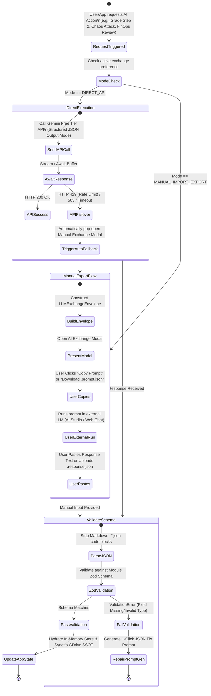
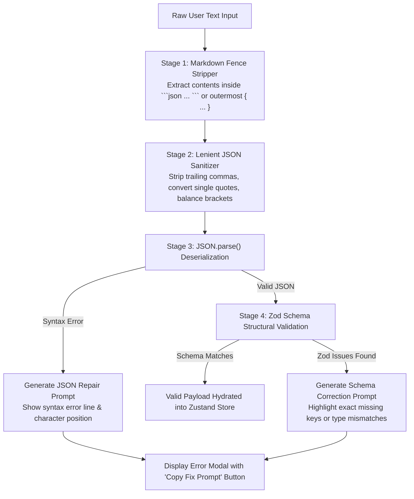

# Detailed Design: 02 - Dual-Mode AI Gateway & Exchange Specification

## 1. Executive Summary & Problem Context

The **2026 ML System Design Platform** integrates conversational, evaluative, and adversarial LLM interactions across all 13 operational modules. However, the system relies exclusively on the **Google Gemini Free Tier**, which imposes strict rate limits (typically $15\text{ RPM}$, $1\text{M TPM}$, and $1,500\text{ RPD}$ on standard flash models), transient latency spikes, and quota exhaustion errors (`HTTP 429 Too Many Requests`).

To guarantee uninterrupted learning and high availability without requiring paid API infrastructure, every AI-powered feature in the system is built on a **Dual-Mode Hybrid AI Gateway**:
1. **Direct Mode (Automated Streaming API)**: Direct client or edge invocation of Gemini models (`gemini-2.5-flash` / `gemini-2.5-pro`) with automated retries, rate-limiting circuit breakers, and structured JSON generation.
2. **Manual Mode (Air-Gapped Prompt Export & Response Import)**: A zero-failure fallback mechanism that packages the entire prompt context, system instructions, and target JSON Schema into a standardized `LLMExchangeEnvelope`. Users can copy-paste the prompt into Google AI Studio, ChatGPT, Claude, or any external web LLM interface, and import the generated JSON response back into the platform with zero data loss.

---

## 2. Gateway Architecture & State Machine



---

## 3. The Standardized Exchange Contract: `LLMExchangeEnvelope`

Every prompt package and imported response conforms to the `LLMExchangeEnvelope` specification. This envelope is stored in RAM and archived to `/ML_System_Design_2026_SSOT/llm_exchange_vault/` upon successful synchronization.

### 3.1 Envelope JSON Schema Definition

```json
{
  "$schema": "https://json-schema.org/draft/2020-12/schema",
  "title": "LLMExchangeEnvelope",
  "type": "object",
  "required": [
    "envelopeVersion",
    "envelopeId",
    "moduleId",
    "useCaseId",
    "timestamp",
    "promptPayload",
    "expectedResponseSchema"
  ],
  "properties": {
    "envelopeVersion": { "type": "string", "const": "2026.1.0" },
    "envelopeId": { "type": "string", "format": "uuid" },
    "moduleId": {
      "type": "string",
      "enum": [
        "SANDBOX_BUILDER",
        "CASE_STUDY_LIBRARY",
        "AI_INTERVIEW_SIMULATOR",
        "CHAOS_ADVERSARIAL_PLAYGROUND",
        "FINOPS_CALCULATOR",
        "DATA_ALIGNMENT_ENGINE",
        "CHAOS_MONKEY_ARGON",
        "TELEMETRY_LOG_GAME",
        "REGULATORY_COMPLIANCE_SIM",
        "RESUME_PORTFOLIO_EXPORTER",
        "MATH_REWARD_WORKSPACE",
        "DATA_ARCHAEOLOGY_SUITE",
        "CAUSAL_INFERENCE_LAB"
      ]
    },
    "useCaseId": { "type": "string" },
    "timestamp": { "type": "string", "format": "date-time" },
    "promptPayload": {
      "type": "object",
      "required": [
        "systemInstruction",
        "userPrompt",
        "serializedContext",
        "copyPasteReadyMarkdown"
      ],
      "properties": {
        "systemInstruction": { "type": "string" },
        "userPrompt": { "type": "string" },
        "serializedContext": { "type": "object" },
        "copyPasteReadyMarkdown": { "type": "string" }
      }
    },
    "expectedResponseSchema": {
      "type": "object",
      "description": "JSON Schema Draft-07 describing the required response shape"
    },
    "llmResponse": {
      "type": ["object", "null"],
      "default": null,
      "description": "The validated response object from the LLM"
    },
    "metadata": {
      "type": "object",
      "properties": {
        "source": { "type": "string", "enum": ["DIRECT_GEMINI_API", "MANUAL_IMPORT"] },
        "modelIdentifier": { "type": "string" },
        "executionLatencyMs": { "type": "number" },
        "validationErrors": { "type": "array", "items": { "type": "string" } }
      }
    }
  }
}
```

---

## 4. Client Parsing, JSON Repair & Error Recovery Engine

When users paste responses from external LLM chat interfaces, the text often contains preamble text (e.g., *"Here is the JSON you requested:"*), Markdown code blocks (` ```json ... ``` `), or minor syntax glitches (trailing commas, unescaped quotes).

The `ResponseValidator` executes a 4-stage pipeline before rejecting a payload:



### 4.1 Schema Correction Prompt Generator

If an imported JSON object fails Zod validation, the system generates an immediate correction prompt for the user to paste back into their external LLM:

```typescript
export function generateSchemaRepairPrompt(
  envelope: LLMExchangeEnvelope,
  rawJson: string,
  zodErrors: z.ZodError
): string {
  return `The JSON output you previously generated failed schema validation:
Validation Errors:
${JSON.stringify(zodErrors.format(), null, 2)}

Original Invalid Output:
${rawJson}

Expected JSON Schema:
${JSON.stringify(envelope.expectedResponseSchema, null, 2)}

CRITICAL INSTRUCTION:
Regenerate the JSON object so that it strictly adheres to the Expected JSON Schema without any errors. Output ONLY the raw JSON object inside a \`\`\`json markdown block. Do not provide commentary.`;
}
```

---

## 5. Exhaustive Module Specifications (Modules 1 to 13)

Below is the concrete technical specification of `serializedContext`, prompt templates, and the required `expectedResponseSchema` for each of the 13 platform modules.

---

### Module 01: Interactive Sandbox Architecture Builder (`SANDBOX_BUILDER`)

- **Use Case**: Analyzes user's canvas topology for hidden bottlenecks, single points of failure (SPOF), and high-latency hops.
- **Serialized Context**: Current graph nodes, edges, calculated traffic QPS, and hardware configurations.
- **Response Schema (`Zod` / JSON Schema)**:

```json
{
  "title": "SandboxBuilderAnalysis",
  "type": "object",
  "required": ["overallHealthScore", "identifiedBottlenecks", "suggestedOptimizations", "tradeOffAssessment"],
  "properties": {
    "overallHealthScore": { "type": "number", "minimum": 0, "maximum": 100 },
    "identifiedBottlenecks": {
      "type": "array",
      "items": {
        "type": "object",
        "required": ["nodeId", "severity", "category", "description", "suggestedFix"],
        "properties": {
          "nodeId": { "type": "string" },
          "severity": { "type": "string", "enum": ["LOW", "MEDIUM", "HIGH", "CRITICAL"] },
          "category": { "type": "string", "enum": ["LATENCY", "MEMORY_VRAM", "NETWORK_BANDWIDTH", "COST", "RELIABILITY"] },
          "description": { "type": "string" },
          "suggestedFix": { "type": "string" }
        }
      }
    },
    "suggestedOptimizations": {
      "type": "array",
      "items": {
        "type": "object",
        "required": ["componentSwap", "estimatedLatencyDeltaMs", "estimatedCostDeltaUSD", "rationale"],
        "properties": {
          "componentSwap": { "type": "string" },
          "estimatedLatencyDeltaMs": { "type": "number" },
          "estimatedCostDeltaUSD": { "type": "number" },
          "rationale": { "type": "string" }
        }
      }
    },
    "tradeOffAssessment": { "type": "string" }
  }
}
```

---

### Module 02: Interactive Case-Study Library (`CASE_STUDY_LIBRARY`)

- **Use Case**: Evaluates candidate's patch against a simulated production outage (e.g., E-Commerce Flash Sale drift, Fraud detection streaming skew).
- **Response Schema**:

```json
{
  "title": "CaseStudyEvaluation",
  "type": "object",
  "required": ["resolutionStatus", "rubricScore", "rootCauseDiagnosis", "architecturalStrengths", "unmitigatedRisks", "industryBestPracticeComparison"],
  "properties": {
    "resolutionStatus": { "type": "string", "enum": ["RESOLVED", "PARTIALLY_RESOLVED", "FAILED"] },
    "rubricScore": { "type": "number", "minimum": 0, "maximum": 100 },
    "rootCauseDiagnosis": { "type": "string" },
    "architecturalStrengths": { "type": "array", "items": { "type": "string" } },
    "unmitigatedRisks": { "type": "array", "items": { "type": "string" } },
    "industryBestPracticeComparison": { "type": "string" }
  }
}
```

---

### Module 03: AI Interview Simulator (`AI_INTERVIEW_SIMULATOR`)

- **Use Case**: Conducts a realistic, dynamic 6-Step Whiteboard System Design interview (YouTube Recs, Ad Click Prediction, ChatGPT serving).
- **Response Schema**:

```json
{
  "title": "InterviewStepEvaluation",
  "type": "object",
  "required": ["stepNumber", "stepCompleted", "stepScore", "interviewerSpeech", "feedback", "dimensionScores", "suggestedNextQuestions"],
  "properties": {
    "stepNumber": { "type": "integer", "minimum": 1, "maximum": 6 },
    "stepCompleted": { "type": "boolean" },
    "stepScore": { "type": "number", "minimum": 0, "maximum": 100 },
    "interviewerSpeech": { "type": "string", "description": "The dynamic persona response/question to the candidate" },
    "feedback": {
      "type": "object",
      "required": ["strengths", "missingConsiderations", "bottlenecksIdentified"],
      "properties": {
        "strengths": { "type": "array", "items": { "type": "string" } },
        "missingConsiderations": { "type": "array", "items": { "type": "string" } },
        "bottlenecksIdentified": { "type": "array", "items": { "type": "string" } }
      }
    },
    "dimensionScores": {
      "type": "object",
      "required": ["scaleAwareness", "componentSelection", "failureHandling", "businessAlignment"],
      "properties": {
        "scaleAwareness": { "type": "number", "minimum": 1, "maximum": 5 },
        "componentSelection": { "type": "number", "minimum": 1, "maximum": 5 },
        "failureHandling": { "type": "number", "minimum": 1, "maximum": 5 },
        "businessAlignment": { "type": "number", "minimum": 1, "maximum": 5 }
      }
    },
    "suggestedNextQuestions": { "type": "array", "items": { "type": "string" } }
  }
}
```

---

### Module 04: Chaos Engineering & Adversarial Playground (`CHAOS_ADVERSARIAL_PLAYGROUND`)

- **Use Case**: Simulates red-team injection into LLM architectures (token context overflow, network partition, agent cascading loop).
- **Response Schema**:

```json
{
  "title": "ChaosInjectionResult",
  "type": "object",
  "required": ["exploitSucceeded", "systemFailureMode", "blastRadiusScore", "executionTrace", "circuitBreakerTriggered", "remediationRecommendations"],
  "properties": {
    "exploitSucceeded": { "type": "boolean" },
    "systemFailureMode": { "type": "string", "enum": ["INFINITE_AGENT_LOOP", "OUT_OF_MEMORY_CRASH", "CONTEXT_WINDOW_OVERFLOW", "SILENT_DATA_CORRUPTION", "RESILIENT_SURVIVAL"] },
    "blastRadiusScore": { "type": "number", "minimum": 0, "maximum": 100 },
    "executionTrace": { "type": "array", "items": { "type": "string" } },
    "circuitBreakerTriggered": { "type": "boolean" },
    "remediationRecommendations": { "type": "array", "items": { "type": "string" } }
  }
}
```

---

### Module 05: FinOps & GPU/TPU Unit Economics Calculator (`FINOPS_CALCULATOR`)

- **Use Case**: Analyzes hardware allocations, memory bandwidth vs. compute bottlenecks, and cost viability under monthly budget ceilings.
- **Response Schema**:

```json
{
  "title": "FinOpsAuditReport",
  "type": "object",
  "required": ["budgetViable", "projectedMonthlySpendUSD", "budgetVariancePercentage", "primaryBottleneck", "hardwareTradeOffAnalysis", "costReductionPlays"],
  "properties": {
    "budgetViable": { "type": "boolean" },
    "projectedMonthlySpendUSD": { "type": "number" },
    "budgetVariancePercentage": { "type": "number" },
    "primaryBottleneck": { "type": "string", "enum": ["MEMORY_BANDWIDTH_BOUND", "COMPUTE_FLOPS_BOUND", "NETWORK_INTERCONNECT_BOUND", "VRAM_CAPACITY_BOUND"] },
    "hardwareTradeOffAnalysis": { "type": "string" },
    "costReductionPlays": {
      "type": "array",
      "items": {
        "type": "object",
        "required": ["tactic", "projectedSavingsUSD", "latencyImpactMs"],
        "properties": {
          "tactic": { "type": "string" },
          "projectedSavingsUSD": { "type": "number" },
          "latencyImpactMs": { "type": "number" }
        }
      }
    }
  }
}
```

---

### Module 06: Advanced Data Alignment & Curation Engine (`DATA_ALIGNMENT_ENGINE`)

- **Use Case**: Audits synthetic data pipelines, detects repetitive phrasing, and validates Human-In-The-Loop active learning setups.
- **Response Schema**:

```json
{
  "title": "DataAlignmentAudit",
  "type": "object",
  "required": ["datasetQualityScore", "detectedBiases", "diversityEntropyScore", "hitlGateEfficiency", "recommendedFilteringRules"],
  "properties": {
    "datasetQualityScore": { "type": "number", "minimum": 0, "maximum": 100 },
    "detectedBiases": {
      "type": "array",
      "items": {
        "type": "object",
        "required": ["biasCategory", "affectedProportion", "exampleSnippet"],
        "properties": {
          "biasCategory": { "type": "string" },
          "affectedProportion": { "type": "number" },
          "exampleSnippet": { "type": "string" }
        }
      }
    },
    "diversityEntropyScore": { "type": "number", "minimum": 0, "maximum": 1 },
    "hitlGateEfficiency": { "type": "string" },
    "recommendedFilteringRules": { "type": "array", "items": { "type": "string" } }
  }
}
```

---

### Module 07: Gamified Failure Modes: Gemini Argon Reviewer (`CHAOS_MONKEY_ARGON`)

- **Use Case**: Gemini Argon acts as a ruthless adversary, finding blind spots and crafting a customized killer workload packet to crash the system.
- **Response Schema**:

```json
{
  "title": "GeminiArgonAdversarialAttack",
  "type": "object",
  "required": ["adversarialCritique", "targetedVulnerability", "killerWorkloadPacket", "predictedSystemFailure"],
  "properties": {
    "adversarialCritique": { "type": "string" },
    "targetedVulnerability": { "type": "string" },
    "killerWorkloadPacket": {
      "type": "object",
      "required": ["trafficPattern", "burstQPS", "adversarialPayloadDescription", "samplePayloadSnippet"],
      "properties": {
        "trafficPattern": { "type": "string", "enum": ["POISSON_BURST", "SKEWED_HASH_KEY_COLLISION", "LONG_CONTEXT_PROMPT_BOMB", "CONCURRENT_CACHE_EVICTION"] },
        "burstQPS": { "type": "number" },
        "adversarialPayloadDescription": { "type": "string" },
        "samplePayloadSnippet": { "type": "string" }
      }
    },
    "predictedSystemFailure": { "type": "string" }
  }
}
```

---

### Module 08: Telemetry Observability & Log Trace Analysis Game (`TELEMETRY_LOG_GAME`)

- **Use Case**: Evaluates student's diagnosis of messy production logs (CUDA OOM, NCCL deadlocks, vector index fragmentation).
- **Response Schema**:

```json
{
  "title": "LogTraceGameEvaluation",
  "type": "object",
  "required": ["diagnosisCorrect", "actualFailureRootCause", "userScore", "technicalExplanation", "postMortemActionItems"],
  "properties": {
    "diagnosisCorrect": { "type": "boolean" },
    "actualFailureRootCause": { "type": "string" },
    "userScore": { "type": "number", "minimum": 0, "maximum": 100 },
    "technicalExplanation": { "type": "string" },
    "postMortemActionItems": { "type": "array", "items": { "type": "string" } }
  }
}
```

---

### Module 09: Regulatory, Compliance & AI Safety Simulator (`REGULATORY_COMPLIANCE_SIM`)

- **Use Case**: Audits pipeline for EU AI Act compliance, GDPR Right to be Forgotten (RTBF) machine unlearning, and toxic prompt injection gates.
- **Response Schema**:

```json
{
  "title": "RegulatoryComplianceAudit",
  "type": "object",
  "required": ["euAiActComplianceStatus", "gdprRtbfScore", "unlearningLeakageRisks", "guardrailPenetrationTest", "complianceChecklist"],
  "properties": {
    "euAiActComplianceStatus": { "type": "string", "enum": ["COMPLIANT", "HIGH_RISK_NON_COMPLIANT", "PROHIBITED"] },
    "gdprRtbfScore": { "type": "number", "minimum": 0, "maximum": 100 },
    "unlearningLeakageRisks": { "type": "array", "items": { "type": "string" } },
    "guardrailPenetrationTest": {
      "type": "object",
      "required": ["bypassAttemptSnippet", "blockedByGuardrail", "vulnerabilityNotes"],
      "properties": {
        "bypassAttemptSnippet": { "type": "string" },
        "blockedByGuardrail": { "type": "boolean" },
        "vulnerabilityNotes": { "type": "string" }
      }
    },
    "complianceChecklist": {
      "type": "array",
      "items": {
        "type": "object",
        "required": ["regulation", "requirement", "status"],
        "properties": {
          "regulation": { "type": "string" },
          "requirement": { "type": "string" },
          "status": { "type": "string", "enum": ["PASS", "FAIL", "NEEDS_REVIEW"] }
        }
      }
    }
  }
}
```

---

### Module 10: Interactive Resume-Builder & Portfolio Exporter (`RESUME_PORTFOLIO_EXPORTER`)

- **Use Case**: Compiles the student's architecture canvas and failure-resilience tests into a publication-ready Production Manifesto.
- **Response Schema**:

```json
{
  "title": "ProductionManifestoExport",
  "type": "object",
  "required": ["portfolioTitle", "executiveSummaryMd", "architecturalDecisionsMd", "hardwareAndUnitEconomicsMd", "failureModesAndChaosResilienceMd", "recommendedInterviewTalkingPoints"],
  "properties": {
    "portfolioTitle": { "type": "string" },
    "executiveSummaryMd": { "type": "string" },
    "architecturalDecisionsMd": { "type": "string" },
    "hardwareAndUnitEconomicsMd": { "type": "string" },
    "failureModesAndChaosResilienceMd": { "type": "string" },
    "recommendedInterviewTalkingPoints": { "type": "array", "items": { "type": "string" } }
  }
}
```

---

### Module 11: Mathematical Objective & Alignment Formulation Workspace (`MATH_REWARD_WORKSPACE`)

- **Use Case**: Simulates agent population against student's authored mathematical reward function; detects Goodhart's Law reward hacking.
- **Response Schema**:

```json
{
  "title": "RewardFunctionAnalysis",
  "type": "object",
  "required": ["rewardHackingDetected", "hackingSeverity", "degenerateAgentStrategy", "mathematicalFlawDiagnosis", "suggestedConstraintReformulation"],
  "properties": {
    "rewardHackingDetected": { "type": "boolean" },
    "hackingSeverity": { "type": "string", "enum": ["NONE", "SUBTLE", "SEVERE", "CATASTROPHIC"] },
    "degenerateAgentStrategy": { "type": "string", "description": "How the agents gamed the reward metric (e.g., outputs empty text to avoid toxicity penalty)" },
    "mathematicalFlawDiagnosis": { "type": "string" },
    "suggestedConstraintReformulation": { "type": "string", "description": "Adjusted loss/reward equation with proper regularization or KL penalties" }
  }
}
```

---

### Module 12: Data Archaeology & Contamination Auditing Suite (`DATA_ARCHAEOLOGY_SUITE`)

- **Use Case**: Evaluates candidate's programmatic MinHash LSH and decontamination filters on synthetic benchmark datasets.
- **Response Schema**:

```json
{
  "title": "DataArchaeologyReport",
  "type": "object",
  "required": ["decontaminationRecall", "falsePositiveRate", "retainedDatasetEntropy", "missedContaminatedSamples", "methodologyCritique"],
  "properties": {
    "decontaminationRecall": { "type": "number", "minimum": 0, "maximum": 1 },
    "falsePositiveRate": { "type": "number", "minimum": 0, "maximum": 1 },
    "retainedDatasetEntropy": { "type": "number" },
    "missedContaminatedSamples": { "type": "array", "items": { "type": "string" } },
    "methodologyCritique": { "type": "string" }
  }
}
```

---

### Module 13: Causal Inference & Counterfactual Lab (`CAUSAL_INFERENCE_LAB`)

- **Use Case**: Validates user's drawn Causal DAG, verifies Backdoor/Frontdoor criterion adjustments, and benchmarks CUPED experimental variance reduction.
- **Response Schema**:

```json
{
  "title": "CausalInferenceEvaluation",
  "type": "object",
  "required": ["dagValid", "backdoorConditionSatisfied", "unblockedConfoundingPaths", "cupedVarianceReductionPercent", "causalInterpretation"],
  "properties": {
    "dagValid": { "type": "boolean" },
    "backdoorConditionSatisfied": { "type": "boolean" },
    "unblockedConfoundingPaths": { "type": "array", "items": { "type": "string" } },
    "cupedVarianceReductionPercent": { "type": "number" },
    "causalInterpretation": { "type": "string" }
  }
}
```

---

## 6. Implementation Code Contract

The core gateway is encapsulated in the `LLMOrchestrator` class:

```typescript
// src/core/ai-gateway/llm-orchestrator.ts

import { z } from 'zod';
import { LLMExchangeEnvelope } from './types';
import { ResponseValidator } from './response-validator';
import { EnvelopeFactory } from './envelope-factory';

export class LLMOrchestrator {
  private readonly responseValidator = new ResponseValidator();
  private readonly envelopeFactory = new EnvelopeFactory();

  public async executeModuleAI<T>(
    moduleId: LLMExchangeEnvelope['moduleId'],
    useCaseId: string,
    context: Record<string, unknown>,
    schema: z.ZodSchema<T>,
    mode: 'DIRECT_API' | 'MANUAL_IMPORT_EXPORT'
  ): Promise<{ result: T | null; envelope: LLMExchangeEnvelope }> {
    const envelope = this.envelopeFactory.createEnvelope(moduleId, useCaseId, context, schema);

    if (mode === 'DIRECT_API') {
      try {
        const rawResponse = await this.callGeminiDirect(envelope);
        const validated = this.responseValidator.validate(rawResponse, schema);
        envelope.llmResponse = validated;
        envelope.metadata = { source: 'DIRECT_GEMINI_API', executionLatencyMs: 840 };
        return { result: validated, envelope };
      } catch (error) {
        console.warn('Direct Gemini API failed (Rate limit or network). Switching to manual envelope:', error);
        // Returns envelope for UI modal export
        return { result: null, envelope };
      }
    }

    // Manual mode returns envelope for user copy/paste
    return { result: null, envelope };
  }

  private async callGeminiDirect(envelope: LLMExchangeEnvelope): Promise<string> {
    // Invokes @google/genai or edge route proxy with gemini-2.5-flash
    const response = await fetch('/api/gemini/proxy', {
      method: 'POST',
      headers: { 'Content-Type': 'application/json' },
      body: JSON.stringify(envelope),
    });

    if (!response.ok) {
      throw new Error(`Gemini Proxy Error: ${response.status} ${response.statusText}`);
    }

    const json = await response.json();
    return json.text;
  }
}
```

---

## 7. Next Steps

- Proceed to [03_deterministic_simulation_and_worker_engine.md](file:///home/somesh/git_repos/ml-sys-design/documentation/design/detailed/03_deterministic_simulation_and_worker_engine.md) for the mathematical modeling, Web Worker pipeline, and sub-100ms simulation algorithms.
