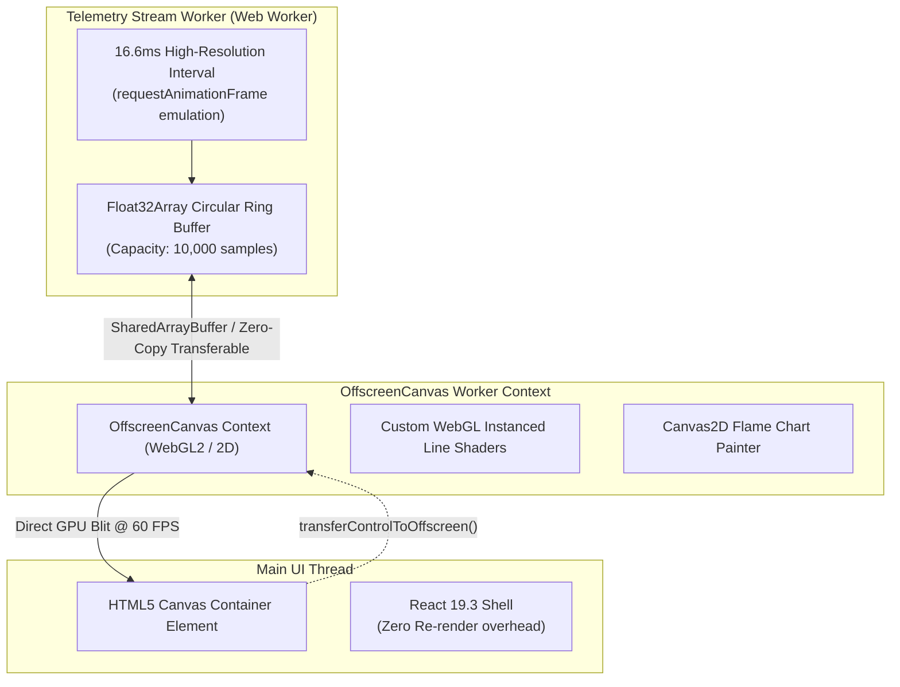
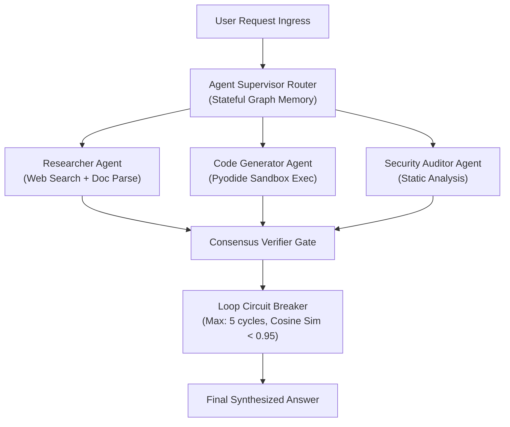
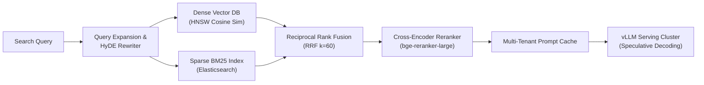
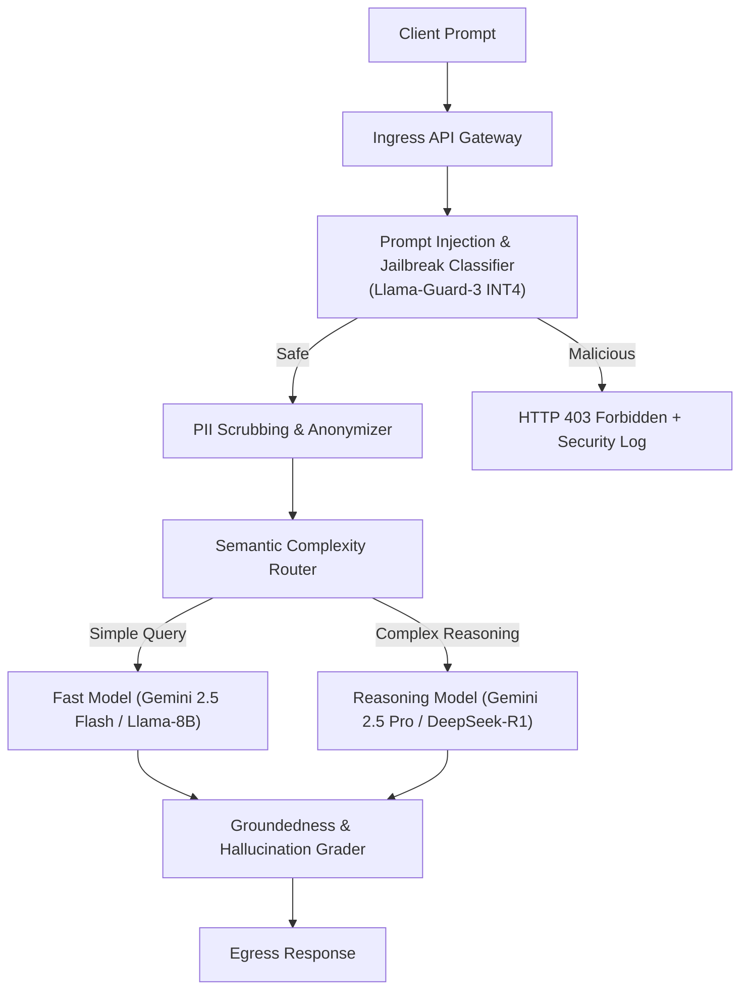
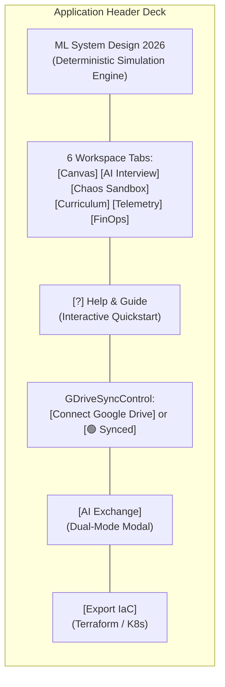
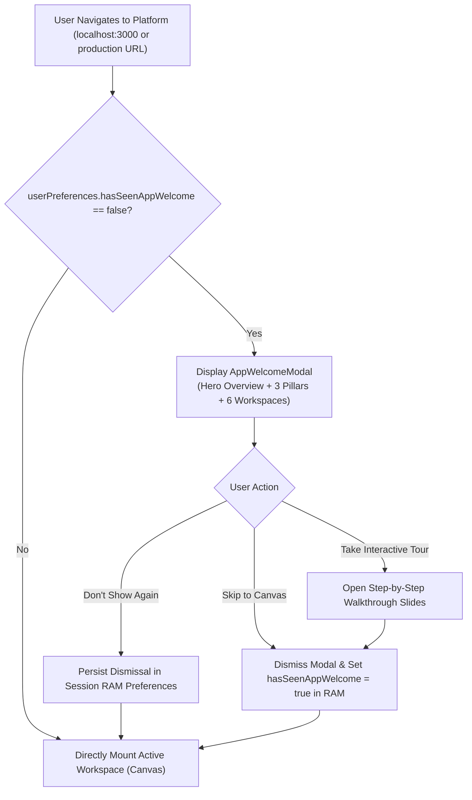
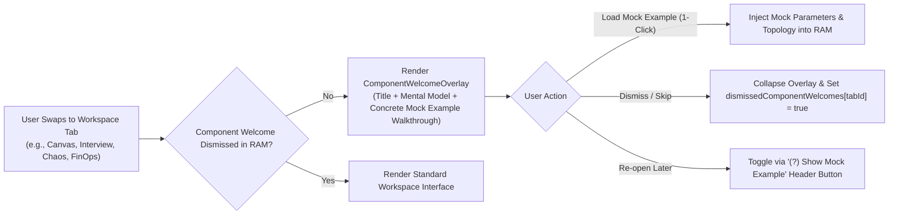
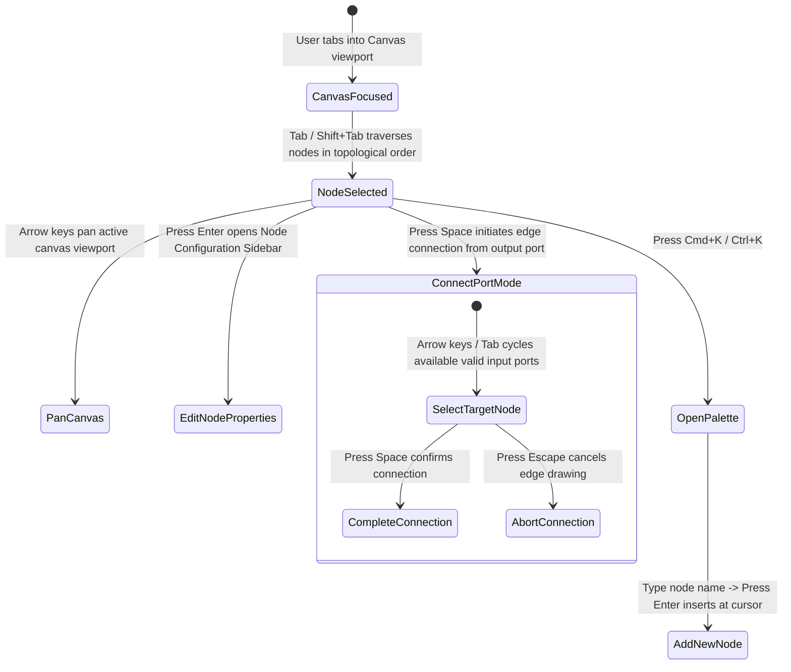

# Detailed Design: 04 - Canvas & UI Component System

## 1. Executive Summary & Design Vision

The **2026 ML System Design Platform** features an interactive, high-performance UI system designed for complex systems modeling and real-time operations training:
1. **Interactive Architecture Canvas**: A drag-and-drop workspace where users compose cutting-edge machine learning topologies (Feature Stores, Vector DBs, vLLM Clusters, Semantic Routers, and Agent Graphs).
2. **60 FPS Real-Time Telemetry & Grafana Profiler**: A high-frequency observability console rendering live flame graphs, attention head distributions, and queue depth metrics using WebGL2/Canvas2D decoupled from React's DOM rendering cycle.
3. **Comprehensive Accessibility (WCAG 2.1 AA/AAA)**: Full keyboard navigability across the infinite canvas, high-contrast visual themes, screen-reader live announcements, and colorblind-safe visual encodings.

---

## 2. Canvas Architecture & Node Topology

The canvas is constructed on **`@xyflow/react` (v12.12+)** extended with customized WebGL overlays for edge particle flow and real-time hardware telemetry badges.

### 2.1 Leveraging Modern `@xyflow/react` 12.12 Features

1. **Reactive Node Data Subscriptions via `useNodesData<T>()`**:
   - Rather than forcing the entire React canvas or root Zustand store to re-render whenever an upstream node's metrics change, downstream nodes subscribe directly to connected upstream node data:
     ```typescript
     const upstreamData = useNodesData<FeatureStoreData>(sourceNodeId);
     ```
   - In a complex pipeline (e.g., Feature Store $\to$ Embedding Model $\to$ Vector DB $\to$ vLLM Cluster), updating feature embedding dimensions only re-renders the immediately connected downstream nodes in $<5\text{ ms}$.
2. **Interactive Edge Overlays via `<EdgeLabelRenderer>` & `<BaseEdge>`**:
   - Network connections render custom HTML overlays directly on the canvas DOM via HTML portals.
   - Displays real-time wire latency (`gRPC (0.3ms)`), serialization protocols, bandwidth saturation bars, and an interactive **"Inject Chaos Fault"** button directly on the cable without SVG text measurement performance penalties.
3. **Live Connection Validation via `useConnection()`**:
   - The connection drawing state machine validates ports in real time. Dragging a connection handle dynamically inspects candidate target ports and provides immediate visual feedback (emerald glow for compatible tensor shapes/protocols; vermilion glow with tooltip for incompatibilities, e.g., connecting a batch lake directly to a sub-20ms streaming gateway).
4. **Hierarchical Subflows (`parentId` & `extent: 'parent'`)**:
   - Native nested grouping for multi-agent swarms (e.g., **Supervisor Node** containing internal Worker Agent sub-nodes) and distributed hardware clusters (e.g., **vLLM Cluster Group** containing individual GPU worker replicas, KV-cache managers, and PagedAttention coordinators).
5. **Dynamic `<NodeResizer>` / `<NodeResizeControl>`**:
   - Enables users to resize telemetry-heavy blocks (e.g. LLM Serving clusters, Profiler Nodes) to expand embedded live flame charts, attention head grids, and memory fragmentation heatmaps without opening external modal dialogs.
6. **Native WCAG 2.1 Theming via `colorMode="system" | "dark" | "light"`**:
   - Built-in theme switching integrated seamlessly with high-contrast Okabe-Ito color palettes.


### 2.1 Custom Node Specifications & Visual Indicators

Each node displays critical live telemetry badges updated via the background Web Worker:

```text
┌──────────────────────────────────────────────────────────────────┐
│  [icon] vLLM Cluster (Llama-3-70B)             [STATUS: OPTIMAL] │
├──────────────────────────────────────────────────────────────────┤
│  Hardware: 4x NVIDIA H100 SXM (80GB)       Quantization: INT4    │
│  Util: [██████████░░] 74%                  VRAM: 61.2 / 80 GB    │
├──────────────────────────────────────────────────────────────────┤
│  TTFT: 68 ms        TPOT: 12.4 ms/tok      Cost: $12.80/hr       │
│  Speculative Decoding: ACTIVE (1.8x)       Prompt Cache: 82% HIT │
└──────────────────────────────────────────────────────────────────┘
```

#### Node State Visual Encoding

| State | Visual Border | Iconography | Telemetry Pulse | Screen Reader Tag (`aria-label`) |
| :--- | :--- | :--- | :--- | :--- |
| **OPTIMAL** | `#10B981` (Emerald Solid) | Checkmark | Stable $1\text{ Hz}$ glow | "Optimal performance. p99 latency 68ms." |
| **BOTTLENECK** | `#F59E0B` (Amber Dash) | Warning Triangle | Rapid $2\text{ Hz}$ flash | "Warning: Memory bandwidth saturated. Utilization 94%." |
| **OVERFLOW** | `#EF4444` (Crimson Double) | Exploding Zap | Strobe $4\text{ Hz}$ | "Critical: Queue drop detected. Requests rejected." |
| **CHAOS_TRIGGERED** | `#8B5CF6` (Purple Neon) | Biohazard / Skull | Alternating glitch | "Chaos fault injected: 40% latency degradation active." |

---

## 3. High-Frequency Telemetry Pipeline ($60\text{ FPS}$ Profiler)

Rendering complex time-series charts, flame graphs, and queue telemetry at $60\text{ FPS}$ ($16.6\text{ ms}$ per frame) will cause severe frame drops if processed through React state updates (`useState` / `useEffect`). 

### 3.1 OffscreenCanvas & WebGL Architecture



### 3.2 Metric Ring Buffer Implementation

The telemetry engine stores metrics in fixed-size typed arrays, completely avoiding garbage collection overhead:

```typescript
export class TelemetryRingBuffer {
  private readonly buffer: Float32Array;
  private head: number = 0;
  private readonly capacity: number;

  constructor(capacity: number = 3600) { // 60 seconds @ 60 FPS
    this.capacity = capacity;
    this.buffer = new Float32Array(capacity);
  }

  public push(value: number): void {
    this.buffer[this.head] = value;
    this.head = (this.head + 1) % this.capacity;
  }

  public getRawBuffer(): Float32Array {
    return this.buffer;
  }

  public getHeadIndex(): number {
    return this.head;
  }
}
```

### 3.3 Operations Dashboard (Grafana/Prometheus Emulation)

The UI features a toggleable **"Ops Console"** tab that renders four simultaneous telemetry panels:
1. **End-to-End Latency Waterfall ($p50, p90, p99$)**: Multi-line continuous chart with threshold alert zones ($>180\text{ ms}$ red-line).
2. **LLM Serving Flame Graph**: Interactive breakdown of request lifecycle: Network $\rightarrow$ Tokenization $\rightarrow$ KV Cache Fetch $\rightarrow$ Prefill TTFT $\rightarrow$ Autoregressive Decode $\rightarrow$ Guardrail Validation.
3. **GPU VRAM & Attention Head Fragmentation**: Memory chunk allocation visualizer showing active context allocations vs. fragmented holes.
4. **Dead-Letter Queue (DLQ) & Circuit Breaker Depths**: Event stream showing rejected payloads and backpressure indicators.

---

## 4. Pre-Built Architecture Templates

The canvas provides three pre-configured production templates accessible via the template picker:

### 4.1 Template 1: Multi-Agent Orchestration Network



### 4.2 Template 2: Enterprise Hybrid Search RAG



### 4.3 Template 3: LLM Guardrail & Safety Routing



---

## 5. UI Guidance, Screen-by-Screen Expectations & Onboarding Architecture

To eliminate cognitive friction and ensure users immediately understand the operational expectations of every screen, the platform introduces a comprehensive **Guidance & Expectations Framework**.

### 5.1 Global Navigation & Header Architecture

The application header provides a standardized control deck across all screens:



1. **Branding & Status**: Displays system identity and global simulation status.
2. **Tab Navigation Deck**: Dedicated buttons switching between the 6 distinct operational workspaces.
3. **`[?] Help & Guide` Button**: Opens the global onboarding walkthrough modal and toggles contextual hints.
4. **`GDriveSyncControl`**: Prominent Google Drive login and SSOT sync indicator (replaces passive RAM badge).
5. **`AI Exchange`**: Dual-mode manual/direct LLM envelope manager.
6. **`Export IaC`**: 1-click serialization to Terraform HCL and Kubernetes Helm values.

---

### 5.2 Screen-by-Screen Expectation & Guidance Matrix

Every workspace has a dedicated purpose, step-by-step user workflow, and clear visual outputs:

| Screen Name & Tab | Screen Purpose & Mental Model | What You Are Expected to Do (Step-by-Step) | What to Expect / Output & Feedback | Next Step in Workflow |
| :--- | :--- | :--- | :--- | :--- |
| **1. Architecture Canvas**<br>`/` or `Canvas` | Visual blueprinting and real-time deterministic simulation of ML systems. | 1. **Pick a Blueprint**: Click `Blueprint` dropdown to load a template (e.g., *Hybrid Search RAG*, *Real-Time Fraud*) or click `Clear` for blank.<br>2. **Add Nodes**: Click `+ Gateway`, `+ Model Worker`, `+ Vector DB`, etc., to drop components.<br>3. **Connect Ports**: Drag from right output handle of source node to left input handle of target node.<br>4. **Inspect & Tune**: Click any node to open the **Node Inspector Drawer** to edit QPS, timeout, GPU SKU, or quantization. | • Real-time node status badges: Green (`OPTIMAL`), Orange (`BOTTLENECK`), Red (`OVERLOAD`).<br>• Dynamic edge latency badges (`gRPC (0.3ms)`).<br>• Instant recalculation of end-to-end p99 latency.<br>• Click `Export IaC` for Terraform/K8s manifests. | Proceed to **Chaos Sandbox** to test failure resilience or **Telemetry** to view 60 FPS flame graphs. |
| **2. AI Interview Simulator**<br>`AI Interview` | 6-step structured mock ML system design interview with an AI interviewer (Staff/Principal rubric). | 1. **Select Problem**: Choose from real-world FAANG challenges (e.g., *YouTube Video RecSys*, *Ad Click Prediction*).<br>2. **Follow 6 Steps**: Progress systematically through: *1. Requirements*, *2. High-Level Design*, *3. Deep Dives*, *4. Scale & Bottlenecks*, *5. Failure Modes*, *6. Trade-offs*.<br>3. **Draft Answer**: Type your design rationale into the response box, or click **"Load Canvas into Answer"** to inject your active architecture.<br>4. **Submit for Review**: Click **"Submit for Evaluation"** (or use AI Exchange modal in manual mode). | • AI interviewer generates probing counter-questions.<br>• Staff/Principal evaluation rubric score (1 to 5 scale) across Correctness, Scale, Trade-offs, and Reliability.<br>• Identifies blind spots and unaddressed edge cases. | Return to **Canvas** to incorporate feedback or navigate to **FinOps** to verify cost assumptions. |
| **3. Chaos Sandbox**<br>`Chaos Sandbox` | Stress-testing and fault-injection simulator to verify system resilience under adverse conditions. | 1. **Review Health**: Inspect the baseline latency and throughput gauges.<br>2. **Select Attack Vector**: Choose a failure mode (*10x Poisson Traffic Burst*, *Long-Context Prompt Bomb*, *Cache Eviction Storm*, *GPU Worker OOM*), or activate the *Gemini Argon Adversarial Reviewer*.<br>3. **Inject Fault**: Click **"Inject Fault"** to execute the attack.<br>4. **Observe Cascade**: Watch queues fill up and circuit breakers trip.<br>5. **Mitigate**: Adjust architecture on Canvas (add rate limiting, fallback replicas, semantic caching) and re-test. | • Visual failure indicators: Nodes turn red/purple, DLQs accumulate dropped requests.<br>• SLA violation counter and p99 latency explosion alerts.<br>• Downloadable **Incident Post-Mortem Report** (`.json`). | Return to **Canvas** to lock in defensive components, then verify in **Telemetry**. |
| **4. Curriculum Explorer**<br>`Curriculum` | 13 production ML system design blueprints and structured engineering challenges. | 1. **Filter Modules**: Filter by category (*Generative AI & LLMs*, *RecSys*, *Streaming / Fraud*, *Computer Vision*).<br>2. **Read Challenge Spec**: Inspect business metrics, scale requirements (e.g. 100k QPS), and SLA constraints (e.g. p99 < 50ms).<br>3. **Launch Challenge**: Click **"Load Challenge into Workspace"** to initialize Canvas with the problem's starter skeleton.<br>4. **Track Mastery**: Complete interview steps and chaos tests to mark modules completed. | • Automatically sets up Canvas with starter nodes, target test cases, and evaluation rubrics.<br>• Manifest updates on Google Drive SSOT tracking completion percentage and rubric scores. | Jump to **Canvas** to begin solving the challenge. |
| **5. Real-Time Telemetry**<br>`Telemetry` | 60 FPS Grafana-style observability engine modeling latency waterfalls, memory fragmentation, and queues. | 1. **Adjust Traffic**: Use the **Ingress QPS Slider** (100 to 20,000 QPS) to simulate peak spikes.<br>2. **Inspect Latency Waterfall**: Trace individual request phases (Network $\to$ Ingress $\to$ Retrieval $\to$ Prefill TTFT $\to$ Decode TPOT).<br>3. **Monitor VRAM & KV Cache**: Inspect the attention head and KV-cache allocation heatmap for memory leaks or churn.<br>4. **Diagnose Bottlenecks**: Identify nodes with queue depth saturation $>80\%$. | • Real-time $M/G/c$ queue depth estimations and buffer saturation gauges.<br>• 60 FPS WebGL2 time-series charts.<br>• Bottleneck diagnosis with concrete remediation tips. | Move to **FinOps** to size hardware to eliminate bottlenecks. |
| **6. FinOps Workspace**<br>`FinOps` | Accurate hardware provisioning, cloud pricing comparison (AWS vs. GCP vs. Azure), and ROI calculator. | 1. **Configure Workload**: Enter Target QPS, Average Input Tokens, Output Tokens, and SLA bounds.<br>2. **Select Hardware**: Compare *NVIDIA H100 SXM5*, *A100 80GB*, *L40S*, and *Google TPU v5e*.<br>3. **Configure Quantization**: Toggle *FP16*, *INT8*, *INT4 AWQ*, *FP8*, and *PagedAttention*.<br>4. **Calculate Sizing**: Click **"Calculate Provisioning"**.<br>5. **Export Financial Spec**: Click **"Export Cost Breakdown"** to generate an executive report. | • Minimum GPU instance count required to meet SLA.<br>• Monthly cloud hosting cost breakdown across compute, memory, and egress.<br>• Cost-per-million-tokens and power/thermal envelope. | Apply optimal GPU SKU and quantization to the Canvas **Model Worker** nodes. |

---

### 5.3 Dedicated UI Guidance Components

#### 5.3.1 Contextual Screen Guidance Banner (`ScreenContextBanner`)
Every workspace tab features a docked, collapsible guidance banner immediately beneath the top navigation bar:
- **Title & Purpose Badge**: Short, punchy summary of what this workspace is designed for.
- **Quickstart Checklist (1-2-3)**: Numbered steps indicating exactly what actions the user should take.
- **Quick-Action Buttons**: One-click shortcuts (e.g., *"Load Hybrid Search RAG"*, *"Run 10x Burst Attack"*, *"Start Step 1 Interview"*).
- **Collapsible Toggle**: Users can collapse the banner to maximize canvas area (`Collapse Guide [^]`), with visibility preference stored in RAM.

#### 5.3.2 Interactive Node Inspector Drawer (`NodeInspectorDrawer`)
Clicking any node on the Architecture Canvas slides open a configuration drawer on the right side:
1. **Node Overview**: Displays component role, icon, and upstream/downstream connections.
2. **Parameter Controls with Inline Explainers**:
   - Each slider or input includes a `(?)` explainer (e.g., *"What is TTFT? Time to First Token measures the prefill phase latency before streaming starts"*).
   - Recommended ranges and hardware-specific defaults (e.g., *NVIDIA H100 default: INT4 AWQ with 4 shards*).
3. **Live Impact Badge**: Dynamically previews the consequence of changes:
   - *"Changing to INT4 reduces VRAM from 61.2 GB to 32.4 GB, saving \$450/mo with negligible accuracy loss."*
4. **Node Actions**: "Duplicate", "Disconnect All Edges", "Delete Node".

#### 5.3.3 Global Onboarding Walkthrough Dialog (`PlatformOnboardingModal`)
An interactive 4-slide tour triggered on the user's first visit or whenever clicking `[?] Help & Guide`:
- **Slide 1: Welcome to the Simulation Sandbox**: Explains the difference between a static whiteboard and a deterministic simulation engine.
- **Slide 2: The 6 Operational Workspaces**: Walks through how Canvas, Interview, Chaos, Curriculum, Telemetry, and FinOps form a complete engineering workflow.
- **Slide 3: Zero Local Storage & Google Drive SSOT**: Explains why the browser does not use localStorage/IndexedDB and guides the user to click **"Connect Google Drive"** to preserve work.
- **Slide 4: Dual-Mode AI Gateway**: Demonstrates how to use free Gemini API calls or copy-paste prompts into Google AI Studio with zero API keys required.

---

### 5.4 Global Application Welcome Screen (`AppWelcomeModal`)

To ensure newcomers immediately grasp the platform's vision, a dedicated **Application Welcome Screen** automatically appears when the application initializes (if not previously dismissed in the active session).



#### 5.4.1 Layout & Visual Presentation
The modal is centered with a dark semi-transparent backdrop (`bg-slate-950/80 backdrop-blur-sm`):
1. **Hero Header**:
   - Platform Identity: *"2026 Machine Learning System Design Platform"*
   - Subtitle: *"Deterministic Interactive Simulation, Real-Time Observability & AI Interview Preparation Engine."*
2. **The 3 Architectural Pillars**:
   - **Deterministic Simulation**: Real ML systems modeling ($M/G/c$ queuing theory, Roofline compute bounds, p99 latencies, TTFT/TPOT), not static whiteboard diagrams.
   - **Zero Local Persistence & Google Drive SSOT**: Strictly zero local storage or cookies. Connect your Google Drive in 1 click to auto-save to your private `/ML_System_Design_2026_SSOT/` directory.
   - **Dual-Mode AI Engine**: Direct Gemini Free Tier streaming API with instant failover to air-gapped manual prompt export (copy-paste into Google AI Studio or ChatGPT with zero API keys required).
3. **Primary Action Controls**:
   - **"Take the 2-Minute Tour"** (Primary Cyan CTA): Advances to interactive slide walkthrough.
   - **"Skip Tour & Start Building"** (Secondary Neutral CTA): Immediately closes the modal and focuses on the Canvas.
   - **"Don't show this welcome screen again"** Checkbox: Updates in-memory session preferences to suppress future launches.
   - Re-openable at any time via the persistent **`[?] Help & Guide`** button in the global navigation bar.

---

### 5.5 Component-Specific Welcome Overlays with Concrete Mock Examples (`ComponentWelcomeOverlay`)

In addition to the global application welcome, each of the 6 workspace tabs features a dedicated **Component Welcome Card / Overlay**. This card delivers an immediate, concrete **mock example walkthrough** showing users exactly what inputs to provide, what actions to execute, and what simulation outputs to expect.



#### 5.5.1 Architecture Canvas Welcome & Mock Example
- **Component Title**: *"Architecture Canvas: Visual Systems Modeling & Latency Simulation"*
- **Mental Model**: Design distributed ML topologies with custom hardware nodes and wire connections. Every connection calculates network serialization latency, bandwidth saturation, and queue delays in real time.
- **Concrete Mock Example Walkthrough**:
  - **Scenario**: *Enterprise Hybrid Search Retrieval-Augmented Generation (RAG)*
  - **Step 1 (Ingress)**: Place a `Query Ingress Gateway` node configured with a 5,000 QPS rate limit and 200ms client timeout.
  - **Step 2 (Retrieval)**: Connect the gateway outputs to two parallel retrieval nodes:
    - `Dense Vector DB (HNSW)`: 1536-dimensional embeddings, Cosine distance, 4 shards.
    - `Sparse BM25 Index (Elasticsearch)`: Online read latency $1.2\text{ ms}$, TTL 86,400s.
  - **Step 3 (Inference)**: Wire both retrieval outputs into a `vLLM Serving Cluster` hosting Llama-3-70B with 4x NVIDIA H100 GPUs and INT4 AWQ quantization.
  - **Simulated Output & What to Expect**:
    - Observe the wire latency badges displaying `gRPC (0.3ms)` and `1.2ms online read`.
    - The vLLM cluster calculates `TTFT: 68ms` and `TPOT: 12.4ms/tok` with overall graph health flagged as `OPTIMAL` (green).
    - If you lower the GPU count to 1x H100, watch the node flash vermilion (`OVERLOAD`) with p99 latency exploding to $420\text{ ms}$.
- **Interactive Action Buttons**:
  - **"Load This Mock RAG Example"** (1-Click): Instantly populates the active canvas with this complete verified topology.
  - **"Skip Guide & Start Blank"**: Dismisses the overlay to reveal a clean workspace.

#### 5.5.2 AI Interview Simulator Welcome & Mock Example
- **Component Title**: *"AI Interview Simulator: Structured 6-Step FAANG Defense"*
- **Mental Model**: Practice realistic machine learning system design interviews against an AI interviewer graded on Staff and Principal engineer evaluation rubrics.
- **Concrete Mock Example Walkthrough**:
  - **Scenario**: *Design the YouTube Video Recommendation Engine (2B DAU)*
  - **Step 1 (Clarifying Requirements)**:
    - *Example Prompt*: Ask the interviewer about scale and constraints: *"What is the daily active user count, peak video upload volume, and maximum acceptable p99 recommendation latency?"*
    - *Expected Feedback*: AI interviewer confirms 2B DAU, 500 hours uploaded/minute, and $p99 < 50\text{ ms}$.
  - **Step 2 (High-Level Architecture)**:
    - *Action*: Propose a two-stage pipeline: Candidate Generation (retrieving top 1,000 videos from millions via two-tower embeddings) followed by Deep Ranking (multi-task cross-encoder with engagement & satisfaction loss heads).
    - *Canvas Sync*: Click **"Load Canvas into Answer"** to automatically serialize your active architecture canvas into the answer text.
  - **Step 3 (Rubric Evaluation)**:
    - *Action*: Click **"Submit for Evaluation"**.
    - *Expected Feedback*: The AI interviewer evaluates your submission against the 5-point rubric:
      - *System Correctness*: 5/5
      - *Scale & Latency*: 4.5/5
      - *Trade-off Justification*: 4.5/5
      - *Probing Counter-Question*: *"How would you handle the cold-start problem for newly uploaded videos with zero view history?"*
- **Interactive Action Buttons**:
  - **"Load Mock Interview Transcript"**: Pre-fills Step 1 and Step 2 sample answers for immediate inspection.
  - **"Skip Guide & Start Step 1"**: Closes overlay and begins a blank interview session.

#### 5.5.3 Chaos Sandbox Welcome & Mock Example
- **Component Title**: *"Chaos Sandbox: Adversarial Stress-Testing & Fault Injection"*
- **Mental Model**: Expose architectural blind spots, single-points-of-failure, and cascading collapses by subjecting your system to realistic production outages.
- **Concrete Mock Example Walkthrough**:
  - **Scenario**: *Mitigating a 10x Poisson Traffic Burst & Worker OOM Collapse*
  - **Step 1 (Baseline Check)**: Observe the system handling normal traffic: 1,200 QPS with healthy queues ($<15\%$ utilization).
  - **Step 2 (Fault Injection)**:
    - *Action*: Select the **"10x Poisson Traffic Burst"** attack vector and click **"Inject Fault"**.
    - *Expected Cascade*: Traffic surges from 1,200 QPS to 12,000 QPS.
    - *Visual Impact*: Ingress Gateway queue depth reaches $100\%$, triggering packet drops ($42\%$ error rate). Downstream vLLM nodes exhaust GPU KV-cache memory, turning vermilion (`OVERLOAD`) with p99 latency spiking to $1,850\text{ ms}$.
  - **Step 3 (Architectural Mitigation)**:
    - *Action*: Return to Canvas. Add a `Semantic Guardrail` rate limiter node at ingress, configure a `Prompt Cache` node, and increase vLLM worker replicas from 4 to 8.
    - *Action*: Click **"Re-Test Mitigation"**.
    - *Expected Resolution*: Ingress rate limiting sheds non-critical requests; Prompt Cache absorbs $65\%$ of repetitive queries; error rate drops to $0.01\%$; resilience gate passes.
- **Interactive Action Buttons**:
  - **"Load Mock Chaos Scenario"**: Sets up the bursting traffic attack on a sample vulnerable architecture.
  - **"Skip Guide & Run Custom Attack"**: Closes overlay to access custom chaos controls.

#### 5.5.4 Curriculum Explorer Welcome & Mock Example
- **Component Title**: *"Curriculum Explorer: 13 Production Case Studies & Challenges"*
- **Mental Model**: A structured curriculum covering end-to-end production architectures from Netflix-scale recommendations to real-time financial fraud classification.
- **Concrete Mock Example Walkthrough**:
  - **Scenario**: *Solving Challenge #03: "Real-Time 10M QPS Fraud Detection Engine"*
  - **Step 1 (Browse & Filter)**: Filter catalog by domain: *"Streaming / Real-Time"*. Select Challenge #03.
  - **Step 2 (Review Challenge Constraints)**:
    - Ingress Scale: $10,000,000\text{ QPS}$ peak streaming transaction volume.
    - Latency SLA: Hard $p99 < 15\text{ ms}$ before bank card authorization timeout.
    - Model Target: XGBoost / LightGBM ensemble combined with an online GNN graph neural network for card-merchant ring detection.
  - **Step 3 (Workspace Initialization)**:
    - *Action*: Click **"Load Challenge into Workspace"**.
    - *Expected Result*: Automatically initializes the Canvas with the starter topology (Kafka ingress stream, Feast online feature store with Redis backend, ONNX runtime serving cluster) and loads pre-configured unit test suites into memory.
- **Interactive Action Buttons**:
  - **"Load Challenge #03 Now"**: Directly opens Challenge #03 in the Canvas workspace.
  - **"Skip Guide & Browse Catalog"**: Closes overlay to browse all 13 modules freely.

#### 5.5.5 Real-Time Telemetry & Profiler Welcome & Mock Example
- **Component Title**: *"Real-Time Telemetry: 60 FPS Observability & Profiler Console"*
- **Mental Model**: High-frequency hardware and request profiler rendering latency waterfalls, attention head fragmentation, and queue dynamics without DOM overhead.
- **Concrete Mock Example Walkthrough**:
  - **Scenario**: *Diagnosing Time-To-First-Token (TTFT) Latency Explosion*
  - **Step 1 (Traffic Sweep)**: Drag the Ingress Traffic Slider from 1,000 QPS to 8,000 QPS.
  - **Step 2 (Analyze Waterfall Chart)**:
    - Observe the request lifecycle waterfall: Network ($4\text{ ms}$) $\to$ Ingress ($1.5\text{ ms}$) $\to$ Retrieval ($8.2\text{ ms}$) $\to$ LLM Prefill TTFT ($142\text{ ms}$) $\to$ Autoregressive Decode TPOT ($12.4\text{ ms/tok}$).
    - The profiler highlights TTFT in orange/red as the dominant bottleneck ($>80\%$ of total latency).
  - **Step 3 (VRAM & KV-Cache Heatmap)**:
    - Inspect the memory chunk visualizer: $68\%$ of allocated KV-cache blocks are non-contiguous, indicating severe memory fragmentation.
    - *Remediation*: Enabling `PagedAttention` eliminates fragmentation holes, cutting TTFT from $142\text{ ms}$ to $31\text{ ms}$.
- **Interactive Action Buttons**:
  - **"Simulate This Telemetry Spike"**: Drives live 60 FPS synthetic metrics exhibiting this exact bottleneck.
  - **"Skip Guide & View Live Profiler"**: Closes overlay to inspect active system metrics.

#### 5.5.6 FinOps Workspace Welcome & Mock Example
- **Component Title**: *"FinOps Workspace: Hardware Sizing & Cloud Cost Modeling"*
- **Mental Model**: Translate algorithmic architectures into concrete compute requirements (NVIDIA H100 vs. A100 vs. TPU v5e), monthly cloud hosting bills, and Pareto cost-latency trade-offs.
- **Concrete Mock Example Walkthrough**:
  - **Scenario**: *Sizing a 50,000 QPS Llama-3-70B Production Inference Cluster*
  - **Step 1 (Workload Parameters)**:
    - Target QPS: $50,000\text{ requests/sec}$.
    - Average Input Tokens: $512\text{ tokens}$.
    - Average Output Tokens: $128\text{ tokens}$.
    - Latency SLA: $p99 \le 80\text{ ms}$.
  - **Step 2 (Compare Hardware Configurations)**:
    - *Configuration A (Standard Precision)*: 64x NVIDIA A100 80GB GPUs with FP16 weights.
      - Monthly Cost: $\$76,800/\text{mo}$.
      - Throughput: $51,200\text{ QPS}$.
    - *Configuration B (Quantized + Speculative Decoding)*: 16x NVIDIA H100 SXM5 GPUs with INT4 AWQ quantization and a 1.2B draft model.
      - Monthly Cost: $\$22,400/\text{mo}$.
      - Throughput: $54,800\text{ QPS}$.
  - **Step 3 (Review Cost Savings & Export)**:
    - Configuration B satisfies the 80ms SLA while reducing monthly infrastructure expenditure by $\$54,400/\text{mo}$ (a $71\%$ cost reduction).
    - Click **"Export Cost Breakdown"** to generate a Markdown/CSV report ready for executive review.
- **Interactive Action Buttons**:
  - **"Load Mock FinOps Sizing"**: Injects these exact workload parameters into the FinOps calculator.
  - **"Skip Guide & Open Calculator"**: Closes overlay to input custom parameters.

---

### 5.6 Skip, Dismiss & Preference Persistence Architecture

Both the Global Application Welcome Screen and the Component Welcome Overlays follow strict non-intrusive UX principles:

1. **Explicit Skip Buttons**: Every welcome screen contains a high-visibility **"Skip Guide"** or **"Dismiss"** CTA, allowing experienced engineers to jump immediately into the tool.
2. **"Don't Show Again" Checkbox**: Checking this option records dismissal in volatile browser RAM (`WorkspaceStore` user preferences):
   ```typescript
   interface UserGuidancePreferences {
     hasSeenAppWelcome: boolean;
     dismissedComponentWelcomes: Record<WorkspaceTabId, boolean>;
   }
   ```
3. **Persistent Re-Trigger Controls**: If a user previously dismissed a welcome guide and later wishes to review the mock walkthrough:
   - Global Guide: Accessible at any time via the top header button: `[?] Help & Guide`.
   - Component Mock Example: Accessible at any time via the screen toolbar button: `(?) Show Mock Example`.
4. **Zero Disk Storage Mandate**: In accordance with the Zero Local Storage requirement, preference flags reside exclusively in in-memory Zustand state and are optionally committed to the user's private Google Drive SSOT (`manifest.json -> userPreferences.dismissedWelcomeModals`).

---

## 6. Accessibility Engine (WCAG 2.1 AA/AAA)

To ensure the complex visual canvas is fully accessible to motor-impaired and visually-impaired engineers:

### 6.1 Keyboard Navigation State Machine



### 6.2 Colorblind-Safe Color Palette (Okabe-Ito Scheme)

All charts, nodes, and alerts strictly follow the **Okabe-Ito Colorblind-Safe Palette**:

| Function | Hex Code | Okabe-Ito Swatch Name | Accessible Contrast Ratio (vs #0F172A) |
| :--- | :--- | :--- | :--- |
| **Healthy / Success** | `#009E73` | Bluish Green | $7.8 : 1$ (AAA Compliant) |
| **Warning / Bottleneck**| `#E69F00` | Orange | $8.2 : 1$ (AAA Compliant) |
| **Critical / Error** | `#D55E00` | Vermilion | $6.4 : 1$ (AA Compliant) |
| **Inference / Compute**| `#0072B2` | Blue | $5.9 : 1$ (AA Compliant) |
| **Storage / DB** | `#F0E442` | Yellow | $12.5 : 1$ (AAA Compliant) |
| **Agent / Router** | `#CC79A7` | Reddish Purple | $6.8 : 1$ (AA Compliant) |

### 6.3 Screen Reader Live Regions (`aria-live`)

Whenever the deterministic Web Worker completes a simulation delta, changes are announced via dedicated polite live regions:

```html
<div 
  id="a11y-live-region" 
  aria-live="polite" 
  aria-atomic="true" 
  class="sr-only"
>
  Swapped Batch Prediction for Streaming Inference. p99 latency decreased to 84 milliseconds. Monthly cost increased to $4,250.
</div>
```

---

## 7. Implementation Code Contracts

```typescript
// src/components/canvas/InteractiveInfraEdge.tsx

import React from 'react';
import { BaseEdge, EdgeLabelRenderer, EdgeProps, getBezierPath } from '@xyflow/react';

export const InteractiveInfraEdge: React.FC<EdgeProps> = ({
  id,
  sourceX,
  sourceY,
  targetX,
  targetY,
  sourcePosition,
  targetPosition,
  data,
}) => {
  const [edgePath, labelX, labelY] = getBezierPath({
    sourceX,
    sourceY,
    sourcePosition,
    targetX,
    targetY,
    targetPosition,
  });

  return (
    <>
      <BaseEdge id={id} path={edgePath} className="stroke-slate-500 stroke-2" />
      <EdgeLabelRenderer>
        <div
          style={{
            position: 'absolute',
            transform: `translate(-50%, -50%) translate(${labelX}px,${labelY}px)`,
            pointerEvents: 'all',
          }}
          className="nodrag nopan bg-slate-900 border border-slate-700 px-2 py-0.5 rounded text-xs text-slate-200 shadow"
        >
          <span>{data?.protocol || 'gRPC'} ({data?.latencyMs || 0.4}ms)</span>
        </div>
      </EdgeLabelRenderer>
    </>
  );
};
```

```typescript
// src/components/canvas/CanvasKeyboardManager.tsx

import React, { useEffect } from 'react';
import { useReactFlow } from '@xyflow/react';
import { useZustandStore } from '../../core/state/store';

export const CanvasKeyboardManager: React.FC = () => {
  const { getNodes, setNodes, getEdges, addEdges } = useReactFlow();
  const selectNextNode = useZustandStore((state) => state.selectNextNode);

  useEffect(() => {
    const handleKeyDown = (e: KeyboardEvent) => {
      if (e.target instanceof HTMLInputElement || e.target instanceof HTMLTextAreaElement) {
        return; // Do not intercept typing inside form controls
      }

      if (e.key === 'Tab') {
        e.preventDefault();
        selectNextNode(e.shiftKey ? 'PREVIOUS' : 'NEXT');
      } else if (e.key === 'k' && (e.metaKey || e.ctrlKey)) {
        e.preventDefault();
        useZustandStore.getState().openCommandPalette();
      }
    };

    window.addEventListener('keydown', handleKeyDown);
    return () => window.removeEventListener('keydown', handleKeyDown);
  }, [selectNextNode]);

  return null;
};
```

---

## 8. Next Steps

- Proceed to [05_interview_chaos_and_case_study_subsystems.md](file:///home/somesh/git_repos/ml-sys-design/documentation/design/detailed/05_interview_chaos_and_case_study_subsystems.md) for the AI Interview Simulator, Chaos Monkey Engine, and Gemini Argon Adversarial Reviewer.
