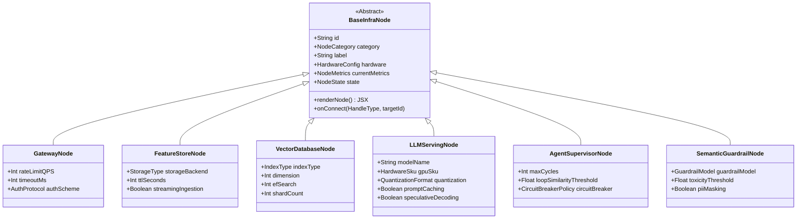
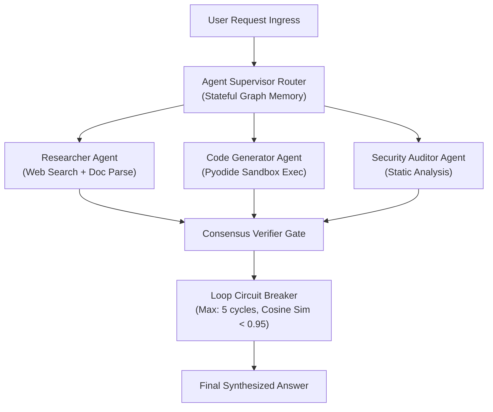
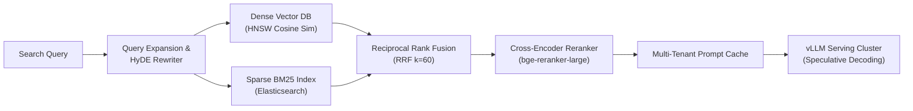
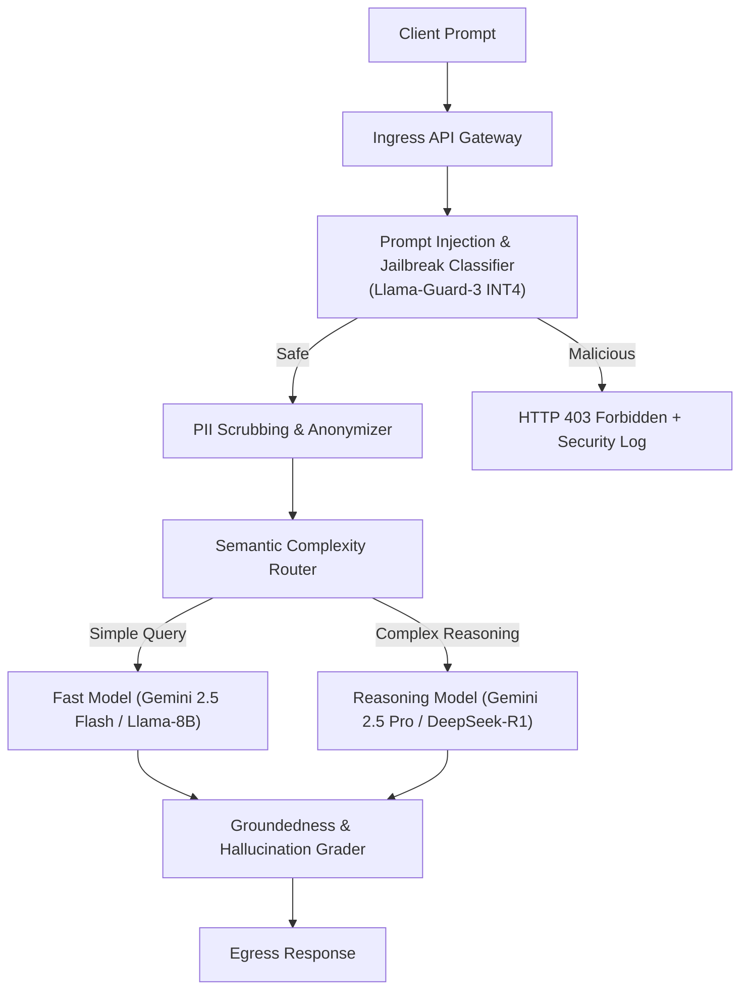
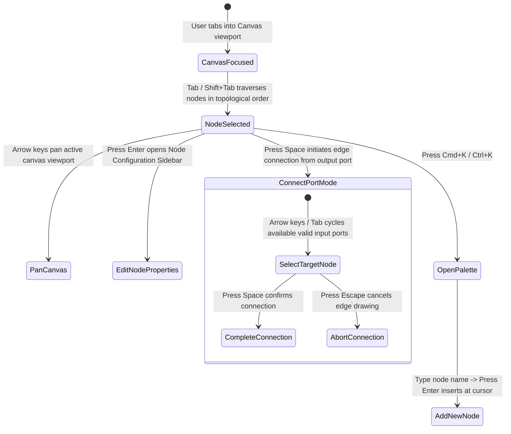

# Detailed Design: 04 - Canvas & UI Component System

## 1. Executive Summary & Design Vision

The **2026 ML System Design Platform** features an interactive, high-performance UI system designed for complex systems modeling and real-time operations training:
1. **Interactive Architecture Canvas**: A drag-and-drop workspace where users compose cutting-edge machine learning topologies (Feature Stores, Vector DBs, vLLM Clusters, Semantic Routers, and Agent Graphs).
2. **60 FPS Real-Time Telemetry & Grafana Profiler**: A high-frequency observability console rendering live flame graphs, attention head distributions, and queue depth metrics using WebGL2/Canvas2D decoupled from React's DOM rendering cycle.
3. **Comprehensive Accessibility (WCAG 2.1 AA/AAA)**: Full keyboard navigability across the infinite canvas, high-contrast visual themes, screen-reader live announcements, and colorblind-safe visual encodings.

---

## 2. Canvas Architecture & Node Topology

The canvas is constructed on **React Flow (v12)** extended with customized WebGL overlays for edge particle flow and real-time hardware telemetry badges.



### 2.1 Custom Node Specifications & Visual Indicators

Each node displays critical live telemetry badges updated via the background Web Worker:

```text
┌──────────────────────────────────────────────────────────────────┐
│  [icon] vLLM Cluster (Llama-3-70B)             [STATUS: OPTIMAL] │
├──────────────────────────────────────────────────────────────────┤
│  Hardware: 4x NVIDIA H100 SXM (80GB)       Quantization: INT4    │
│  Util: [██████████░░] 74%                  VRAM: 61.2 / 80 GB    │
├──────────────────────────────────────────────────────────────────┤
│  TTFT: 68 ms        TPOT: 12.4 ms/tok      Cost: $12.80/hr       │
│  Speculative Decoding: ACTIVE (1.8x)       Prompt Cache: 82% HIT │
└──────────────────────────────────────────────────────────────────┘
```

#### Node State Visual Encoding

| State | Visual Border | Iconography | Telemetry Pulse | Screen Reader Tag (`aria-label`) |
| :--- | :--- | :--- | :--- | :--- |
| **OPTIMAL** | `#10B981` (Emerald Solid) | Checkmark | Stable $1\text{ Hz}$ glow | "Optimal performance. p99 latency 68ms." |
| **BOTTLENECK** | `#F59E0B` (Amber Dash) | Warning Triangle | Rapid $2\text{ Hz}$ flash | "Warning: Memory bandwidth saturated. Utilization 94%." |
| **OVERFLOW** | `#EF4444` (Crimson Double) | Exploding Zap | Strobe $4\text{ Hz}$ | "Critical: Queue drop detected. Requests rejected." |
| **CHAOS_TRIGGERED** | `#8B5CF6` (Purple Neon) | Biohazard / Skull | Alternating glitch | "Chaos fault injected: 40% latency degradation active." |

---

## 3. High-Frequency Telemetry Pipeline ($60\text{ FPS}$ Profiler)

Rendering complex time-series charts, flame graphs, and queue telemetry at $60\text{ FPS}$ ($16.6\text{ ms}$ per frame) will cause severe frame drops if processed through React state updates (`useState` / `useEffect`). 

### 3.1 OffscreenCanvas & WebGL Architecture

```mermaid
graph TD
    subgraph Compute_Worker["Telemetry Stream Worker (Web Worker)"]
        MetricRing["Float32Array Circular Ring Buffer\n(Capacity: 10,000 samples)"]
        TickLoop["16.6ms High-Resolution Interval (requestAnimationFrame emulation)"]
        TickLoop --> MetricRing
    end

    subgraph DOM_Thread["Main UI Thread"]
        CanvasContainer["HTML5 <canvas> Container Element"]
        ReactUI["React 19 Shell (Zero Re-render overhead)"]
    end

    subgraph GPU_Render["OffscreenCanvas Worker Context"]
        OffscreenTarget["OffscreenCanvas Context (WebGL2 / 2D)"]
        ShaderEngine["Custom WebGL Instanced Line Shaders"]
        FlameGraphEngine["Canvas2D Flame Chart Painter"]
    end

    CanvasContainer -.->|transferControlToOffscreen()| OffscreenTarget
    Compute_Worker <-->|SharedArrayBuffer / Zero-Copy Transferable| GPU_Render
    GPU_Render -->|Direct GPU Blit @ 60 FPS| CanvasContainer
```

### 3.2 Metric Ring Buffer Implementation

The telemetry engine stores metrics in fixed-size typed arrays, completely avoiding garbage collection overhead:

```typescript
export class TelemetryRingBuffer {
  private readonly buffer: Float32Array;
  private head: number = 0;
  private readonly capacity: number;

  constructor(capacity: number = 3600) { // 60 seconds @ 60 FPS
    this.capacity = capacity;
    this.buffer = new Float32Array(capacity);
  }

  public push(value: number): void {
    this.buffer[this.head] = value;
    this.head = (this.head + 1) % this.capacity;
  }

  public getRawBuffer(): Float32Array {
    return this.buffer;
  }

  public getHeadIndex(): number {
    return this.head;
  }
}
```

### 3.3 Operations Dashboard (Grafana/Prometheus Emulation)

The UI features a toggleable **"Ops Console"** tab that renders four simultaneous telemetry panels:
1. **End-to-End Latency Waterfall ($p50, p90, p99$)**: Multi-line continuous chart with threshold alert zones ($>180\text{ ms}$ red-line).
2. **LLM Serving Flame Graph**: Interactive breakdown of request lifecycle: Network $\rightarrow$ Tokenization $\rightarrow$ KV Cache Fetch $\rightarrow$ Prefill TTFT $\rightarrow$ Autoregressive Decode $\rightarrow$ Guardrail Validation.
3. **GPU VRAM & Attention Head Fragmentation**: Memory chunk allocation visualizer showing active context allocations vs. fragmented holes.
4. **Dead-Letter Queue (DLQ) & Circuit Breaker Depths**: Event stream showing rejected payloads and backpressure indicators.

---

## 4. Pre-Built Architecture Templates

The canvas provides three pre-configured production templates accessible via the template picker:

### 4.1 Template 1: Multi-Agent Orchestration Network



### 4.2 Template 2: Enterprise Hybrid Search RAG



### 4.3 Template 3: LLM Guardrail & Safety Routing



---

## 5. Accessibility Engine (WCAG 2.1 AA/AAA)

To ensure the complex visual canvas is fully accessible to motor-impaired and visually-impaired engineers:

### 5.1 Keyboard Navigation State Machine



### 5.2 Colorblind-Safe Color Palette (Okabe-Ito Scheme)

All charts, nodes, and alerts strictly follow the **Okabe-Ito Colorblind-Safe Palette**:

| Function | Hex Code | Okabe-Ito Swatch Name | Accessible Contrast Ratio (vs #0F172A) |
| :--- | :--- | :--- | :--- |
| **Healthy / Success** | `#009E73` | Bluish Green | $7.8 : 1$ (AAA Compliant) |
| **Warning / Bottleneck**| `#E69F00` | Orange | $8.2 : 1$ (AAA Compliant) |
| **Critical / Error** | `#D55E00` | Vermilion | $6.4 : 1$ (AA Compliant) |
| **Inference / Compute**| `#0072B2` | Blue | $5.9 : 1$ (AA Compliant) |
| **Storage / DB** | `#F0E442` | Yellow | $12.5 : 1$ (AAA Compliant) |
| **Agent / Router** | `#CC79A7` | Reddish Purple | $6.8 : 1$ (AA Compliant) |

### 5.3 Screen Reader Live Regions (`aria-live`)

Whenever the deterministic Web Worker completes a simulation delta, changes are announced via dedicated polite live regions:

```html
<div 
  id="a11y-live-region" 
  aria-live="polite" 
  aria-atomic="true" 
  class="sr-only"
>
  Swapped Batch Prediction for Streaming Inference. p99 latency decreased to 84 milliseconds. Monthly cost increased to $4,250.
</div>
```

---

## 6. Implementation Code Contracts

```typescript
// src/components/canvas/CanvasKeyboardManager.tsx

import React, { useEffect } from 'react';
import { useReactFlow } from 'reactflow';
import { useZustandStore } from '../../core/state/store';

export const CanvasKeyboardManager: React.FC = () => {
  const { getNodes, setNodes, getEdges, addEdges } = useReactFlow();
  const selectNextNode = useZustandStore((state) => state.selectNextNode);

  useEffect(() => {
    const handleKeyDown = (e: KeyboardEvent) => {
      if (e.target instanceof HTMLInputElement || e.target instanceof HTMLTextAreaElement) {
        return; // Do not intercept typing inside form controls
      }

      if (e.key === 'Tab') {
        e.preventDefault();
        selectNextNode(e.shiftKey ? 'PREVIOUS' : 'NEXT');
      } else if (e.key === 'k' && (e.metaKey || e.ctrlKey)) {
        e.preventDefault();
        useZustandStore.getState().openCommandPalette();
      }
    };

    window.addEventListener('keydown', handleKeyDown);
    return () => window.removeEventListener('keydown', handleKeyDown);
  }, [selectNextNode]);

  return null;
};
```

---

## 7. Next Steps

- Proceed to [05_interview_chaos_and_case_study_subsystems.md](file:///home/somesh/git_repos/ml-sys-design/documentation/design/detailed/05_interview_chaos_and_case_study_subsystems.md) for the AI Interview Simulator, Chaos Monkey Engine, and Gemini Argon Adversarial Reviewer.
