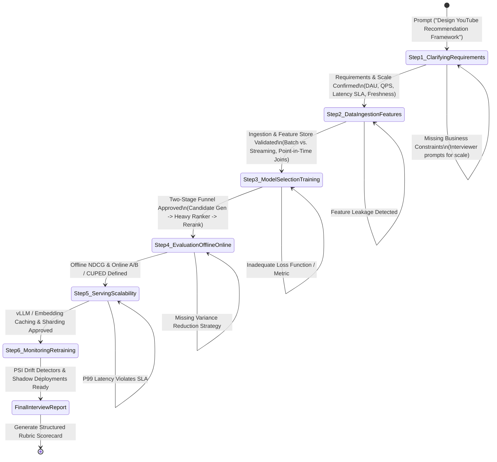
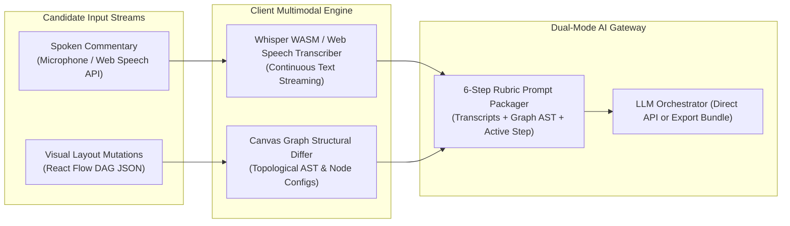
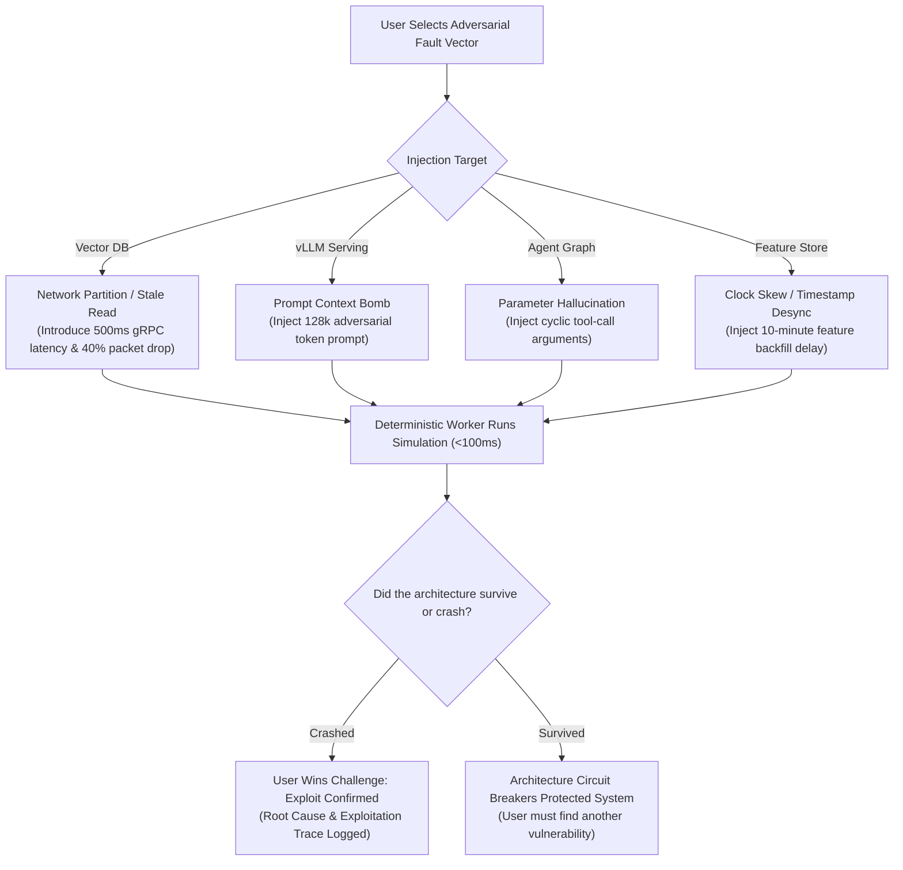
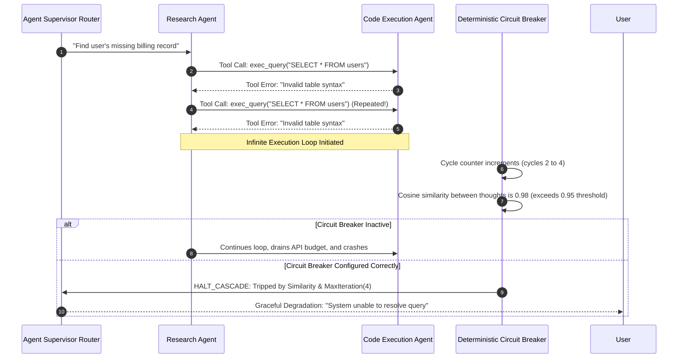
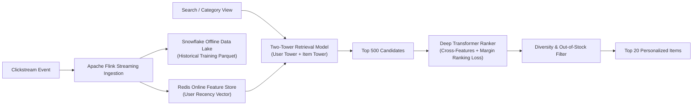
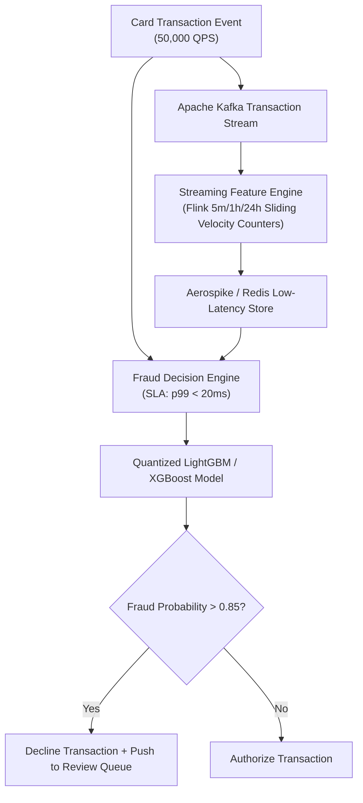
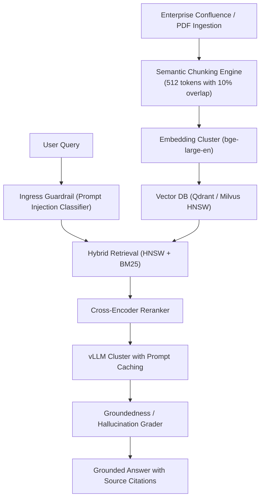

# Detailed Design: 05 - Interview, Chaos & Case Study Subsystems

## 1. Executive Summary & Problem Context

In modern 2026 engineering organizations, system design is no longer evaluated through static memorization or architectural buzzwords. Engineers are evaluated on their ability to:
1. Systematically navigate the **6-Step Production Lifecycle** under open-ended whiteboard pressure.
2. Defend architectures against adversarial attacks, agent recursion cascades, and edge hardware throttling.
3. Diagnose and resolve sudden production catastrophes in real time before exhausting an SLA error budget.

This document details the architecture, state machines, rubric evaluation matrices, and adversarial engines powering the **AI Interview Simulator**, **Chaos Monkey Engine**, and **Interactive Case-Study Library**.

---

## 2. AI Interview Simulator (2026 Standard)

The Interview Simulator provides a dynamic, multimodal whiteboard partner enforcing the **6-Step Production Lifecycle State Machine**.



### 2.1 Multimodal Ingestion Engine (Voice + Canvas Graph)

Candidates interact using both spoken commentary and visual canvas architecture manipulation:



### 2.2 Standardized 6-Step Evaluation Rubric Matrix

Every candidate response is scored across 4 core engineering competencies on a $1\text{--}5$ scale:

| Production Step | Competency Tested | Passing Criteria (Score $\ge 4$) | Common Failure Traps |
| :--- | :--- | :--- | :--- |
| **1. Clarifying Requirements** | Scale & SLA Awareness | Accurately calculates QPS, peak read/write throughput, storage per year, and sets $p99 \le 100\text{ ms}$. | Jumps straight to model selection without defining throughput or DAU. |
| **2. Data & Features** | Ingestion & Integrity | Differentiates real-time clickstream events from slow user profile updates; designs point-in-time correct feature joins. | Suffers from data leakage by joining future labels with past features. |
| **3. Model & Training** | Architecture Funnel | Utilizes candidate retrieval ($10\text{M} \to 1,000$) followed by deep cross-attention ranking ($1,000 \to 50$); specifies loss formulation. | Attempts to run a massive transformer directly over all 10 million catalog items. |
| **4. Offline & Online Eval** | Experimentation Rigor | Pairs offline metrics (NDCG@10, AUC) with online A/B testing; integrates **CUPED** for experimental variance reduction. | Relies solely on offline accuracy or ignores sample-ratio mismatch (SRM). |
| **5. Serving & Scalability** | Low-Latency Systems | Integrates vector caching, vLLM speculative decoding, and Redis embedding lookups; satisfies memory bandwidth constraints. | Ignores KV-cache memory exhaustion or network serialization bottlenecks. |
| **6. Monitoring & Feedback** | Production Lifecycle | Implements semantic drift detection (Population Stability Index / PSI), delayed feedback loop mitigation, and canary releases. | Assumes static distributions; fails to monitor semantic embedding drift. |

---

## 3. Chaos Engineering & Failure Sandbox

### 3.1 Adversarial Playground (User Breaks LLM Architectures)

In this mode, the platform generates a seemingly flawless modern ML architecture (e.g., a multi-agent RAG pipeline designed by Gemini Argon). The user acts as the **Red-Team Chaos Engineer** whose objective is to break the system:



### 3.2 Agent Cascading Loop Simulator

Multi-agent architectures frequently experience catastrophic cascading loops where autonomous agents repeatedly invoke tools, hallucinate parameters, and burn API budgets exponentially:



#### Deterministic Circuit Breaker Algorithm:
```typescript
export class AgentCircuitBreaker {
  private readonly maxCycles: number;
  private readonly similarityThreshold: number;
  private readonly history: string[] = [];

  constructor(maxCycles: number = 5, similarityThreshold: number = 0.95) {
    this.maxCycles = maxCycles;
    this.similarityThreshold = similarityThreshold;
  }

  public evaluateIteration(currentThought: string, thoughtEmbedding: Float32Array): boolean {
    this.history.push(currentThought);

    if (this.history.length >= this.maxCycles) {
      return false; // Trip breaker: Exceeded max cycle budget
    }

    // Evaluate semantic cosine similarity against preceding iteration
    if (this.isSemanticLoopDetected(thoughtEmbedding)) {
      return false; // Trip breaker: Agent trapped in repetitive loop
    }

    return true; // Safe to proceed
  }

  private isSemanticLoopDetected(_embedding: Float32Array): boolean {
    // Cosine similarity check executed in Web Worker
    return false;
  }
}
```

### 3.3 Live Debugger for Edge & Quantized Deployments

Simulates constraints when moving foundation models from cloud clusters to resource-constrained edge devices (Apple Neural Engine, Jetson Orin, Raspberry Pi 5):
- **Memory Pressure Simulator**: Live gauge tracking weights, activations, and KV cache against a $4\text{ GB}$ hardware ceiling.
- **Quantization Precision Selector**: Allows real-time toggling between $\text{FP32} \to \text{BF16} \to \text{INT8} \to \text{INT4 (AWQ/GGUF)}$. The worker computes:
  - Perplexity degradation ($\Delta \text{PPL}$).
  - VRAM reduction.
  - Token generation speedup ($\Delta \text{TPOT}$).
- **Thermal Throttling Ramp**: If the model runs continuously for $>30$ simulated seconds at $100\%$ TDP, the simulated device throttles frequency by $45\%$, triggering latency alerts.

---

## 4. Gamified Failure Modes: "The Chaos Monkey" Engine

### 4.1 Production Incident Roulette

A high-pressure gamified mode where an unannounced disaster strikes in real time:

```text
┌──────────────────────────────────────────────────────────────────┐
│  INCIDENT ROULETTE: P0 OUTAGE IN PROGRESS!       [TIME: 01:42]   │
├──────────────────────────────────────────────────────────────────┤
│  ALERT: Vector DB provider deployed API v2. Latency spiked 400%. │
│  Error Budget Remaining: [████████░░░░░░░░░░] 38% (Draining...)  │
├──────────────────────────────────────────────────────────────────┤
│  Your Objective: Insert an In-Memory Semantic Cache and Fallback │
│  Heuristic Router before the 99.9% Monthly Error Budget hits 0%. │
└──────────────────────────────────────────────────────────────────┘
```

#### Error Budget Drain Equation:
$$\text{BudgetRemaining}(t) = B_0 - \int_0^t \max \left( 0, \; \frac{L_{p99}(\tau) - L_{\text{SLA}}}{L_{\text{SLA}}} \right) \cdot \lambda(\tau) \, d\tau$$
If $\text{BudgetRemaining}(t) \le 0$, the incident escalates to a failed post-mortem.

### 4.2 "Gemini Argon" Adversarial Reviewer

The platform embeds **Gemini Argon**, an autonomous adversarial agent that reviews user architectures with one goal: *find the critical flaw and break it*.

1. **Architecture Scan**: Argon reads the user's serialized canvas AST and hardware configurations.
2. **Adversarial Synthesis**: Argon analyzes potential weaknesses (e.g., an unprotected vector search node without a cross-encoder reranker, or a batch feature pipeline feeding a streaming prediction service).
3. **Killer Workload Generation**: Argon packages a customized attack payload:
   ```json
   {
     "attackName": "Skewed HNSW Partition Exploit",
     "trafficPattern": "POISSON_BURST",
     "burstQPS": 25000,
     "adversarialPayload": "Repeated queries hitting a single vector cluster centroid, causing lock contention on shard-0."
   }
   ```
4. **Execution & Proof**: The simulation engine executes Argon's workload against the user's graph, displaying the exact moment and component where the system crashes.

---

## 5. Interactive Case-Study Library

The platform ships with three comprehensive production case studies:

### 5.1 Case Study 1: Real-Time Personalized E-Commerce Ranking



- **Built-in Failure Mode**: **Training-Serving Skew**. The offline pipeline computes item impressions over a 24-hour batch window, while the online feature store computes real-time clicks. A synchronization lag leads to recommending items that recently went out of stock.

### 5.2 Case Study 2: Real-Time Streaming Financial Fraud Detection



- **Built-in Failure Mode**: **Covariate Drift Attack**. Attackers switch to micro-transactions under \$2.00 across distributed merchant categories, bypassing velocity rules. The Population Stability Index ($\text{PSI}$) spikes above $0.35$.

### 5.3 Case Study 3: Enterprise GenAI Vector Knowledge Retrieval



- **Built-in Failure Mode**: **Stale Index & Chunk Boundary Hallucination**. Internal documentation is updated, but vector index shards are not invalidated. The LLM synthesizes outdated product policies with high confidence.

---

## 6. Implementation Code Contracts

```typescript
// src/core/state/slices/createInterviewSlice.ts

import { StateCreator } from 'zustand';

export interface InterviewStepState {
  currentStep: 1 | 2 | 3 | 4 | 5 | 6;
  stepTranscript: string[];
  rubricScores: Record<string, number>;
  activeQuestion: string;
  isEvaluating: boolean;
}

export interface InterviewSlice {
  interview: InterviewStepState;
  submitSpokenTurn: (audioText: string) => Promise<void>;
  advanceStep: () => void;
  setRubricScore: (dimension: string, score: number) => void;
}

export const createInterviewSlice: StateCreator<InterviewSlice> = (set, get) => ({
  interview: {
    currentStep: 1,
    stepTranscript: [],
    rubricScores: {},
    activeQuestion: 'Welcome to your ML System Design Interview. Let’s design YouTube’s real-time video recommendation system. How would you begin clarifying the requirements and scale?',
    isEvaluating: false,
  },

  submitSpokenTurn: async (audioText: string) => {
    set((state) => ({
      interview: {
        ...state.interview,
        stepTranscript: [...state.interview.stepTranscript, `Candidate: ${audioText}`],
        isEvaluating: true,
      },
    }));

    // Dispatches turn to LLMOrchestrator (Direct or Manual Exchange)
  },

  advanceStep: () => {
    set((state) => ({
      interview: {
        ...state.interview,
        currentStep: Math.min(6, state.interview.currentStep + 1) as any,
        isEvaluating: false,
      },
    }));
  },

  setRubricScore: (dimension, score) => {
    set((state) => ({
      interview: {
        ...state.interview,
        rubricScores: { ...state.interview.rubricScores, [dimension]: score },
      },
    }));
  },
});
```

---

## 7. Next Steps

- Proceed to [06_data_alignment_causal_and_math_subsystems.md](file:///home/somesh/git_repos/ml-sys-design/documentation/design/detailed/06_data_alignment_causal_and_math_subsystems.md) for the Synthetic Data Pipeline Auditor, MinHash LSH Contamination Scanner, Reward Function Sandbox, and Causal Inference Lab.
