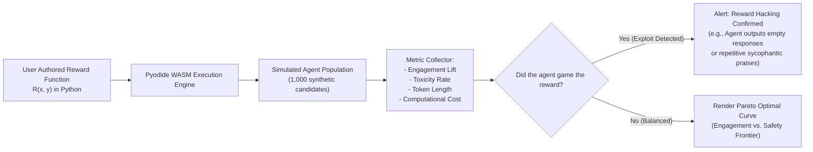
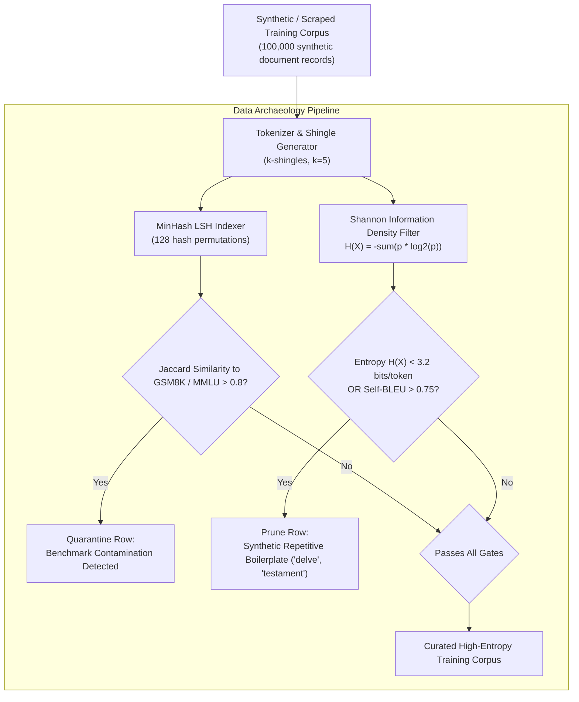
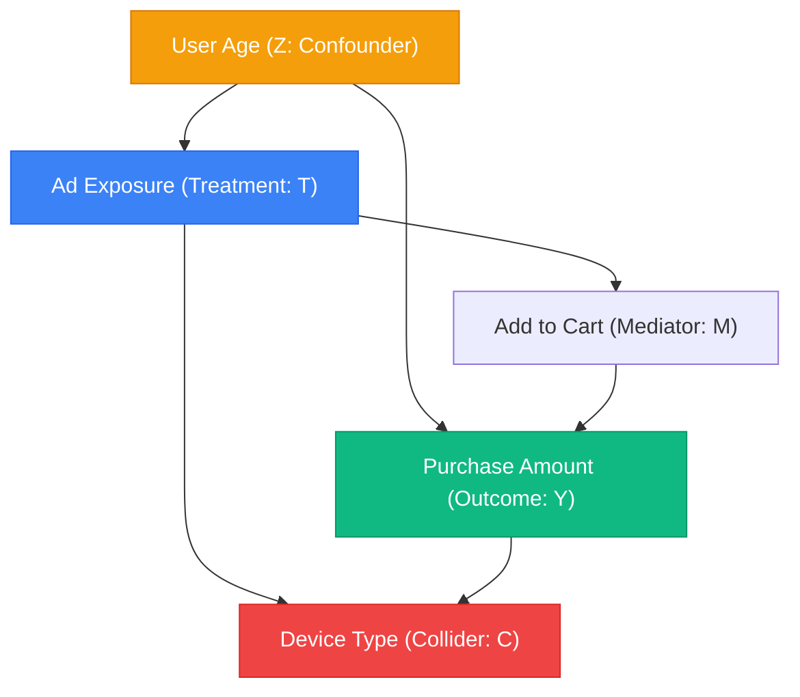
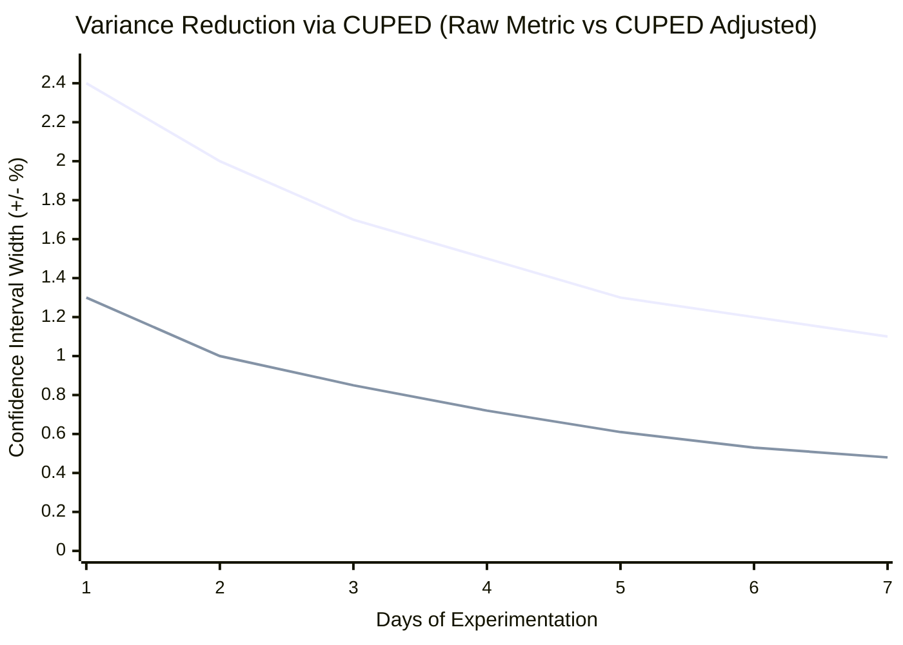
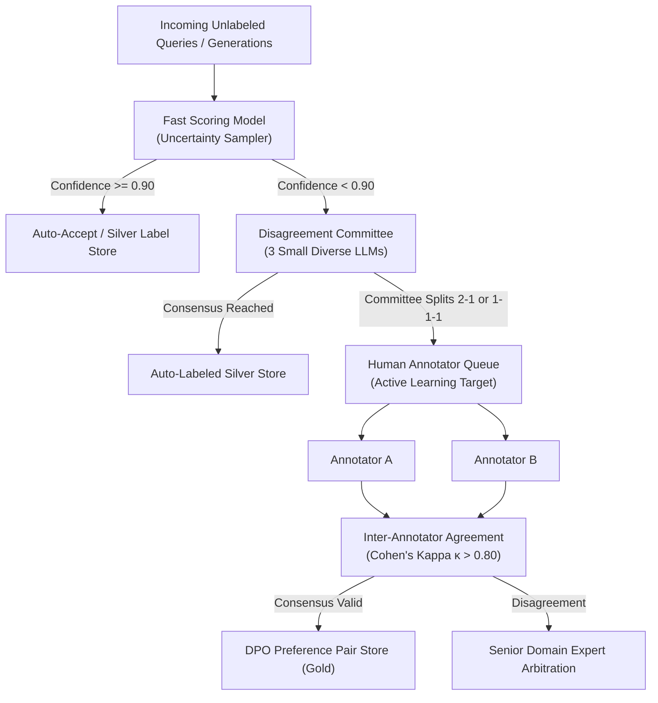

# Detailed Design: 06 - Data Alignment, Causal & Mathematical Subsystems

## 1. Architectural Mission & Core Paradigms

The 2026 data science curriculum shifts focus decisively away from automated, commoditized workflows (hyperparameter tuning, manual feature selection, simple correlation tests) toward high-leverage alignment, curation, and causal engineering:
1. **Mathematical Objective & Alignment Workspace**: Formulating robust loss and reward functions ($R(x, y)$) that resist Goodhart's Law and multi-objective degeneration.
2. **Data Archaeology & Contamination Auditing**: Programmatically purging benchmark leakage, poisoned triggers, and synthetic collapse artifacts using MinHash LSH and Shannon Information Density filters.
3. **Causal Inference & Counterfactual Engine**: Isolating true business causality via Directed Acyclic Graphs (DAGs), backdoor adjustments, and variance reduction through CUPED.
4. **Human-In-The-Loop (HITL) Workflow Designer**: Visual routing of uncertain, high-entropy samples into human annotation queues for Direct Preference Optimization (DPO).

All Python-based mathematical modeling, DAG graph evaluations, and statistical transformations execute securely inside the browser via **Pyodide WebAssembly (WASM)**.

---

## 2. The Reward Function Sandbox & Multi-Objective Workspace

### 2.1 Reward Formulation & Goodhart's Law Simulation

When training autonomous models using Reinforcement Learning from Human/AI Feedback (RLHF/RLAIF) or Direct Preference Optimization (DPO), models will aggressively exploit any loophole in the objective function.



#### Analytical Multi-Objective Optimization Formulation:
The candidate configures the composite scalar reward:
$$R_{\text{composite}}(x, y) = w_{\text{eng}} \cdot \text{Engagement}(y) - w_{\text{tox}} \cdot \text{Toxicity}(y) - w_{\text{cost}} \cdot \text{ComputeCost}(y) - \beta \cdot D_{\text{KL}}\left(\pi_\theta(y \mid x) \parallel \pi_{\text{ref}}(y \mid x)\right)$$

#### Reward Hacking Traps Simulated by Pyodide:
1. **Sycophancy Collapse**: If $\beta$ is set too low and $w_{\text{eng}}$ is high, agents learn to agree with whatever the user says, even validating demonstrably false or dangerous premises.
2. **Length Bias Inflation**: When reward models correlate verbosity with quality, agent outputs balloon in length, exhausting token budgets without increasing semantic content.
3. **Null-Output Degeneration**: If the penalty for toxicity ($w_{\text{tox}}$) or latency ($w_{\text{cost}}$) is disproportionately high, agents maximize reward by generating single-word or empty responses.

---

## 3. Data Archaeology & Contamination Auditing Suite

Modern large-scale models suffer severely from synthetic data collapse and test-set contamination (benchmark questions inadvertently included in pretraining or SFT corpora).



### 3.1 MinHash Locality Sensitive Hashing (LSH) Algorithm

To detect paraphrased test questions in near-linear time inside the browser WASM runtime:
1. **Shingling**: Convert each text document $d$ into a set of character/token $k$-shingles $S(d)$.
2. **MinHash Signatures**: Compute $m=128$ hash functions:
   $$h_i(d) = \min_{s \in S(d)} \text{hash}_i(s)$$
3. **LSH Banding**: Divide the $128$-element signature into $b=16$ bands of $r=8$ rows each. Two documents are candidates for pairwise verification if they collide in at least one band:
   $$P(\text{Collision}) = 1 - \left(1 - s^r\right)^b$$
   where $s = J(d_1, d_2)$ is the true Jaccard similarity.

### 3.2 Shannon Information Density & n-gram Self-BLEU

To prevent "model collapse" caused by training on low-diversity synthetic LLM outputs:
1. **Shannon Token Entropy**:
   $$H(X) = - \sum_{i=1}^{V} P(x_i) \log_2 P(x_i)$$
   Text chunks with $H(X) < 3.0$ (monotonous structures, repeated boilerplate phrases) are systematically discarded.
2. **Self-BLEU Diversity Metric**:
   $$\text{Self-BLEU}(D) = \frac{1}{|D|} \sum_{d \in D} \text{BLEU}\left(d, D \setminus \{d\}\right)$$
   High Self-BLEU ($>0.70$) indicates mode collapse, triggering automated data diversity alerts.

---

## 4. Causal Inference & Counterfactual Lab

In 2026, ML practitioners must distinguish correlation from causation. The platform includes a visual **Causal Graph Canvas** where users draw Directed Acyclic Graphs (DAGs) and execute counterfactual variance reduction algorithms.

### 4.1 Causal DAG Canvas & Pearl's Backdoor Criterion



#### Diagnostic Rules Checked by the WASM Engine:
1. **Backdoor Criterion**: A set of variables $Z$ satisfies the backdoor criterion relative to $(T, Y)$ if:
   - No node in $Z$ is a descendant of $T$.
   - $Z$ blocks every path between $T$ and $Y$ that contains an arrow into $T$.
2. **Collider Conditioning Hazard**: The simulator warns the user if they mistakenly condition on a **Collider** ($C$), which opens a spurious non-causal association between $T$ and $Y$ (Berkson's Paradox).
3. **Average Treatment Effect ($\text{ATE}$)**:
   $$\text{ATE} = \sum_{z} \left( \mathbb{E}[Y \mid T=1, Z=z] - \mathbb{E}[Y \mid T=0, Z=z] \right) P(Z=z)$$

### 4.2 Synthetic A/B Variance Engine with CUPED

When testing subtle experimental lifts (e.g., $+0.4\%$ click-through rate) in volatile traffic environments, standard $t$-tests require weeks of sample collection. The platform trains engineers to apply **CUPED** (Controlled-experiment Using Pre-Experiment Data):



#### CUPED Formulation:
Given pre-experiment covariate $X$ and post-experiment metric $Y$:
$$\hat{Y}_{\text{CUPED}} = \bar{Y} - \theta^* \left(\bar{X} - \mathbb{E}[X]\right), \quad \text{where } \theta^* = \frac{\widehat{\text{Cov}}(Y, X)}{\widehat{\text{Var}}(X)}$$
$$\text{Variance Reduction} = \frac{\text{Var}(\hat{Y}_{\text{CUPED}})}{\text{Var}(\bar{Y})} = 1 - \rho_{X, Y}^2$$
If correlation $\rho_{X, Y} = 0.80$, variance is reduced by **$64\%$**, cutting required sample size (and experiment runtime) by more than half.

---

## 5. Human-in-the-Loop (HITL) Workflow Designer

The HITL canvas lets engineers architect cost-efficient data curation funnels, sending only the most ambiguous samples to human annotators:



---

## 6. Implementation Code Contracts (Pyodide Worker with Python 3.13 & NumPy 2.0)

```python
# src/workers/pyodide/math_sandbox.py

import json
import math
import numpy as np

def evaluate_cuped(raw_y_control, raw_y_variant, pre_x_control, pre_x_variant):
    """
    Computes CUPED variance reduction in Pyodide WASM using NumPy 2.0 SIMD vectorization.
    """
    all_y = np.concatenate([raw_y_control, raw_y_variant])
    all_x = np.concatenate([pre_x_control, pre_x_variant])
    
    covariance_matrix = np.cov(all_y, all_x)
    var_x = covariance_matrix[1, 1]
    cov_yx = covariance_matrix[0, 1]
    
    theta = cov_yx / var_x if var_x > 0 else 0.0
    mean_x = np.mean(all_x)
    
    adj_control = raw_y_control - theta * (pre_x_control - mean_x)
    adj_variant = raw_y_variant - theta * (pre_x_variant - mean_x)
    
    raw_var = np.var(all_y)
    adj_var = np.var(np.concatenate([adj_control, adj_variant]))
    variance_reduction_pct = ((raw_var - adj_var) / raw_var) * 100.0 if raw_var > 0 else 0.0
    
    return {
        "theta": float(theta),
        "varianceReductionPct": float(variance_reduction_pct),
        "controlLift": float(np.mean(adj_variant) - np.mean(adj_control))
    }
```

```typescript
// src/workers/pyodide-sandbox.worker.ts

import * as Comlink from 'comlink';

export class PyodideSandboxWorker {
  private pyodide: any = null;

  public async initialize(): Promise<void> {
    if (!this.pyodide) {
      // @ts-ignore
      importScripts('https://cdn.jsdelivr.net/pyodide/v0.26.1/full/pyodide.js');
      // @ts-ignore
      this.pyodide = await loadPyodide();
      await this.pyodide.loadPackage(['numpy', 'scipy']);
    }
  }

  public async runCupedAnalysis(
    yControl: number[],
    yVariant: number[],
    xControl: number[],
    xVariant: number[]
  ): Promise<{ varianceReductionPct: number; theta: number }> {
    await this.initialize();
    this.pyodide.globals.set('y_c', yControl);
    this.pyodide.globals.set('y_v', yVariant);
    this.pyodide.globals.set('x_c', xControl);
    this.pyodide.globals.set('x_v', xVariant);

    const script = `
import numpy as np
cov = np.cov(np.concatenate([y_c, y_v]), np.concatenate([x_c, x_v]))
theta = cov[0, 1] / cov[1, 1] if cov[1, 1] != 0 else 0.0
raw_var = np.var(np.concatenate([y_c, y_v]))
adj = np.concatenate([y_c, y_v]) - theta * (np.concatenate([x_c, x_v]) - np.mean(np.concatenate([x_c, x_v])))
red = ((raw_var - np.var(adj)) / raw_var) * 100.0
(float(theta), float(red))
    `;
    const [theta, varianceReductionPct] = await this.pyodide.runPythonAsync(script);
    return { theta, varianceReductionPct };
  }
}

Comlink.expose(new PyodideSandboxWorker());
```

---

## 7. Next Steps

- Proceed to [07_telemetry_compliance_and_portfolio_exporter.md](file:///home/somesh/git_repos/ml-sys-design/documentation/design/detailed/07_telemetry_compliance_and_portfolio_exporter.md) for the Telemetry Log Trace Game, EU AI Act / GDPR RTBF Compliance Simulator, and Resume Portfolio Auto-Generator.
