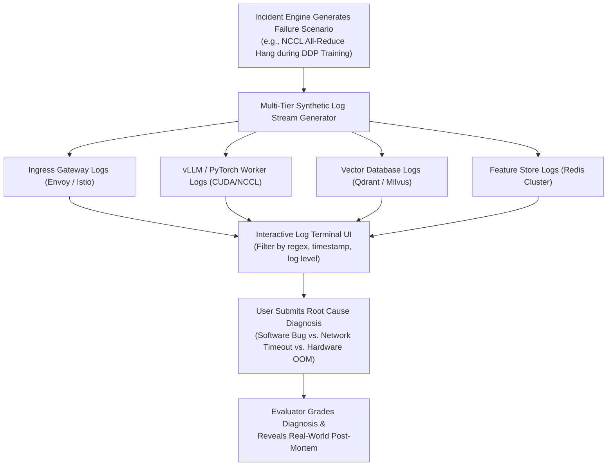
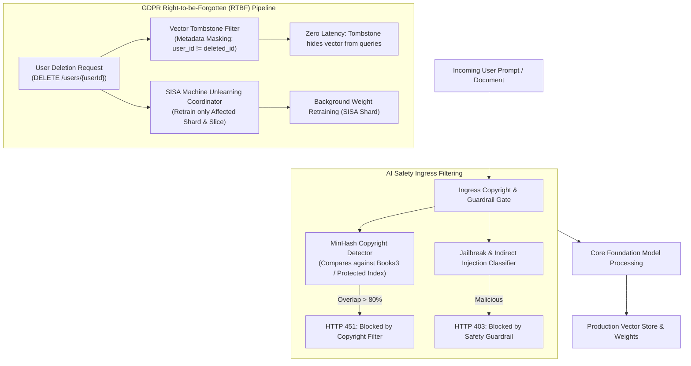
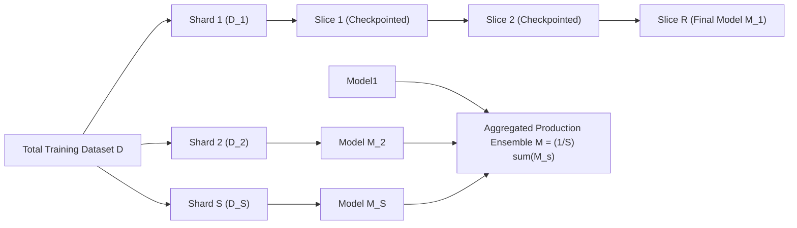
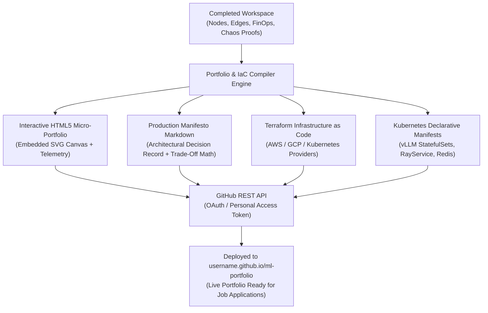

# Detailed Design: 07 - Telemetry, Compliance & Portfolio Exporter

## 1. Executive Summary & Problem Scope

This document specifies the operational telemetry, legal compliance, and career translation systems of the platform:
1. **Telemetry & Log Trace Analysis Game**: Training engineers to diagnose production incidents from realistic, messy multi-tier log traces (CUDA Out-Of-Memory, NCCL ring deadlocks, gRPC timeouts, and vector shard starvation).
2. **Regulatory, Compliance & AI Safety Simulator**: Engineering data pipelines that enforce the **EU AI Act**, **GDPR Right-to-be-Forgotten (RTBF)** via Machine Unlearning (SISA) and Vector Tombstoning, and Copyright / Prompt Injection filters.
3. **Interactive Resume-Builder & Portfolio Exporter**: Compiling visual canvas designs and simulation benchmarks into publication-ready **Production Manifestos**, **Terraform HCL ASTs**, **Kubernetes Manifests**, and deploying them directly to **GitHub Pages** via the GitHub REST API.

---

## 2. Telemetry & Log Trace Analysis Game

Modern ML engineers spend a large portion of on-call shifts debugging distributed failures. The **Log Trace Analysis Game** generates raw, multi-system log streams with realistic noise, clock drifts, and concurrency races.



### 2.1 Example Synthetic Crash Log Stream (CUDA OOM vs. gRPC Timeout)

Below is an authentic synthetic log snippet generated for a distributed pipeline failure:

```text
2026-10-30T03:14:02.104Z [gateway-prod-7b8f] INFO  ingress.router - Incoming batch QPS: 14,200. Dispatching to cluster-pool-gpu-a.
2026-10-30T03:14:02.189Z [vllm-worker-node-03] DEBUG vllm.engine.scheduler - Total KV blocks free: 142 / 16384 (Critical threshold: 256)
2026-10-30T03:14:02.215Z [vllm-worker-node-03] WARN  vllm.engine.scheduler - Preemption triggered: Evicting sequence req_901a to host RAM.
2026-10-30T03:14:02.390Z [vllm-worker-node-03] ERROR torch.distributed - [Rank 3] ProcessGroupNCCL: Work timeout after 10000ms.
2026-10-30T03:14:02.391Z [vllm-worker-node-03] ERROR torch.distributed - [Rank 3] Call stack:
   File "/opt/vllm/model_runner.py", line 412, in execute_model
     hidden_states = self.tp_all_reduce(hidden_states)
   RuntimeError: CUDA out of memory. Tried to allocate 4.20 GiB (GPU 3; 79.15 GiB total capacity; 75.82 GiB already allocated).
2026-10-30T03:14:02.401Z [gateway-prod-7b8f] ERROR ingress.proxy - Upstream connection reset by peer. gRPC status: UNAVAILABLE (code: 14)
```

### 2.2 Diagnostic Classification Taxonomies

The user must correctly identify:
1. **Primary Failure Class**: `CUDA_OOM`, `NCCL_RING_DEADLOCK`, `KV_CACHE_STARVATION`, `STALE_EMBEDDING_INDEX`, or `NETWORK_PARTITION`.
2. **Triggering Component**: Exact node ID where the fault originated.
3. **Correct Remediation Command**: (e.g., *Enable Chunked Prefill & PagedAttention v2* or *Increase NCCL_ASYNC_ERROR_HANDLING=1*).

---

## 3. Regulatory, Compliance & AI Safety Simulator

In 2026, building architectures that are merely fast and cost-effective is insufficient; systems must satisfy stringent legal mandates.



### 3.1 Machine Unlearning via SISA (Sharded, Isolated, Sliced, Aggregated)

When a user exercises their GDPR Article 17 "Right to be Forgotten", removing their data points from model parameters without full model retraining is achieved through the **SISA Architecture**:

$$D = \bigcup_{s=1}^S D_s, \quad \text{where each shard } D_s = \bigcup_{r=1}^R D_{s, r} \text{ is partitioned into } R \text{ slices}$$



#### Unlearning Protocol:
1. When deletion request arrives for record $x \in D_{s, r}$:
2. Only shard $s$ requires modification; all other $S-1$ shards remain untouched.
3. Shard $s$ rolls back to checkpoint $r-1$ and retrains slices $r, r+1, \dots, R$.
4. **Computational Savings**:
   $$\text{Compute Fraction} = \frac{1}{S} \cdot \frac{R - r + 1}{R} \ll 1.0$$
   For $S=10$ shards and $R=10$ slices, unlearning an average record requires only $\approx 5.5\%$ of full pretraining compute.

### 3.2 Vector DB Tombstoning vs. Hard Deletion

1. **Immediate Ingress Tombstoning ($<5\text{ ms}$)**:
   A metadata filter `deleted_at IS NULL` is injected into all HNSW / IVF vector search queries, immediately preventing deleted vectors from appearing in RAG contexts.
2. **Compaction & Graph Re-indexing**:
   During low-traffic maintenance windows, the vector engine performs a vacuum compact, re-building the HNSW graph edges without the tombstoned IDs to reclaim RAM and preserve clustering quality.

---

## 4. Interactive "Resume-Builder" Architecture Exporter

The platform turns classroom exercise into career leverage by exporting designs into production artifacts.



### 4.1 Production Manifesto Structure (`README.md`)

The auto-generated manifesto provides the engineering rationale for technical recruiters and hiring managers:
- **System Overview & Problem Statement**: Target throughput, latency SLA, and business objectives.
- **Hardware & FinOps Justification**: Detailed explanation of why specific GPUs/TPUs were chosen based on the **Roofline Model**, including monthly unit economics.
- **Trade-Off Decision Matrix**: Analytical comparison of batch vs. streaming inference, quantization tradeoffs ($\text{FP16}$ vs. $\text{INT4}$), and caching layers.
- **Chaos & Failure Resilience**: Proof of survivability under adversarial injections (Gemini Argon attacks, cascading agent loops).
- **Compliance Certification**: EU AI Act audit checklist and GDPR RTBF unlearning pipeline.

### 4.2 Auto-Generated Terraform HCL (`architecture.tf`)

The canvas AST compiles directly into reproducible Terraform infrastructure:

```hcl
# Auto-generated by 2026 ML System Design Platform
# Workspace: Enterprise Hybrid Search RAG

terraform {
  required_version = ">= 1.8.0"
  required_providers {
    kubernetes = {
      source  = "hashicorp/kubernetes"
      version = "~> 2.30"
    }
  }
}

# Node: vLLM Inference Cluster
resource "kubernetes_deployment_v1" "vllm_serving_cluster" {
  metadata {
    name = "vllm-llama3-70b-service"
    labels = {
      app = "vllm-serving"
      hardware = "nvidia-h100"
    }
  }
  spec {
    replicas = 4
    selector {
      match_labels = {
        app = "vllm-serving"
      }
    }
    template {
      metadata {
        labels = {
          app = "vllm-serving"
        }
      }
      spec {
        container {
          name  = "vllm-server"
          image = "vllm/vllm-openai:latest"
          args  = [
            "--model", "meta-llama/Meta-Llama-3-70B-Instruct",
            "--tensor-parallel-size", "4",
            "--quantization", "awq",
            "--max-model-len", "8192",
            "--enable-prefix-caching"
          ]
          resources {
            limits = {
              "nvidia.com/gpu" = "4"
              memory           = "128Gi"
              cpu              = "32"
            }
          }
          port {
            container_port = 8000
          }
        }
      }
    }
  }
}
```

### 4.3 GitHub REST API Deployment Engine

Users link their GitHub account to publish the static portfolio:

```typescript
// src/core/exporters/github-publisher.ts

export class GitHubPublisher {
  public async publishPortfolio(
    githubToken: string,
    repositoryName: string,
    manifestoContent: string,
    terraformContent: string,
    bundleHtml: string
  ): Promise<string> {
    const headers = {
      Authorization: `token ${githubToken}`,
      Accept: 'application/vnd.github.v3+json',
      'Content-Type': 'application/json',
    };

    // 1. Create or verify repository
    // 2. Commit README.md, architecture.tf, index.html via GitHub Git Database API
    // 3. Enable GitHub Pages on gh-pages branch
    
    return `https://${repositoryName.split('/')[0]}.github.io/${repositoryName.split('/')[1]}`;
  }
}
```

---

## 5. Implementation Code Contracts

```typescript
// src/schemas/portfolio-export-schema.ts

import { z } from 'zod';

export const ProductionManifestoSchema = z.object({
  portfolioTitle: z.string(),
  authorName: z.string(),
  generatedDate: z.string(),
  executiveSummaryMd: z.string(),
  hardwareAndUnitEconomicsMd: z.string(),
  failureResilienceManifestoMd: z.string(),
  complianceCertificationMd: z.string(),
  recommendedInterviewTalkingPoints: z.array(z.string()),
});

export type ProductionManifesto = z.infer<typeof ProductionManifestoSchema>;
```

---

## 6. Next Steps

- Proceed to [08_plug_and_play_schema_and_curriculum_specs.md](file:///home/somesh/git_repos/ml-sys-design/documentation/design/detailed/08_plug_and_play_schema_and_curriculum_specs.md) for the plug-and-play scenario YAML format, curriculum modules 1-3, and reference blueprint configurations.
