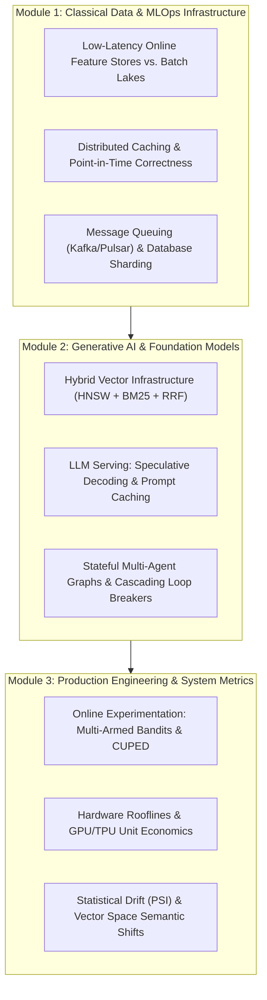

# Detailed Design: 08 - Plug-and-Play Schema & Curriculum Specifications

## 1. Executive Summary & Design Vision

The machine learning ecosystem evolves at a rapid pace. To prevent the platform's learning modules from becoming obsolete as new hardware and software architectures emerge:
1. **Open-Ended Scenario Plugin Engine**: All learning exercises, system failure drills, and case studies are declared via a standardized **YAML/JSON Plug-and-Play Scenario Schema**. Instructors and the open-source community can drop new failure incidents or system blueprints into the `/ML_System_Design_2026_SSOT/schemas/` folder in Google Drive without writing code.
2. **2026 Core Curriculum Matrix**: The platform delivers three deep curriculum modules reflecting modern industry realities—abandoning automated/commoditized skills (hyperparameter sweeps, manual feature selection) in favor of high-leverage alignment, serving economics, causal inference, and streaming infrastructure.

---

## 2. Plug-and-Play Scenario Schema Specification (`ScenarioPluginSchema`)

Each scenario plugin is a self-contained declarative document specifying the initial canvas topology, hardware constraints, traffic parameters, chaos perturbations, and passing rubric conditions.

### 2.1 Complete JSON Schema Definition

```json
{
  "$schema": "https://json-schema.org/draft/2020-12/schema",
  "title": "ScenarioPluginSchema",
  "type": "object",
  "required": [
    "scenarioVersion",
    "scenarioId",
    "metadata",
    "constraints",
    "initialCanvasState",
    "chaosTriggers",
    "evaluationCriteria"
  ],
  "properties": {
    "scenarioVersion": { "type": "string", "const": "2026.1" },
    "scenarioId": { "type": "string" },
    "metadata": {
      "type": "object",
      "required": ["title", "moduleCategory", "difficulty", "summary", "author"],
      "properties": {
        "title": { "type": "string" },
        "moduleCategory": {
          "type": "string",
          "enum": ["MODULE_1_MLOPS", "MODULE_2_GENAI", "MODULE_3_PRODUCTION_METRICS"]
        },
        "difficulty": {
          "type": "string",
          "enum": ["JUNIOR", "MID_LEVEL", "SENIOR", "STAFF_ENGINEER", "PRINCIPAL"]
        },
        "summary": { "type": "string" },
        "author": { "type": "string" }
      }
    },
    "constraints": {
      "type": "object",
      "required": ["targetQPS", "maxP99LatencyMs", "maxMonthlyBudgetUSD"],
      "properties": {
        "targetQPS": { "type": "number", "minimum": 1 },
        "maxP99LatencyMs": { "type": "number", "minimum": 1 },
        "maxMonthlyBudgetUSD": { "type": "number", "minimum": 0 },
        "complianceRegimes": {
          "type": "array",
          "items": { "type": "string", "enum": ["EU_AI_ACT", "GDPR_RTBF", "HIPAA", "SOC2"] }
        }
      }
    },
    "initialCanvasState": {
      "type": "object",
      "required": ["nodes", "edges"],
      "properties": {
        "nodes": {
          "type": "array",
          "items": {
            "type": "object",
            "required": ["id", "type", "config"],
            "properties": {
              "id": { "type": "string" },
              "type": { "type": "string" },
              "config": { "type": "object" }
            }
          }
        },
        "edges": {
          "type": "array",
          "items": {
            "type": "object",
            "required": ["source", "target", "protocol"],
            "properties": {
              "source": { "type": "string" },
              "target": { "type": "string" },
              "protocol": { "type": "string", "enum": ["GRPC", "REST", "KAFKA", "REDIS_PUBSUB"] }
            }
          }
        }
      }
    },
    "chaosTriggers": {
      "type": "array",
      "items": {
        "type": "object",
        "required": ["triggerId", "type", "description", "injectedMetricsDelta"],
        "properties": {
          "triggerId": { "type": "string" },
          "type": { "type": "string" },
          "description": { "type": "string" },
          "injectedMetricsDelta": { "type": "object" }
        }
      }
    },
    "evaluationCriteria": {
      "type": "object",
      "required": ["requiredNodes", "prohibitedNodes", "maxAllowedP99Ms", "minRubricScore"],
      "properties": {
        "requiredNodes": { "type": "array", "items": { "type": "string" } },
        "prohibitedNodes": { "type": "array", "items": { "type": "string" } },
        "maxAllowedP99Ms": { "type": "number" },
        "minRubricScore": { "type": "number", "minimum": 0, "maximum": 100 }
      }
    }
  }
}
```

---

## 3. Concrete Reference Blueprints (Production Scenarios)

### 3.1 Blueprint 1: Real-Time Personalized E-Commerce Clothing Ranking

```yaml
scenarioVersion: "2026.1"
scenarioId: "ecom-fashion-ranking-2026"
metadata:
  title: "Flash Sale Real-Time Personalized Clothing Ranking"
  moduleCategory: "MODULE_1_MLOPS"
  difficulty: "STAFF_ENGINEER"
  summary: "Design a two-tower and deep cross-ranker pipeline serving 20,000 QPS during a Black Friday event."
  author: "ML System Design 2026 Core Team"
constraints:
  targetQPS: 20000
  maxP99LatencyMs: 65
  maxMonthlyBudgetUSD: 18000
  complianceRegimes: ["GDPR_RTBF"]
initialCanvasState:
  nodes:
    - id: "gw-ingress"
      type: "INFERENCE_GATEWAY"
      config: { rateLimitQPS: 25000, timeoutMs: 100 }
    - id: "kafka-clicks"
      type: "KAFKA_STREAM"
      config: { partitions: 32, retentionHours: 72 }
    - id: "flink-agg"
      type: "FLINK_STREAM_PROCESSOR"
      config: { windowMinutes: 5, parallelism: 16 }
    - id: "redis-online"
      type: "FEATURE_STORE_ONLINE"
      config: { engine: "REDIS_CLUSTER", maxMemoryGB: 128, replicationFactor: 3 }
    - id: "two-tower-retrieval"
      type: "RETRIEVAL_MODEL"
      config: { candidateCount: 500, vectorDimension: 128 }
    - id: "deep-ranker"
      type: "TRANSFORMER_RANKER"
      config: { gpuSku: "NVIDIA_H100_SXM", count: 4, quantization: "INT8" }
  edges:
    - source: "gw-ingress"
      target: "kafka-clicks"
      protocol: "KAFKA"
    - source: "kafka-clicks"
      target: "flink-agg"
      protocol: "KAFKA"
    - source: "flink-agg"
      target: "redis-online"
      protocol: "REDIS_PUBSUB"
    - source: "redis-online"
      target: "two-tower-retrieval"
      protocol: "GRPC"
    - source: "two-tower-retrieval"
      target: "deep-ranker"
      protocol: "GRPC"
chaosTriggers:
  - triggerId: "inventory-skew-01"
    type: "TRAINING_SERVING_SKEW"
    description: "Redis streaming backfill falls 8 minutes behind Snowflake batch lake during flash sale."
    injectedMetricsDelta:
      p99LatencyMsMultiplier: 2.1
      staleRecommendationsRate: 0.38
evaluationCriteria:
  requiredNodes: ["DIVERSITY_RERANKER", "POINT_IN_TIME_FEATURE_JOIN"]
  prohibitedNodes: ["BATCH_ONLY_WAREHOUSE_LOOKUP"]
  maxAllowedP99Ms: 65
  minRubricScore: 85
```

---

### 3.2 Blueprint 2: Streaming Financial Fraud Detection

```yaml
scenarioVersion: "2026.1"
scenarioId: "streaming-fraud-detection-2026"
metadata:
  title: "Sub-20ms Real-Time Financial Fraud Detection"
  moduleCategory: "MODULE_3_PRODUCTION_METRICS"
  difficulty: "PRINCIPAL"
  summary: "Architect a sub-20ms transaction scoring engine executing sliding window velocity rules and GBDT inference."
  author: "ML System Design 2026 Core Team"
constraints:
  targetQPS: 50000
  maxP99LatencyMs: 20
  maxMonthlyBudgetUSD: 30000
  complianceRegimes: ["EU_AI_ACT", "SOC2"]
initialCanvasState:
  nodes:
    - id: "tx-gateway"
      type: "INFERENCE_GATEWAY"
      config: { rateLimitQPS: 60000, timeoutMs: 25 }
    - id: "aerospike-features"
      type: "FEATURE_STORE_ONLINE"
      config: { engine: "AEROSPIKE", readLatencyP99Ms: 1.2 }
    - id: "xgboost-cluster"
      type: "GBDT_INFERENCE_CLUSTER"
      config: { cpuCores: 128, treeCount: 500, maxDepth: 8 }
  edges:
    - source: "tx-gateway"
      target: "aerospike-features"
      protocol: "GRPC"
    - source: "aerospike-features"
      target: "xgboost-cluster"
      protocol: "GRPC"
chaosTriggers:
  - triggerId: "covariate-drift-burst"
    type: "COVARIATE_DRIFT"
    description: "Fraudsters launch coordinated micro-transactions under $2 across 10,000 new merchant accounts."
    injectedMetricsDelta:
      psiMetricScore: 0.42
      falsePositiveRateSpike: 0.15
evaluationCriteria:
  requiredNodes: ["PSI_DRIFT_DETECTOR", "FALLBACK_HEURISTIC_RULE_ENGINE"]
  prohibitedNodes: ["SYNCHRONOUS_COLD_DATABASE_QUERY"]
  maxAllowedP99Ms: 20
  minRubricScore: 90
```

---

### 3.3 Blueprint 3: Enterprise GenAI Knowledge Retrieval (Hybrid RAG)

```yaml
scenarioVersion: "2026.1"
scenarioId: "enterprise-vector-rag-2026"
metadata:
  title: "Enterprise Hybrid Search RAG with Speculative Decoding"
  moduleCategory: "MODULE_2_GENAI"
  difficulty: "STAFF_ENGINEER"
  summary: "Build an enterprise knowledge retrieval system balancing vector search, prompt caching, and hallucination guardrails."
  author: "ML System Design 2026 Core Team"
constraints:
  targetQPS: 5000
  maxP99LatencyMs: 220
  maxMonthlyBudgetUSD: 24000
  complianceRegimes: ["EU_AI_ACT", "GDPR_RTBF"]
initialCanvasState:
  nodes:
    - id: "rag-api"
      type: "INFERENCE_GATEWAY"
      config: { rateLimitQPS: 8000, timeoutMs: 500 }
    - id: "hybrid-search"
      type: "HYBRID_RETRIEVER"
      config: { vectorIndex: "HNSW", sparseIndex: "BM25", rrfK: 60 }
    - id: "cross-reranker"
      type: "CROSS_ENCODER_RERANKER"
      config: { model: "bge-reranker-large", topK: 10 }
    - id: "vllm-cluster"
      type: "VLLM_CLUSTER"
      config: { gpuSku: "NVIDIA_H200_SXM", count: 8, speculativeDecoding: true, promptCaching: true }
    - id: "groundedness-guard"
      type: "SEMANTIC_GUARDRAIL"
      config: { hallucinationThreshold: 0.05 }
  edges:
    - source: "rag-api"
      target: "hybrid-search"
      protocol: "GRPC"
    - source: "hybrid-search"
      target: "cross-reranker"
      protocol: "GRPC"
    - source: "cross-reranker"
      target: "vllm-cluster"
      protocol: "GRPC"
    - source: "vllm-cluster"
      target: "groundedness-guard"
      protocol: "GRPC"
chaosTriggers:
  - triggerId: "prompt-cache-invalidation"
    type: "CACHE_STAMPEDE"
    description: "Simultaneous documentation updates trigger 90% prompt cache eviction; TTFT spikes to 1400ms."
    injectedMetricsDelta:
      ttftMsAdder: 1200
      vramFragmentationRatio: 0.45
evaluationCriteria:
  requiredNodes: ["PROMPT_CACHE_LAYER", "CROSS_ENCODER_RERANKER", "SEMANTIC_GUARDRAIL"]
  prohibitedNodes: ["UNINDEXED_FULL_TEXT_SCAN"]
  maxAllowedP99Ms: 220
  minRubricScore: 90
```

---

## 4. The 2026 Core Curriculum Matrix

The platform is structured into three progressive learning modules:



### The 2026 Data Science Curriculum Transformation

| Automated / Deprecated Skill (Zero Value) | High-Value 2026 Core Skill (Trained in App) | Practical Production Application |
| :--- | :--- | :--- |
| **Hyperparameter GridSearch / Optuna** | **Mathematical Reward Function Optimization** | Formulating multi-objective loss functions that prevent Goodhart's Law reward hacking. |
| **Manual Feature Selection (PCA, Scikit)** | **Data Ingestion Alignment & Contamination Auditing** | Using MinHash LSH and Shannon entropy to purge synthetic collapse artifacts and benchmark leaks. |
| **Simple Correlation A/B Testing** | **Causal Inference & CUPED Experimental Systems** | Eliminating confounding bias via Causal DAGs and reducing online experiment variance by $>50\%$. |
| **Manual Model Weight Fitting** | **Prompt & Context Pattern Mining** | Structuring KV caches and dynamic contextual prompts for multi-tenant foundation models. |

---

## 5. Next Steps

- Proceed to [09_isomorphic_deployment_and_ci_cd.md](file:///home/somesh/git_repos/ml-sys-design/documentation/design/detailed/09_isomorphic_deployment_and_ci_cd.md) for the isomorphic local/Vercel deployment architecture, stateless Edge routes, and 90%+ CI test pipeline.
