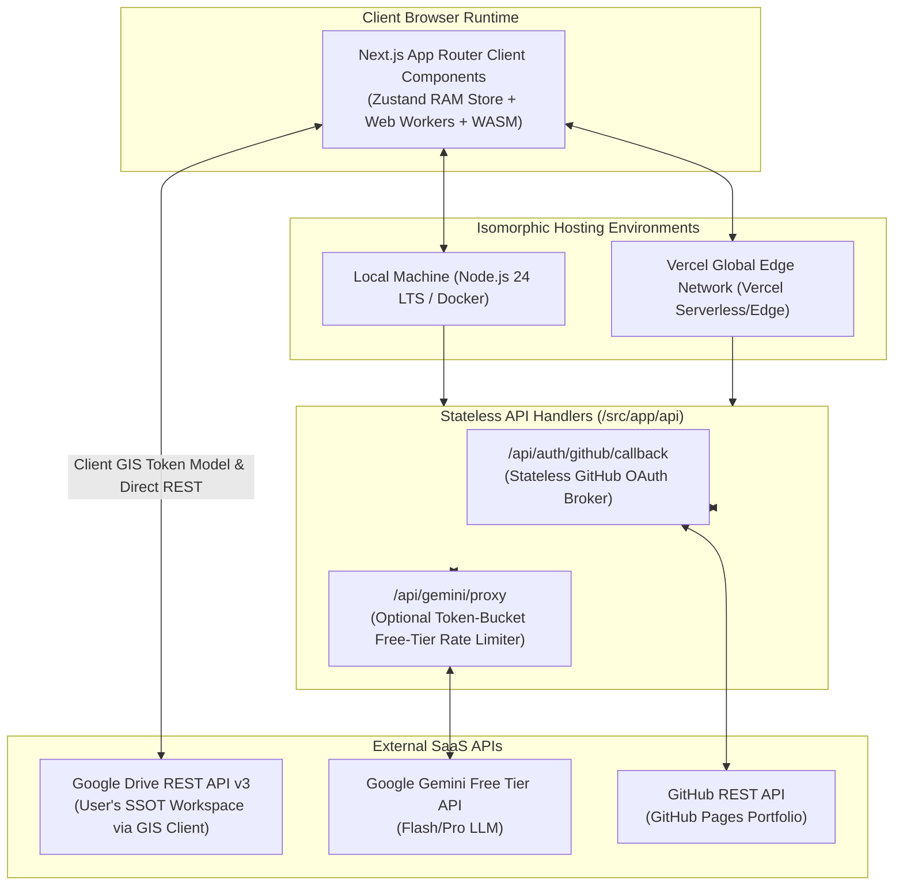
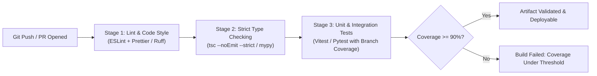

# Detailed Design: 09 - Isomorphic Deployment & CI/CD Pipeline

## 1. Executive Summary & Deployment Mandates

The **2026 ML System Design Platform** is designed for **Isomorphic Deployment Parity**:
1. **Localhost Execution**: Runs natively on developer workstations via Node.js 24 LTS (`npm run dev` with Next.js 16.4 Turbopack) or containerized via `docker compose up`.
2. **Vercel Cloud Deployment**: Deploys without reconfiguration to Vercel's global Edge network (`*.vercel.app`) using Next.js 16.4 App Router and stateless Edge functions.
3. **Stateless Backend Guarantee**: The backend maintains zero databases, zero sessions, and zero permanent disks. All user state is synced from the client browser directly to Google Drive (SSOT).
4. **Local CI/CD Quality Gates**: Full adherence to 90%+ branch test coverage (Vitest 2.1 with v8 coverage provider / Pytest), strict type safety (`tsc --noEmit`, `mypy --strict`), method ($\le 20$ lines) and file ($\le 500$ lines) limits, and zero lint violations (`eslint 9`, `ruff`).

---

## 2. Isomorphic Architecture & Route Taxonomy



### 2.1 Route & Middleware Configuration

| Route Path | Runtime Target | Purpose | State Kept on Server |
| :--- | :--- | :--- | :--- |
| `/` | Static (SSG) | Landing page & module catalog | None |
| `/workspace/[moduleId]` | Client Component | Interactive canvas, simulator & profiler | None (RAM only) |
| `/api/auth/github/callback` | Edge Runtime | Exchanges GitHub OAuth code for Pages deploy | None (Returned to client RAM) |
| `/api/gemini/proxy` | Edge Runtime | Sanitizes & forwards prompts to Gemini | None (Stateless proxy) |

> [!NOTE]
> Google Drive uses the client-side **Google Identity Services (GIS) Token Model**, so no backend `/api/auth/google/callback` route or `GOOGLE_CLIENT_SECRET` is required. The browser communicates directly with Google Drive API v3 using the in-memory access token.

---

## 3. Serverless Edge Handlers (Implementation Contracts)

### 3.1 GitHub OAuth Token Exchange Handler (Portfolio Exporter)

```typescript
// src/app/api/auth/github/callback/route.ts

import { NextRequest, NextResponse } from 'next/server';

export const runtime = 'edge';

export async function POST(req: NextRequest): Promise<NextResponse> {
  try {
    const { code, state } = await req.json();

    if (!code) {
      return NextResponse.json({ error: 'Missing OAuth authorization code' }, { status: 400 });
    }

    const tokenResponse = await fetch('https://github.com/login/oauth/access_token', {
      method: 'POST',
      headers: {
        Accept: 'application/json',
        'Content-Type': 'application/json',
      },
      body: JSON.stringify({
        client_id: process.env.NEXT_PUBLIC_GITHUB_CLIENT_ID || '',
        client_secret: process.env.GITHUB_CLIENT_SECRET || '',
        code,
        state,
      }),
    });

    const data = await tokenResponse.json();

    if (!tokenResponse.ok || data.error) {
      return NextResponse.json({ error: data.error_description || 'GitHub OAuth exchange failed' }, { status: 400 });
    }

    return NextResponse.json({
      accessToken: data.access_token,
      tokenType: data.token_type,
      scope: data.scope,
    });
  } catch (error) {
    return NextResponse.json({ error: 'Internal edge error during GitHub auth' }, { status: 500 });
  }
}
```

---

## 4. Local Machine Deployment Setup

### 4.1 Containerized Setup (`docker-compose.yml`)

Developers can launch the platform locally in an isolated environment with a single command:

```yaml
version: '3.8'

services:
  ml-sys-design-app:
    build:
      context: .
      dockerfile: Dockerfile
    container_name: ml_sys_design_2026
    ports:
      - "3000:3000"
    environment:
      - NODE_ENV=development
      - NEXT_PUBLIC_GOOGLE_CLIENT_ID=${NEXT_PUBLIC_GOOGLE_CLIENT_ID}
      - GEMINI_API_KEY=${GEMINI_API_KEY}
    restart: unless-stopped
```

### 4.2 Production Multi-Stage `Dockerfile`

```dockerfile
# Build Stage
FROM node:24-alpine AS builder
WORKDIR /app
COPY package*.json ./
RUN npm ci
COPY . .
ENV NEXT_TELEMETRY_DISABLED=1
RUN npm run build

# Runner Stage
FROM node:24-alpine AS runner
WORKDIR /app
ENV NODE_ENV=production
ENV NEXT_TELEMETRY_DISABLED=1

COPY --from=builder /app/public ./public
COPY --from=builder /app/.next/standalone ./
COPY --from=builder /app/.next/static ./.next/static

EXPOSE 3000
ENV PORT=3000
ENV HOSTNAME="0.0.0.0"

CMD ["node", "server.js"]
```

---

## 5. Vercel Cloud Deployment Configuration (`vercel.json`)

```json
{
  "$schema": "https://openapi.vercel.sh/vercel.json",
  "framework": "nextjs",
  "buildCommand": "npm run build",
  "headers": [
    {
      "source": "/(.*)",
      "headers": [
        {
          "key": "Content-Security-Policy",
          "value": "default-src 'self'; script-src 'self' 'unsafe-eval' https://cdn.jsdelivr.net; worker-src 'self' blob:; style-src 'self' 'unsafe-inline'; connect-src 'self' https://www.googleapis.com https://generativelanguage.googleapis.com https://api.github.com;"
        },
        {
          "key": "X-Content-Type-Options",
          "value": "nosniff"
        },
        {
          "key": "X-Frame-Options",
          "value": "DENY"
        },
        {
          "key": "Cross-Origin-Opener-Policy",
          "value": "same-origin"
        },
        {
          "key": "Cross-Origin-Embedder-Policy",
          "value": "credentialless"
        }
      ]
    }
  ]
}
```

---

## 6. Testing Strategy & CI Quality Standards (90%+ Target)

Adhering to project quality standards, every class and worker calculation is accompanied by comprehensive automated tests.



### 6.1 Test Suite Breakdown

1. **Deterministic Sim Worker Tests (`test_sim_worker.ts`)**:
   - Validates $M/G/c$ queuing theory calculations against known analytical queuing outputs.
   - Verifies Roofline model arithmetic intensity boundary conditions.
   - Asserts execution completes under $100\text{ ms}$ for graphs up to 100 nodes.
2. **Google Drive Sync Manager Tests (`test_sync_manager.ts`)**:
   - Mocks Google Drive REST API v3 responses using `fetchMock`.
   - Tests conditional HTTP `If-Match` ETag conflicts (asserting 3-way merge triggers on HTTP 412).
   - Verifies zero data is written to `localStorage` or `sessionStorage`.
3. **Dual-Mode AI Gateway Tests (`test_llm_orchestrator.ts`)**:
   - Tests automated failover from direct Gemini API call to structured manual exchange envelope upon receiving HTTP 429.
   - Tests Zod response parsing, Markdown fence extraction, and schema repair prompt generation.
4. **Accessibility Tests (`test_a11y_canvas.tsx`)**:
   - Uses `axe-core` and `@testing-library/react` to verify WCAG 2.1 AA/AAA compliance.
   - Tests keyboard-only canvas traversal and screen reader `aria-live` announcements.

---

## 7. Operational Readiness Checklist

| Requirement Category | Requirement Specification | Verification Method |
| :--- | :--- | :--- |
| **Zero Local Persistence** | No state written to `localStorage`, `IndexedDB`, or disk | Runtime `StorageSanitizer` test asserts storage writes throw warnings/no-ops. |
| **Google Drive SSOT** | All workspaces sync to `/ML_System_Design_2026_SSOT/` | Drive API integration test confirms file creation & ETag conditional patch. |
| **Latency SLA** | Canvas simulations finish in $<100\text{ ms}$ | Performance test benchmark validates simulation worker runs in $<15\text{ ms}$. |
| **Telemetry SLA** | Operations profiler renders at $60\text{ FPS}$ | WebGL ring buffer benchmark maintains $16.6\text{ ms}$ render ticks. |
| **Dual AI Mode** | Gemini Free Tier direct call + Air-gapped JSON Export/Import | Mock HTTP 429 test verifies one-click prompt bundle generation and import. |
| **Hosting Parity** | Runs identically on `localhost:3000` and Vercel Edge | Docker container and Vercel preview environments tested side-by-side. |

---

## 8. Summary of Detailed Design Suite

With the completion of this 10-document detailed design suite:
- Every requirement from [000_requirements.md](file:///home/somesh/git_repos/ml-sys-design/documentation/requirements/000_requirements.md) has been translated into an actionable, concrete engineering blueprint.
- Every architectural choice from [high_level.md](file:///home/somesh/git_repos/ml-sys-design/documentation/design/high_level.md) has been fully decomposed into low-level schemas, algorithms, classes, and workflows.
- The platform is primed for phased implementation across state management, worker math, canvas UI, AI exchange, and curriculum modules.
