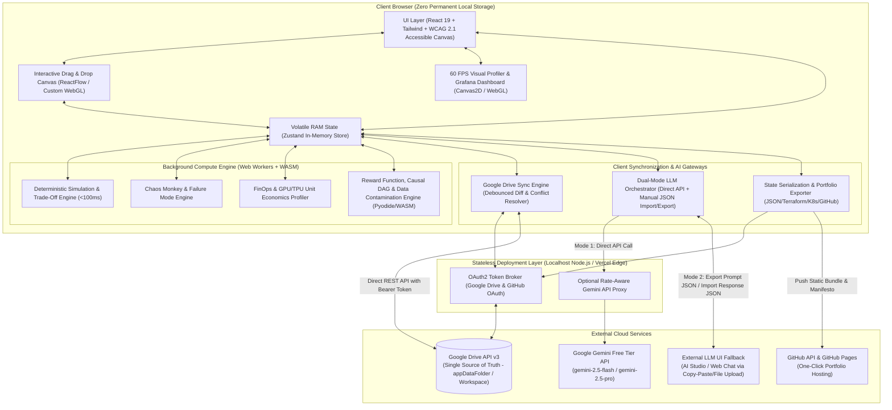
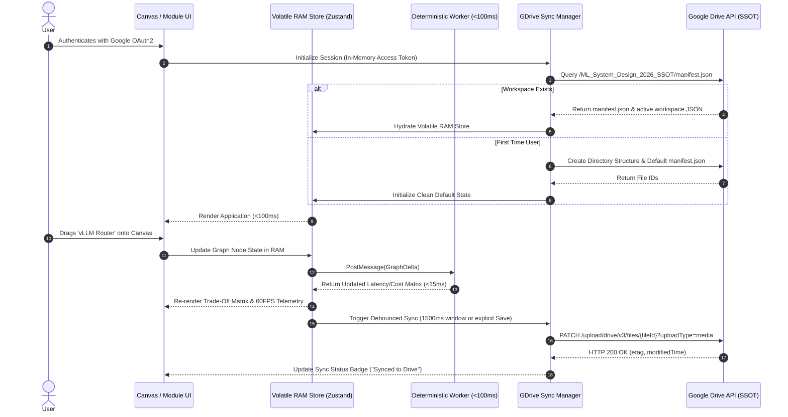
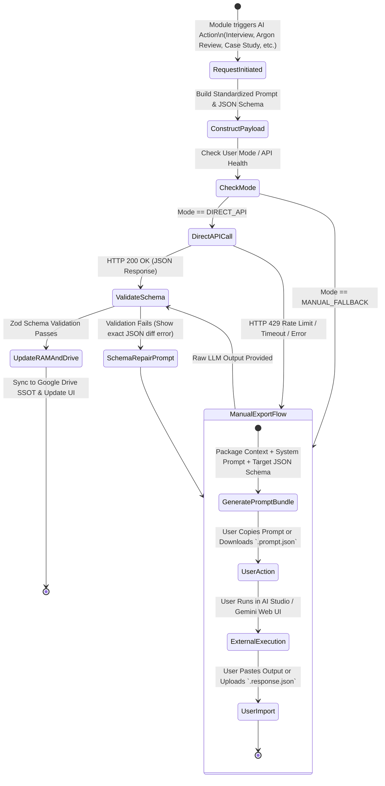
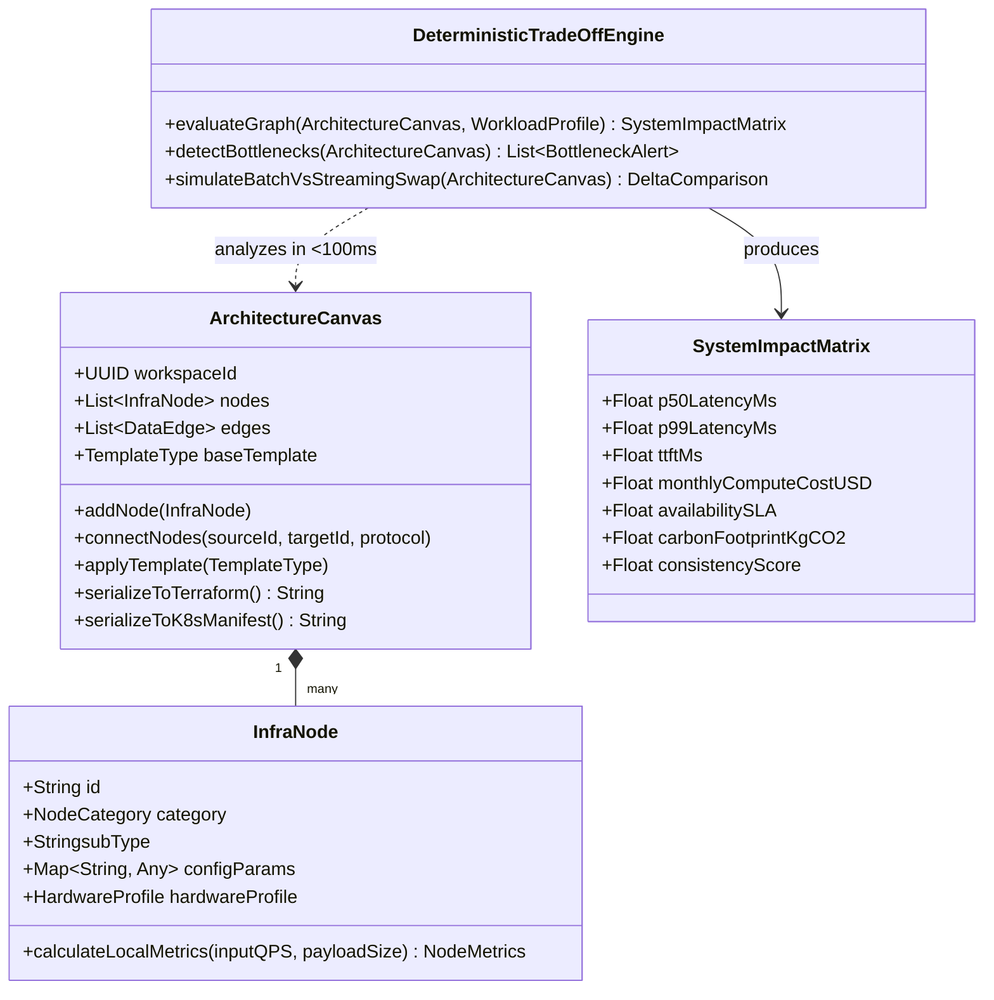
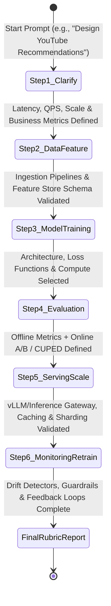

# Detailed System Design: 2026 ML System Design & Interactive Simulation Platform

## 1. Executive Summary & Architectural Vision

This document specifies the complete architecture and technical design for the **2026 Machine Learning System Design & Interactive Simulation Platform**.

To satisfy the deployment constraints (**Local Machine + Vercel Hosting**), state persistence rules (**Google Drive as the Single Source of Truth with zero permanent local state**), performance SLAs (**$<100\text{ ms}$ canvas updates, $60\text{ FPS}$ telemetry rendering**), and LLM access limitations (**unreliable Gemini Free Tier requiring dual Direct API + Manual Export/Import Fallback across all modules**), the platform utilizes a **Local-First Compute, Cloud-Synced State (Thick-Client Serverless)** architecture.

### Key Architectural Pillars
1. **Zero-Latency Client Compute Engine**: All deterministic calculations (trade-off matrices, FinOps GPU/TPU unit economics, causal inference variance engines, and reward function simulations) execute inside **Web Workers** and **WebAssembly (WASM)** on the client browser. This guarantees $<100\text{ ms}$ execution and $60\text{ FPS}$ visual profiling without serverless cold-start latency.
2. **Ephemeral In-Memory State + Google Drive SSOT**: The browser holds state strictly in volatile memory (`Zustand` store in RAM) without utilizing `localStorage` or persistent `IndexedDB`. All user creations, portfolios, module states, and LLM responses are synchronized as structured JSON/YAML blobs to an app-specific folder in the user's **Google Drive**.
3. **Dual-Mode Hybrid AI Gateway (Direct API + Manual Air-Gap Fallback)**: Every AI-powered module (Interview Simulator, Gemini Argon Adversarial Reviewer, Synthetic Data Auditor, Manifesto Generator) connects through a unified `LLMOrchestrator`. When the Gemini Free Tier API experiences rate-limiting (`HTTP 429`) or network failures, the system automatically exposes a **Structured Prompt Bundle Exporter** (JSON + Markdown instructions) and a **Schema-Validated Response Importer**, allowing users to run prompts externally and import the verified JSON output seamlessly.
4. **Isomorphic Deployment (Vercel & Localhost)**: Built on **Next.js (App Router)** with stateless Edge routes for OAuth token exchange and GitHub Pages portfolio publishing, ensuring identical behavior via `npm run dev` locally and on Vercel.

---

## 2. High-Level System Architecture

### 2.1 System Context & Component Diagram (Mermaid C4 / Component)



---

## 3. Core Subsystem Technical Designs

### 3.1 Ephemeral State & Google Drive Single Source of Truth (SSOT)

Because local persistence (`localStorage`, `sessionStorage`, `IndexedDB`, or local SQLite) is strictly prohibited, the application enforces a **RAM-Only + Google Drive Cloud Sync** lifecycle.

#### Google Drive Folder Hierarchy
Upon authentication via Google OAuth2 (`https://www.googleapis.com/auth/drive.file`), the app initializes a dedicated workspace directory in the user's Google Drive:
```text
/ML_System_Design_2026_SSOT/
 ├── manifest.json                     # Global index, user preferences, curriculum progress
 ├── schemas/
 │    └── scenario_plugins.json        # Custom YAML/JSON plug-and-play scenario definitions
 ├── workspaces/
 │    ├── ws_<uuid>_architecture.json  # Serialized canvas graph, trade-offs, IaC configs
 │    ├── ws_<uuid>_interview.json     # 6-Step interview state, transcripts, evaluations
 │    └── ws_<uuid>_chaos_logs.json    # Chaos Monkey incidents, log traces, fixes
 └── llm_exchange_vault/
      ├── exports/                     # Exported prompt packages for offline/manual execution
      └── imports/                     # Validated imported JSON responses from LLM
```

#### State Synchronization Sequence Diagram



---

### 3.2 Dual-Mode Hybrid AI Gateway (Direct Gemini Free Tier + Manual Export/Import)

Since the Gemini Free Tier API has strict rate limits (RPM/TPM/RPD) and potential instability, **every single module** that uses AI implements the `ILLMExchangeContract`. Users can toggle between **Auto Direct API** and **Manual Export/Import Mode** at any time, or let the system auto-failover upon receiving an `HTTP 429` or timeout.

#### Architecture of the Dual-Mode AI Gateway



#### Standardized Exchange JSON Schema (`LLMExchangeEnvelope`)
All 12 modules use this unified envelope for exporting prompts and importing responses:

```json
{
  "$schema": "https://json-schema.org/draft/2020-12/schema",
  "title": "LLMExchangeEnvelope",
  "type": "object",
  "required": ["envelopeVersion", "moduleId", "useCaseId", "timestamp", "promptPayload", "expectedResponseSchema"],
  "properties": {
    "envelopeVersion": { "type": "string", "const": "2026.1.0" },
    "moduleId": {
      "type": "string",
      "enum": [
        "SANDBOX_BUILDER",
        "CASE_STUDY_LIBRARY",
        "AI_INTERVIEW_SIMULATOR",
        "CHAOS_ADVERSARIAL_PLAYGROUND",
        "FINOPS_CALCULATOR",
        "DATA_ALIGNMENT_ENGINE",
        "CHAOS_MONKEY_ARGON",
        "TELEMETRY_LOG_GAME",
        "REGULATORY_COMPLIANCE_SIM",
        "RESUME_PORTFOLIO_EXPORTER",
        "MATH_REWARD_WORKSPACE",
        "DATA_ARCHAEOLOGY_SUITE",
        "CAUSAL_INFERENCE_LAB"
      ]
    },
    "useCaseId": { "type": "string", "description": "Unique identifier of the challenge or current canvas state" },
    "timestamp": { "type": "string", "format": "date-time" },
    "promptPayload": {
      "type": "object",
      "required": ["systemInstruction", "userPrompt", "serializedContext", "copyPasteReadyMarkdown"],
      "properties": {
        "systemInstruction": { "type": "string" },
        "userPrompt": { "type": "string" },
        "serializedContext": { "type": "object", "description": "Current Canvas Graph, Metrics, or Code" },
        "copyPasteReadyMarkdown": {
          "type": "string",
          "description": "Self-contained prompt string with strict instructions to output ONLY valid JSON matching expectedResponseSchema"
        }
      }
    },
    "expectedResponseSchema": {
      "type": "object",
      "description": "Strict JSON Schema that the imported response is validated against via Zod/Ajv"
    },
    "llmResponse": {
      "type": ["object", "null"],
      "description": "Populated either by Direct Gemini API call or by User Import"
    }
  }
}
```

---

## 4. Detailed Design of Functional Modules

### 4.1 Interactive Sandbox Architecture Builder & Live Trade-Off Calculator

#### Component Class Diagram


#### Mathematical Model for the Deterministic Simulation Engine ($<100\text{ ms}$)
Executed inside a dedicated Web Worker on every graph mutation:
1. **End-to-End Latency ($L_{p99}$)**:
   Using critical path traversal across the Directed Acyclic Graph (DAG) of infrastructure blocks, accounting for queuing delay via an $M/G/c$ approximation:
   $$L_{p99} = \max_{\pi \in \text{Paths}(G)} \sum_{v \in \pi} \left( L_{\text{base}}(v) + \frac{\rho_v^{\sqrt{2(c_v+1)}-1}}{c_v(1 - \rho_v)} \cdot S_{p99}(v) + L_{\text{network}}(e_{v}) \right)$$
   where $\rho_v = \frac{\lambda_v}{c_v \mu_v}$ is the utilization ratio of node $v$ under arrival rate $\lambda_v$ (QPS), $c_v$ is the replica count, and $S_{p99}(v)$ is the 99th percentile service time (e.g., batch vs. streaming inference).
2. **Token Time-to-First-Byte ($\text{TTFT}$) & Token Generation Latency**:
   $$\text{TTFT} = \frac{N_{\text{prompt\_tokens}} \cdot 2 \cdot P_{\text{active}}}{C_{\text{FLOPS}} \cdot \eta_{\text{compute}}} \cdot (1 - r_{\text{cache\_hit}}) + L_{\text{gateway}}$$
   $$\text{TPOT (Time Per Output Token)} = \frac{B_{\text{model\_weights}} + B_{\text{KV\_cache}}(N_{\text{seq}})}{\text{BW}_{\text{memory}} \cdot \gamma_{\text{spec\_decoding}}}$$
   where $r_{\text{cache\_hit}}$ is the multi-tenant prompt cache hit ratio and $\gamma_{\text{spec\_decoding}} \ge 1.0$ is the speculative decoding speedup factor.

#### Pre-Built Agentic & RAG Templates
* **Multi-Agent Orchestration**: Supervisor Router $\rightarrow$ Stateful LangGraph/Custom Memory Store $\rightarrow$ Parallel Tool-Calling Workers $\rightarrow$ Consensus Verifier $\rightarrow$ Circuit Breaker Gate.
* **Hybrid Search RAG**: Query Rewriter $\rightarrow$ Parallel Dense Vector DB (HNSW) + Sparse BM25 Index $\rightarrow$ Reciprocal Rank Fusion (RRF) $\rightarrow$ Cross-Encoder Reranker $\rightarrow$ Prompt Cache $\rightarrow$ vLLM Generator.
* **LLM Guardrail Routing**: Ingress API Gateway $\rightarrow$ PII/Prompt Injection Small Classifier (BERT/Llama-Guard quantized) $\rightarrow$ Semantic Router $\rightarrow$ Fast Tier / Reasoning Tier LLM $\rightarrow$ Output Hallucination Grader.

---

### 4.2 Interactive Case-Study Library & Failure Mode Simulator

* **Plug-and-Play Scenario Schema**: Each case study (E-commerce Real-Time Ranking, Streaming Fraud Detection, Enterprise Vector RAG) is defined as a declarative JSON/YAML state machine.
* **"Break the System" Failure Mode Simulator**:
  * Injects synthetic perturbations into the live graph:
    * **Covariate & Semantic Drift**: Shifts input embedding distribution $P_{\text{prod}}(X)$ away from $P_{\text{train}}(X)$ measured via Population Stability Index ($\text{PSI} > 0.25$) or Wasserstein distance $W_1(P_{\text{train}}, P_{\text{prod}})$.
    * **Training-Serving Skew**: Introduces latency lags in offline-to-online Feature Store synchronization (e.g., Redis online store out-of-sync with Snowflake/Parquet offline store).
    * **LLM Hallucination Spikes**: Simulates stale vector index shards or chunking boundary corruption.
  * Users must wire the proper remediation block (e.g., Shadow Deployment, Automated Embedding Re-indexer, Online Feature Store Streaming Backfill, or Groundedness Guardrail) to restore the SLA.

---

### 4.3 AI Interview Simulator (2026 Standard)

Enforces the **6-Step Production Lifecycle State Machine**:



* **Multimodal Evaluation**:
  * Captures **Voice Input** (via Web Speech API / Whisper WASM transcript) + **Serialized Canvas Graph JSON**.
  * Evaluates via Direct Gemini API (`gemini-2.5-flash`) or exports a **6-Step Interview Evaluation Bundle** (`interview_eval_export.json`) for manual grading.

---

### 4.4 Chaos Engineering, "The Chaos Monkey" Engine & "Gemini Argon" Adversarial Reviewer

1. **Adversarial Playground (User Breaks AI Architecture)**:
   * Loads a seemingly optimal architecture generated by Gemini Argon.
   * User selects fault injection vectors from a red-team toolkit: *Network Partition between Vector DB & Reranker*, *Token Context Window Overflow Bomb*, *Redis Cache Stampede*, or *Concurrent Tool-Call Race Condition*.
2. **Agent Cascading Loop Simulator**:
   * Visualizes multi-agent cyclic graphs where Agent A invokes Agent B, which invokes Agent A with malformed tool arguments, causing exponential token burn.
   * Users must implement **Deterministic Control Hooks**: Max Iteration Counters, Token Budget Enforcers, Semantic Loop Detectors (cosine similarity between consecutive agent thoughts $> 0.96$), and Dead-Letter Queues.
3. **Live Debugger for Edge & Quantized Deployments**:
   * Simulates deploying models onto constrained targets (e.g., $4\text{ GB}$ RAM Mobile/Edge NPU).
   * Calculates memory footprint across quantization levels ($\text{FP32} \rightarrow \text{BF16} \rightarrow \text{INT8} \rightarrow \text{INT4/AWQ/GGUF}$):
     $$M_{\text{VRAM}} = P_{\text{params}} \cdot \frac{b_{\text{bits}}}{8} \cdot 1.15_{\text{overhead}} + 2 \cdot n_{\text{layers}} \cdot n_{\text{kv\_heads}} \cdot d_{\text{head}} \cdot N_{\text{context}} \cdot \frac{b_{\text{kv}}}{8}$$
   * Simulates thermal throttling curves (clock speed reduction after $T > 85^\circ\text{C}$) and perplexity degradation ($\Delta \text{PPL}$).
4. **Production Incident Roulette & "Gemini Argon" Reviewer**:
   * **Incident Roulette**: A real-time countdown timer where a live SLA error budget ($99.9\%$ uptime) drains while an unannounced fault occurs (e.g., Vector DB API deprecation spiking p99 latency by $40\%$).
   * **Gemini Argon Adversarial Reviewer**: Scans the user's canvas/code and generates a custom **Killer Workload Packet** (e.g., a burst of $10,000$ long-context adversarial queries with skewed shard keys) to prove where the user's architecture fails.

---

### 4.5 FinOps & GPU/TPU Unit Economics Calculator

* **Compute Budget Simulator**:
  * Inputs: Target QPS, Average Input/Output Tokens, Peak-to-Average Traffic Ratio, Monthly Budget Cap ($B_{\text{max}}$).
  * Decision levers:
    * Proprietary API Routing (e.g., Gemini Flash/Pro per-million token pricing).
    * Self-Hosted Open-Source (vLLM / TensorRT-LLM on reserved vs. on-demand GPU instances).
    * Speculative Decoding (draft model overhead vs. target model latency reduction).
    * Multi-Tenant Prompt Caching (VRAM vs. compute trade-off).
* **Hardware Bottleneck Profiler (Roofline Model Engine)**:
  * Computes the **Arithmetic Intensity** ($I = \frac{\text{FLOPs}}{\text{Bytes Accessed}}$) of the user's workload (Prefill vs. Decode vs. Training) and maps it against empirical 2026 hardware rooflines:
    * **NVIDIA H100 / H200 / B200**: High FP8/FP4 Tensor Core FLOPS vs. HBM3e bandwidth.
    * **Google Cloud TPU v5p / v6e (Trillium)**: High systolic array efficiency and ICI interconnect bandwidth for large-scale training/prefill.
    * **AMD MI300X**: $192\text{ GB}$ HBM3 capacity advantage for fitting massive models/KV-caches on fewer nodes.

---

### 4.6 Advanced Data Alignment, Archaeology & Contamination Suite

1. **Synthetic Data Pipeline Auditor & Information Density Filter**:
   * Users write Python/SQL filtering rules (executed in-browser via **Pyodide WASM**) on synthetic datasets to compute:
     * **n-gram Diversity & Self-BLEU**: Detecting repetitive LLM phrasing ("delve", "testament", mode collapse).
     * **Shannon Information Entropy**: $H(X) = -\sum P(x_i) \log_2 P(x_i)$ to filter out low-entropy boilerplate and retain high-entropy reasoning edge cases.
2. **Data Leakage & Contamination Scanner**:
   * Provides synthetic training and benchmark datasets containing subtle contamination (paraphrased GSM8K/MMLU test questions, timestamp lookahead leakage, target encoding leakage, and backdoor trigger tokens).
   * Users implement MinHash LSH (Locality Sensitive Hashing) and embedding similarity gates to purge contaminated rows.
3. **Human-in-the-Loop (HITL) Workflow Designer**:
   * Visual canvas for Active Learning routing: Uncertainty Sampling $\rightarrow$ Disagreement Committee $\rightarrow$ Human Annotator Queue $\rightarrow$ Inter-Annotator Agreement (Cohen's $\kappa$) Filter $\rightarrow$ DPO Preference Pair Store.

---

### 4.7 Mathematical Objective, Causal Inference & Counterfactual Lab

1. **The Reward Function Sandbox & Multi-Objective Optimization**:
   * Users author custom mathematical reward functions $R(x, y)$ in Python/LaTeX:
     $$R_{\text{total}}(x, y) = w_1 \cdot \text{Engagement}(y) - w_2 \cdot \text{Toxicity}(y) - w_3 \cdot \text{Cost}(y) - \beta \cdot D_{\text{KL}}\left(\pi_\theta(y|x) \parallel \pi_{\text{ref}}(y|x)\right)$$
   * The WASM simulator runs an evolutionary agent population against $R_{\text{total}}$ to demonstrate **Reward Hacking** (Goodhart's Law), such as agents outputting empty responses to achieve zero toxicity and zero cost when $w_1$ is poorly scaled, or sycophancy loops when $\beta$ is too small.
2. **Causal Graph Canvas & Synthetic A/B Variance Engine**:
   * **Causal DAG Builder**: Users draw nodes and directed edges, identify **Confounders**, **Colliders**, and **Mediators**, and apply Pearl's **Backdoor/Frontdoor Adjustment Criteria** to compute the Average Treatment Effect ($\text{ATE}$):
     $$\text{ATE} = \mathbb{E}[Y \mid \text{do}(T=1)] - \mathbb{E}[Y \mid \text{do}(T=0)] = \sum_z \left( \mathbb{E}[Y \mid T=1, Z=z] - \mathbb{E}[Y \mid T=0, Z=z] \right) P(Z=z)$$
   * **CUPED (Controlled-experiment Using Pre-Experiment Data) Simulator**:
     Reduces variance of online A/B test metric $Y$ using pre-experiment covariate $X$:
     $$\hat{Y}_{\text{CUPED}} = \bar{Y} - \theta (\bar{X} - \mathbb{E}[X]), \quad \text{where } \theta = \frac{\text{Cov}(Y, X)}{\text{Var}(X)}, \quad \text{Var}(\hat{Y}_{\text{CUPED}}) = \text{Var}(\bar{Y})(1 - \rho_{X,Y}^2)$$

---

### 4.8 Industry-Grade Telemetry, Regulatory Simulator & Portfolio Exporter

1. **Grafana/Prometheus Dashboard & Log Trace Analysis Game**:
   * Renders $60\text{ FPS}$ time-series charts using HTML5 `Canvas2D` / `WebGL` (`uPlot` / custom shaders) tracking: `p99_latency_ms`, `ttft_ms`, `gpu_vram_fragmentation_ratio`, `kv_cache_eviction_rate`, and `dlq_depth`.
   * **Log Trace Game**: Streams realistic structured/unstructured logs (CUDA OOM stack traces, gRPC deadline exceeded, NCCL ring all-reduce hangs, vector shard timeout) for root-cause classification.
2. **Regulatory, Compliance & AI Safety Simulator**:
   * **EU AI Act & Right-to-be-Forgotten (RTBF)**: Users design architectures with **Machine Unlearning** (SISA—Sharded, Isolated, Sliced, Aggregated training), Vector Tombstoning by `user_id` metadata filters, and differential privacy ($\epsilon, \delta$-DP) noise injection.
   * **Copyright & Guardrail Auditing**: Ingress filter pipelines for MinHash copyright detection and indirect prompt-injection sandboxing.
3. **Interactive "Resume-Builder" Architecture Exporter**:
   * Compiles the workspace into a static interactive micro-site + **Production Manifesto** (`README.md` + `architecture.tf` + `k8s-deployment.yaml` + Mermaid diagrams) and pushes directly to the user's `username.github.io/ml-system-portfolio` via the GitHub REST API.

---

## 5. Comprehensive Export/Import Specification Across All Modules

To satisfy the requirement: *"Have a provision to export prompts and requirements for individual use-cases and then have a mechanism to import and save it. Specify the expected format like json etc. Do this for all modules"*, every module implements a dual-path execution contract.

### Module-by-Module Export/Import Payload Specifications

| Module Name | Module ID | Exported Context (`serializedContext`) | Expected Imported JSON Schema (`llmResponse`) |
| :--- | :--- | :--- | :--- |
| **1. Sandbox Architecture Builder** | `SANDBOX_BUILDER` | Nodes, Edges, QPS, Hardware selections, Current Trade-Off Matrix | `{"bottlenecks": [{"nodeId": "str", "severity": "HIGH", "fix": "str"}], "suggestedOptimizations": [...]}` |
| **2. Interactive Case-Study Library** | `CASE_STUDY_LIBRARY` | Case study ID, active failure mode (drift/skew), user's proposed architectural patch | `{"passed": true, "score": 92, "rootCauseAnalysis": "str", "remainingVulnerabilities": [...]}` |
| **3. AI Interview Simulator** | `AI_INTERVIEW_SIMULATOR` | Current Step (1-6), Voice/Text transcript, Canvas Graph JSON, Rubric criteria | `{"stepCompleted": true, "rubricScores": {"scalability": 4, "economics": 3}, "interviewerFollowUpPrompt": "str", "bottleneckFeedback": "str"}` |
| **4. Chaos & Adversarial Playground** | `CHAOS_ADVERSARIAL_PLAYGROUND` | Base architecture JSON, user-injected faults, agent loop circuit breaker rules | `{"systemCrashed": true, "cascadeTrace": ["AgentA -> AgentB"], "exploitSuccessScore": 85, "mitigationEval": "str"}` |
| **5. FinOps & GPU/TPU Calculator** | `FINOPS_CALCULATOR` | Target QPS, Monthly Budget, vLLM/API split, selected GPU/TPU SKUs | `{"budgetViable": false, "monthlyBurnUSD": 14200, "rooflineBottleneck": "MEMORY_BANDWIDTH", "recommendedHardwareSwap": "str"}` |
| **6. Data Alignment & Curation** | `DATA_ALIGNMENT_ENGINE` | Sampled synthetic data batch, user's filtering rules, HITL active learning graph | `{"detectedBiases": [...], "diversityScore": 0.78, "hitlEfficiencyRating": 88, "missedEdgeCases": [...]}` |
| **7. Chaos Monkey & Gemini Argon** | `CHAOS_MONKEY_ARGON` | Complete user architecture + code config | `{"discoveredEdgeCase": "str", "killerWorkloadPacket": {"qpsBurst": 15000, "payloadPattern": "str"}, "predictedCrashPoint": "node_id"}` |
| **8. Telemetry & Log Trace Game** | `TELEMETRY_LOG_GAME` | Scenario ID, user's root-cause hypothesis, selected remediation command | `{"generatedMessyLogs": ["str"], "isDiagnosisCorrect": true, "actualRootCause": "NCCL_TIMEOUT", "explanation": "str"}` |
| **9. Regulatory & AI Safety Sim** | `REGULATORY_COMPLIANCE_SIM` | Data deletion pipeline graph, unlearning strategy, ingress guardrail filters | `{"euAiActCompliant": false, "rtbfLeakageVectors": ["vector_cache_shard_2"], "promptInjectionBypassExample": "str"}` |
| **10. Resume-Builder Exporter** | `RESUME_PORTFOLIO_EXPORTER` | Full workspace state, FinOps metrics, Chaos survival results | `{"executiveSummaryMd": "str", "hardwareJustificationMd": "str", "unitEconomicsBreakdownMd": "str", "failureResilienceManifestoMd": "str"}` |
| **11. Math Reward Workspace** | `MATH_REWARD_WORKSPACE` | User's LaTeX/Python reward equation, constraint weights | `{"rewardHackingDetected": true, "degenerateAgentBehavior": "str", "paretoOptimalWeights": {"w1": 0.6, "w2": 0.4}}` |
| **12. Data Archaeology Suite** | `DATA_ARCHAEOLOGY_SUITE` | User's contamination test code, information density filter pipeline | `{"leakageDetectionRecall": 0.95, "missedPoisonedRows": [104, 892], "datasetEntropyImprovement": "+34%"}` |
| **13. Causal Inference Lab** | `CAUSAL_INFERENCE_LAB` | User's Causal DAG edges, selected adjustment set, CUPED covariate choice | `{"isValidBackdoorAdjustment": true, "uncontrolledConfounders": [], "varianceReductionPct": 42.5}` |

---

## 6. Plug-and-Play Scenario Schema & State Serialization Formats

### 6.1 Plug-and-Play Scenario Definition Schema (`ScenarioPluginSchema`)
Instructors or community contributors can drop a single JSON/YAML file into the app (or sync via Google Drive) to create a new learning scenario or real-world post-mortem challenge:

```yaml
scenarioVersion: "2026.1"
scenarioId: "case-ecom-rag-outage-2026"
title: "Black Friday Hybrid RAG & Flash-Sale Ranking Meltdown"
moduleCategory: "MODULE_2_GENAI_FOUNDATION"
difficulty: "STAFF_ENGINEER"
constraints:
  targetQPS: 25000
  maxP99LatencyMs: 180
  maxMonthlyBudgetUSD: 45000
  complianceRegimes: ["EU_AI_ACT", "GDPR_RTBF"]
initialCanvasState:
  nodes:
    - id: "api-gw-1"
      type: "INFERENCE_GATEWAY"
      config: { rateLimitQPS: 30000, timeoutMs: 500 }
    - id: "vec-db-1"
      type: "VECTOR_DATABASE"
      config: { indexType: "HNSW", efSearch: 128, shards: 2, replicas: 1 }
    - id: "llm-serve-1"
      type: "VLLM_CLUSTER"
      config: { gpuType: "NVIDIA_H100_80GB", count: 4, quantization: "FP16", promptCache: false }
  edges:
    - source: "api-gw-1"
      target: "vec-db-1"
    - source: "vec-db-1"
      target: "llm-serve-1"
chaosTriggers:
  - triggerId: "drift-spike-01"
    type: "SEMANTIC_DRIFT_AND_CACHE_MISS"
    description: "Flash sale introduces 80% unseen product SKUs; HNSW recall drops and vLLM KV cache evicts at 95%/sec."
    injectedMetricsDelta:
      p99LatencyMsMultiplier: 3.4
      ttftMsAdder: 420
evaluationCriteria:
  requiredNodes: ["PROMPT_CACHE_LAYER", "SEMANTIC_GUARDRAIL", "SPECULATIVE_DECODER"]
  maxAllowedP99Ms: 180
```

---

## 7. Non-Functional Requirements & Engineering Guarantees

### 7.1 Performance Architecture ($<100\text{ ms}$ Canvas Updates & $60\text{ FPS}$ Profiler)
* **Zero Main-Thread Blocking**: The React UI thread handles only DOM reconciliation and pointer events. Graph topology sorting, $M/G/c$ latency propagation, Roofline arithmetic intensity calculations, and CUPED variance matrix operations run inside a dedicated **Comlink Web Worker pool**.
* **60 FPS Telemetry Rendering**: Real-time flame graphs, attention head heatmaps, and Prometheus/Grafana charts bypass React state updates completely. The Worker streams `Float32Array` ring buffers via `SharedArrayBuffer` (or zero-copy `Transferable` `ArrayBuffer`s) directly to an `OffscreenCanvas` rendered via WebGL2 / Canvas2D at $16.6\text{ ms}$ frame budgets.

### 7.2 Accessibility (WCAG 2.1 AA/AAA Compliance)
* **Full Keyboard Canvas Navigation**: Users can traverse nodes using `Tab`/`Arrow` keys, press `Space` to pick up or connect ports, and invoke a command palette (`Cmd/Ctrl + K`) to add nodes, connect edges, and inject faults without a mouse.
* **High-Contrast & Colorblind-Safe Modes**: All status badges, Grafana telemetry lines, and failure alerts pair high-contrast color palettes (Okabe-Ito colorblind-safe palette) with distinct iconography and SVG dash patterns.
* **Screen Reader Live Regions**: `aria-live="polite"` regions announce real-time trade-off matrix changes (e.g., *"Swapped Batch Prediction for Streaming Inference: p99 latency decreased from 4.2 seconds to 85 milliseconds; monthly cost increased by $1,200"*).

---

## 8. Isomorphic Deployment Architecture (Local Machine & Vercel)

### 8.1 Project Repository Structure (Next.js App Router)
```text
ml-system-design-2026/
 ├── src/
 │    ├── app/                          # Next.js App Router (Static + Edge API Routes)
 │    │    ├── api/
 │    │    │    ├── auth/google/        # Stateless OAuth2 Token Exchange for Google Drive
 │    │    │    ├── auth/github/        # Stateless OAuth2 Token Exchange for GitHub Pages
 │    │    │    └── gemini/proxy/       # Optional Edge Proxy for Gemini Free Tier API
 │    │    ├── workspace/[moduleId]/    # Unified Module Shell
 │    │    └── layout.tsx
 │    ├── core/
 │    │    ├── state/                   # RAM-only Zustand Store (No localStorage middleware!)
 │    │    ├── gdrive-ssot/             # Google Drive REST API v3 Client & Conflict Resolver
 │    │    ├── llm-orchestrator/        # Direct API + Prompt Export / Response Import Engine
 │    │    └── exporters/               # Terraform, K8s YAML, & GitHub Pages Portfolio Builder
 │    ├── workers/
 │    │    ├── deterministic-sim.worker.ts  # <100ms Latency, FinOps, Roofline & Chaos Math
 │    │    └── pyodide-sandbox.worker.ts    # Reward Function, Causal DAG & Data Contamination
 │    └── schemas/
 │         └── exchange-schemas.ts      # Zod Schemas for all 13 Modules (Import/Export)
 ├── public/
 │    └── scenarios/                    # Built-in YAML/JSON Plug-and-Play Scenarios
 ├── docker-compose.yml                 # One-command Local Machine execution
 ├── vercel.json                        # Zero-config Vercel Edge deployment
 └── package.json
```

### 8.2 Deployment Parity Matrix

| Aspect | Local Machine Execution (`localhost:3000`) | Vercel Cloud Deployment (`*.vercel.app`) |
| :--- | :--- | :--- |
| **Runtime Command** | `npm run dev` or `docker compose up` | Automatic Git Push to Vercel Edge Network |
| **Permanent Local State** | **None** (Strict RAM-only store; closing tab clears RAM) | **None** (Stateless Edge functions; RAM-only client) |
| **Single Source of Truth** | User's Google Drive via OAuth2 REST API | User's Google Drive via OAuth2 REST API |
| **Simulation Compute** | Browser Web Workers + Pyodide WASM ($<100\text{ ms}$) | Browser Web Workers + Pyodide WASM ($<100\text{ ms}$) |
| **Gemini LLM Access** | Direct Client/Edge Call **OR** JSON Export/Import UI | Direct Client/Edge Call **OR** JSON Export/Import UI |
