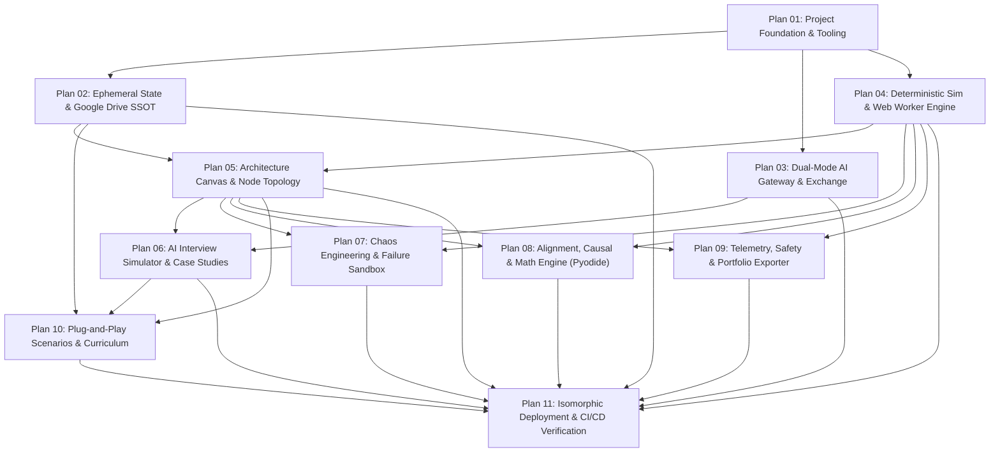

# Execution Roadmap & Plan Index: 2026 ML System Design Platform

> **Document Status:** Active Execution Master Index  
> **Source Documents:**  
> - Requirements: [000_requirements.md](file:///home/somesh/git_repos/ml-sys-design/documentation/requirements/000_requirements.md)  
> - High-Level Design: [high_level.md](file:///home/somesh/git_repos/ml-sys-design/documentation/design/high_level.md)  
> - Detailed Design: [detailed/](file:///home/somesh/git_repos/ml-sys-design/documentation/design/detailed/) (00 to 09)  
> - Coding Standards: [coding_standards.md](file:///home/somesh/git_repos/ml-sys-design/documentation/prompts/coding_standards.md)  
> **Python Virtual Environment:** `source ~/python_envs/p313_llm/bin/activate` (Python 3.13)  
> **Node/TypeScript Runtime:** Node.js 24 LTS / Next.js 16.4+ App Router (React 19.3, Tailwind CSS 3.4)

---

## 1. Executive Summary & Implementation Strategy

This execution master index outlines the end-to-end phased execution strategy for constructing the **2026 Machine Learning System Design & Interactive Simulation Platform**.

The platform is designed around four core architectural pillars:
1. **Local-First Compute & Zero Permanent Local State**: The browser operates purely in ephemeral volatile memory (RAM-only Zustand store). Storage mechanisms such as `localStorage`, `sessionStorage`, and `IndexedDB` are intercepted and disabled.
2. **Google Drive as Single Source of Truth (SSOT)**: Workspaces, user designs, schemas, logs, and interview sessions synchronize directly to the user's Google Drive (`/ML_System_Design_2026_SSOT/`) via Google Drive REST API v3 with ETag-based conflict resolution and 1500ms debouncing.
3. **Dual-Mode Hybrid AI Gateway**: Automated direct streaming via Gemini Free Tier paired with an air-gapped manual JSON prompt export and schema-validated response import for all 13 modules, insulating users from Gemini Free Tier rate-limits (`HTTP 429`).
4. **Deterministic Client Compute & 60 FPS Profiling**: Dedicated Web Workers and Pyodide WebAssembly (WASM) compute queuing latencies ($M/G/c$), Roofline hardware bounds, variance reduction (CUPED), and reward function simulations in $<100\text{ ms}$, while an `OffscreenCanvas` WebGL2/Canvas2D telemetry loop renders metrics at $60\text{ FPS}$.

---

## 2. Master Execution Plan Catalog

The implementation is broken down into 11 phased execution plans. Each plan is self-contained, strictly adheres to [coding_standards.md](file:///home/somesh/git_repos/ml-sys-design/documentation/prompts/coding_standards.md), and can be invoked sequentially using the execution template:

```bash
### New feature plan execution:
Can you go ahead and execute:
./documentation/plan/<PLAN_FILE_NAME>.md

Ensure you read:
./documentation/prompts/coding_standards.md

python env:
source ~/python_envs/p313_llm/bin/activate
```

### Plan Manifest & Phase Dependencies

| Plan File | Phase Title | Core Objectives | Detailed Design Cross-Ref | Estimated Effort |
| :--- | :--- | :--- | :--- | :--- |
| [01_project_scaffolding_and_tooling.md](file:///home/somesh/git_repos/ml-sys-design/documentation/plan/01_project_scaffolding_and_tooling.md) | **Phase 1: Project Foundation & Tooling** | Workspace scaffolding, Next.js 16.4+ App Router, TypeScript strict mode, Tailwind CSS 3.4, Python Pyodide/backend test tooling (`pyproject.toml`, `ruff`, `mypy`, `pytest`), coding standards linters, core exchange & scenario types. | `00_overview`, `09_isomorphic` | 1-2 Days |
| [02_ephemeral_state_and_gdrive_ssot.md](file:///home/somesh/git_repos/ml-sys-design/documentation/plan/02_ephemeral_state_and_gdrive_ssot.md) | **Phase 2: Ephemeral State & Google Drive SSOT** | RAM-only Zustand 5.0 store (`useSyncExternalStore` concurrency safety, `useShallow` selectors, transient telemetry streams), runtime `StorageSanitizer`, Google OAuth2 PKCE Edge route, `GDriveSyncClient`, debounced diffing (`SyncManager`), optimistic cloud sync (`useOptimistic`), and ETag 3-way merge conflict resolution. | `01_state_management` | 2-3 Days |
| [03_dual_mode_ai_gateway_and_exchange.md](file:///home/somesh/git_repos/ml-sys-design/documentation/plan/03_dual_mode_ai_gateway_and_exchange.md) | **Phase 3: Dual-Mode AI Gateway & Exchange Engine** | Unified `LLMOrchestrator`, direct Gemini Free Tier client, prompt envelope exporter (JSON + Markdown), schema-validated response importer (Zod, `jsonrepair`, schema repair), air-gap modal UI. | `02_dual_mode_ai_gateway` | 2-3 Days |
| [04_deterministic_simulation_and_worker_engine.md](file:///home/somesh/git_repos/ml-sys-design/documentation/plan/04_deterministic_simulation_and_worker_engine.md) | **Phase 4: Deterministic Sim & Web Worker Engine** | Next.js 16.4 native ES module Web Worker bundling (`SimWorkerClient`), Comlink RPC, $M/G/c$ queuing theory latency engine, TTFT/TPOT latency calculator, Roofline hardware model (H100/TPU/MI300X), FinOps compute budget simulator. Sub-100ms SLA. | `03_deterministic_sim` | 2-3 Days |
| [05_canvas_and_custom_node_system.md](file:///home/somesh/git_repos/ml-sys-design/documentation/plan/05_canvas_and_custom_node_system.md) | **Phase 5: Architecture Canvas & Node Topology** | `@xyflow/react` 12.12 interactive canvas (`useNodesData` reactive subscriptions, `<EdgeLabelRenderer>` / `<BaseEdge>` cable badges & fault injection buttons, `useConnection` live port validation, hierarchical subflows `parentId`, `<NodeResizer>`), custom nodes, Kahn's DAG cycle detection, WCAG 2.1 AA/AAA accessibility. | `04_canvas_and_ui` | 3 Days |
| [06_interview_simulator_and_case_studies.md](file:///home/somesh/git_repos/ml-sys-design/documentation/plan/06_interview_simulator_and_case_studies.md) | **Phase 6: AI Interview Simulator & Case Studies** | 6-step framework state machine, whiteboard interviewer persona, voice/multimodal canvas evaluation, automated rubric scoring, 3 interactive case study blueprints (E-commerce, Fraud, RAG). | `05_interview_chaos`, `08_curriculum` | 3 Days |
| [07_chaos_engineering_and_failure_sandbox.md](file:///home/somesh/git_repos/ml-sys-design/documentation/plan/07_chaos_engineering_and_failure_sandbox.md) | **Phase 7: Chaos Engineering & Failure Sandbox** | Adversarial playground, inline cable fault injection (`InteractiveInfraEdge`), Gemini Argon reviewer (killer workload packets), Agent Cascading Loop simulator (`AgentCircuitBreaker`), Edge & Quantization debugger (INT4/INT8), Incident Roulette. | `05_interview_chaos` | 2-3 Days |
| [08_data_alignment_causal_and_math_engine.md](file:///home/somesh/git_repos/ml-sys-design/documentation/plan/08_data_alignment_causal_and_math_engine.md) | **Phase 8: Alignment, Causal & Math Engine (Pyodide)** | In-browser Pyodide WASM worker (Python 3.13 + NumPy 2.0 SIMD vectorization & SciPy), Python reward function sandbox, Goodhart's law detector, Pareto multi-objective tuner, Causal DAG d-separation, ATE & CUPED, MinHash LSH contamination suite, HITL designer. | `06_data_alignment` | 3 Days |
| [09_telemetry_compliance_and_portfolio_exporter.md](file:///home/somesh/git_repos/ml-sys-design/documentation/plan/09_telemetry_compliance_and_portfolio_exporter.md) | **Phase 9: Telemetry, Safety & Portfolio Exporter** | Grafana/Prometheus operations dashboard, 60 FPS `TelemetryRingBuffer` & OffscreenCanvas profiler via transient Zustand subscriptions, in-node `<NodeResizer>` charts, Log Trace Analysis game, EU AI Act & GDPR RTBF unlearning gates, Terraform/K8s/GitHub Pages exporter. | `07_telemetry_compliance` | 3 Days |
| [10_plug_and_play_scenario_curriculum.md](file:///home/somesh/git_repos/ml-sys-design/documentation/plan/10_plug_and_play_scenario_curriculum.md) | **Phase 10: Plug-and-Play Scenarios & Curriculum** | YAML/JSON `ScenarioPluginSchema` loader with subflow support, Drive schema watcher, 2026 Core Curriculum modules 1-3, interactive curriculum progression tracking synced to Google Drive SSOT. | `08_curriculum` | 2 Days |
| [11_isomorphic_deployment_and_ci_cd.md](file:///home/somesh/git_repos/ml-sys-design/documentation/plan/11_isomorphic_deployment_and_ci_cd.md) | **Phase 11: Isomorphic Deployment & CI/CD** | Local containerization (`node:24-alpine` Dockerfile, `docker-compose.yml`), Vercel Edge configuration (`vercel.json`), Edge handlers (`/api/auth/github`, `/api/gemini/proxy`), 90%+ CI test suite verification. | `09_isomorphic` | 1-2 Days |

---

## 3. Dependency Graph & Execution Order



---

## 4. Coding Standards Enforcement Strategy

Every execution plan incorporates strict verification rules established in [coding_standards.md](file:///home/somesh/git_repos/ml-sys-design/documentation/prompts/coding_standards.md):

### 4.1 Strict OOP & Member Ordering
- **Strict OOP**: All business logic, algorithms, coordinators, and utilities must be encapsulated in classes. Free-standing functions are strictly prohibited.
- **One Class Per File**: File names must exactly mirror the class name (e.g. `storage_sanitizer.ts` -> `StorageSanitizer`, `sync_manager.py` -> `SyncManager`).
- **Member Ordering Protocol**:
  1. Class-level constants / variables (non-public with leading underscore `_`)
  2. Constructor / `__init__()`
  3. Public methods (alphabetical or logical flow)
  4. Protected methods (`_`)
  5. Private methods (`__`)
  *Public methods must strictly appear before non-public methods.*

### 4.2 Size Limits & Quality Gates
- **Method Body Length**: $\le 20$ logical lines of code. Any method exceeding 20 lines must be decomposed into private helper methods.
- **File Length**: $\le 500$ total lines (including comments and imports).
- **No Magic Values**: String literals, numbers, timeouts, status codes, and thresholds must be declared as private class constants or in dedicated constants files.
- **Test Coverage**: $\ge 90\%$ line and branch coverage (`fail_under = 90`) via pytest and vitest. Zero test failures, zero type errors (`strict = true`), zero linter warnings.

---

## 5. Verification Commands Reference

```bash
# Frontend / Isomorphic Checks
npm run lint         # ESLint + Prettier
npx tsc --noEmit     # TypeScript Strict Typecheck
npm run test:cov     # Vitest with 90%+ branch coverage

# Python / WASM Worker Checks
source ~/python_envs/p313_llm/bin/activate
uv run --with ruff ruff check .
uv run --with mypy mypy src/workers/pyodide
uv run pytest --cov=src/workers/pyodide --cov-report=term-missing --cov-fail-under=90
```

